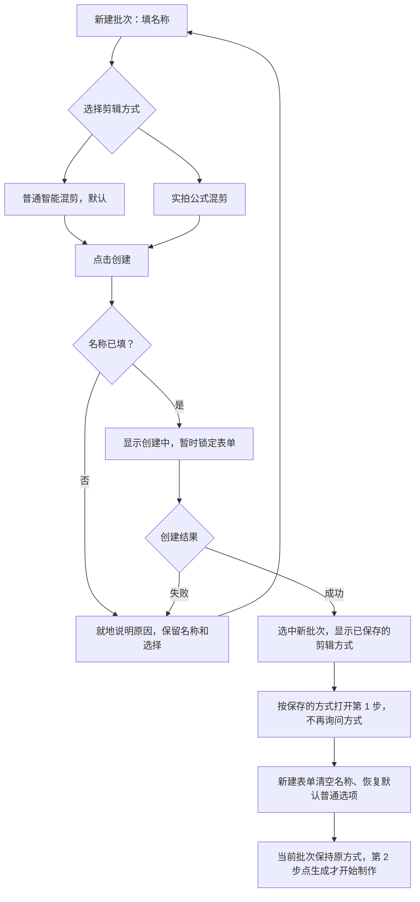

> 已作废：实拍混剪改为独立模块，见 docs/superpowers/plans/2026-10-24-实拍混剪独立模块-拆分方案.md。本文只留作资料。

# 实拍公式混剪开发计划

- 创建：2026-10-21；修订：2026-10-23。
- 状态：已按[开发计划核查](../../2026-10-22-实拍公式混剪-开发计划核查.md)及用户确认的新建批次入口补齐实施边界，与[功能方案](../specs/2026-10-21-实拍公式混剪-功能方案.md)对应。以下条目是开发与验收要求，实际完成情况以开发、验收记录为准，不能把文档补齐视为功能完成。
- 产品规则以功能方案 F-01～F-10 为依据；文中接口、表名和文件名为建议落点，实施时可按现有边界调整，不得因此改变产品行为。
- 核对基点：`327f531`。当前 `lib/batch-production/schema.ts` 迁移截至 v27，实施时重新读取，不预占迁移编号。文末核查项索引把 R1–R10 及接入提醒映射到实施阶段和验收项。

**本次确认的入口：** 打开项目 → 智能混剪 → 批量生产 → 新建批次。在批次名称下直接展示两个单选项：

- **普通智能混剪（默认）**：根据文案自动搭配镜头。
- **实拍公式混剪**：按 Excel 指定的素材编号和顺序剪辑。

**这项入口工作放在 P1，按用户操作逐项交付：**

| 用户做什么 | 开发要保证什么 |
| --- | --- |
| 填名称、选剪辑方式 | 在现有新建区域展示两个选项，默认普通方式；这时不用导入文件或设置声音、包装。 |
| 点「创建」 | 保存名称和方式，成功后进入第一步「准备素材」；此时不开始制作。 |
| 导入素材，准备脚本 | 前两步按该批次的方式展示；第二步点「生成」才制作，后续共用审片和导出。 |
| 以后再打开或刷新 | 列表、标题和页面保持该批次的方式；旧批次按普通方式处理，选错方式需要另建。 |
| 遇到创建失败或功能不可用 | 保留输入并说明原因；提交中防止重复点击，实拍不可用时不自动改成普通方式。 |

入口验收对应 A38–A40。表单示例和使用流程图见[功能方案 §2.1](../specs/2026-10-21-实拍公式混剪-功能方案.md#21-入口与新建批次)，创建成功、失败的交互图见下文 P1。实际完成情况见[开发执行记录](../../2026-10-22-实拍公式混剪-开发执行记录.md)，文档中的要求不代表已验收通过。

## 1. 实施目标与限制

完成一个可从真实 PS866 双表和素材目录进入工作台、按公式生成并正式导出的视频生产模式。导入必须可检查，选择必须可追溯，失败必须可恢复，原声必须真实同步；不能只做 Excel 到 FFmpeg 命令的旁路脚本。

入口固定为「打开项目 → 智能混剪 → 批量生产 → 新建批次 → 选择剪辑方式 → 创建」。在左侧现有新建区域增加「普通智能混剪 / 实拍公式混剪」单选项及一句用途说明，初始选中普通方式。创建成功选中新批次并进入第一步；批次方式持久化，列表和标题显示标识，创建后只读。新项目可直接进入，不以完成前四个项目工作台分区为前置。完整文案、失败和不可用状态按功能方案 §2.1 实施，不新增顶层第三页签或独立工作台。

新建时只选择剪辑方式；原声、配音、脚本份数和包装仍在第二步设置。创建成功后按已保存的方式直接展示对应页面，不再要求用户选一次方式。

入口交付先对照下面五件事；表单示例、两种方式的流程图和 PS866 操作例子见[功能方案 §2.1](../specs/2026-10-21-实拍公式混剪-功能方案.md#21-入口与新建批次)。

| 用户看到的结果 | 开发要完成的事 | 验收 |
| --- | --- | --- |
| 新建时能看懂并选择两种剪辑方式 | 在原名称输入框下增加两个单选项和说明，默认普通方式；支持点文字选择、Tab 聚焦和方向键切换；选择区下方提示创建后不可更换，不额外弹确认框 | P1 / A38、A39 |
| 创建后直接进入该批次的准备素材页 | 创建只要求名称与方式，不要求先导入素材、脚本或配置声音、包装；一起保存名称与方式，成功后清空新建名称、恢复默认普通方式，当前批次仍按保存值显示；不启动 AI、配音或渲染 | P1 / A38、A39 |
| 选实拍方式后，知道下一步该导入什么 | 第一步空页面直接提示导入实拍视频及可选素材表，并显示导入按钮；第二步导入公式脚本表、设置声音与包装、选择脚本和份数；普通方式沿用原有内容，两者共用第三、四步 | P1 / A38，完整制作见 P6 / A24 |
| 重新打开还记得上次创建的是什么批次 | 列表和标题显示方式；刷新保留批量页签、当前批次及已保存方式，创建后不允许改方式 | P1 / A39 |
| 创建失败能接着改，不用重新填 | 创建中锁定名称、方式与按钮，显示「创建中…」；失败恢复操作并保留输入。实拍不可用时说明原因，不自动改选普通方式 | P1 / A40 |

产品流程固定为现有批量剪辑四步：准备素材（AI 按命名/编码整理）→ 脚本与口播（AI 提取表格，选音色与包装/封面策略，点击生成）→ 检查成片（原工作台时间轴、预览、逐条修改）→ 导出成片。默认原声优先 + 其余文案 TTS；合理缺失自动替换并明显标记，在审片时确认。不再把人工逐条批准替换、选同号版本、分配每句声音作为生成前的必经流程。

按下列阶段实施和验收。原 Excel、原视频和 `_work` 辅助记录保持不变，不自动提交、推送或启动用户生产任务；开发不替换用户正在运行的工作台构建。

进入开发后遵守：

- 先读取 `docs/reference/批量生产模块.md`、`视频包装.md`，涉及统一审片时遵守 2026-09-25 PRD 与执行文档的 v14 交互基线。
- 公式模块放在批量领域中，与旧语义计划器显式分路；两条路径共用受控素材、任务、版本、审片与发布能力。
- 共享媒体代码只从 `media-core/` 引用，禁止批量模块导入 `final-edit/`。不修改 `film-render` 的 classic/1 构建器/金样。
- 迁移只追加，经过共享备份、磁盘预检、跨进程锁和审计；公式能力升级失败时，只要基础批量结构独立验证通过，普通批量仍可读写和领取任务。基础结构不安全时必须阻断，不能忽略迁移错误；能力门禁见 §3.6。
- 运行文件走 `dataRoot()`；文件指纹、来源核验、项目隔离、密钥脱敏和停机信号契约保持。
- UI 全中文，颜色走设计令牌，浅色/深色均验收。用户可调整业务选项，不暴露内部哈希、JSON 结构等无助决策的实现信息。

## 2. 核查基点的现状与主要工程缺口

下表记录核查基点的代码情况，供定位改造范围；实施时重新核对工作区，不将其作为后续代码完成度的实时记录。

| 现状（已读代码） | 实施判断 |
| --- | --- |
| `MixcutWorkspace` 已有单条/批量页签；`BatchPreparationPanel` 左侧新建批次只填名称，POST 仅收 projectId/name | 在原新建区域增加剪辑方式选择，贯通创建、持久化、列表/详情和四步分路；核查基点没有公式方式选择 |
| `filename-analysis.ts` 从文件名提取描述与标签，并核验素材 | 保留本地技术核验，新增完整编号解析、AI 命名理解、来源/置信信息及重试；现有本地提取不是模型理解 |
| `manual-script-files.ts` 只收 TXT/MD，一文件一脚本 | 新增 XLSX 读取 + AI 字段/脚本/公式提取 + 确定性原表核验，不改变旧导入行为 |
| 仓库已有 `exceljs`；旧手动脚本接口最多 50 条，视频单请求最多 100 文件/512MiB、单文件 256MiB | 复用库并按锁文件版本验证；公式导入会话和分批上传不能直接穿过旧单次接口。其他模块读取计算结果缓存的单元格转换不能直接沿用 |
| `batch_assets` 以真实内容指纹去重，没有无文件编号定义 | 独立保存命名表逐编号资料及来源，再关联 0..N 个实际候选，区分“有定义缺文件”与“编号未定义” |
| `allocator.ts` 是按句段和素材语义分配的纯计划逻辑 | 单独建立公式计划器，禁止调用旧分配器后再假称保留公式 |
| `phase-e.ts` 等全批口播终态，`BatchPreparationPanel` 再次调用 start 才继续 | 新增服务端持久化逐条阶段编排，复用同一个调度器；公式 start/重选片/恢复均分路，不依赖页面存活或全批配音屏障 |
| `narration-executor.ts` 按脚本快照生成整文音频，旧兼容更新覆盖同脚本输出 | 将可复用音频块与逐输出声音计划分开；定向提交并校验目标声音修订，不以脚本 ID 广播更新 |
| `media-core/audio-edit.ts` 已有源区间与时间线区间，但 track 只有 narration/bgm | 可以复用时间编辑基础；仍需多源原声引用与音画联动模型 |
| `BatchTimelinePreview` 只有单 narrationUrl，按正文时间 seek；音轨编辑只参与可听窗口判断 | 单列多源音频调度及源时间映射，贯通受控媒体接口、代理切换和真实试听；不能只新增轨道或修改 FFmpeg |
| `batch-renderer.ts` 当前 audioMode 为 narration/silent_placeholder，目标时长会取 narration.durationUs | 新声音模式、完整声音清单及统一时长契约是必要改造；不能挂空 narration 绕过去 |
| 启动要求曲库非空；BGM 只支持 auto/manual，取消勾选回到自动 | 公式模式新增显式 none；不需要 TTS 的纯原声计划也不能被 TTS 供应商缺失拦住 |
| 对齐适配器入口为 `media-core/adapters/alignment.ts`，接口要求 audioPath + text | 复用已知文本对齐时须验证能力；不把它直接等同于成熟的自由转写服务。人工转写/区间为无外部服务的可用入口 |
| `output-arrangement.ts` 有修订、撤销、编辑与审片失效语义 | 原声联动操作须一次事务、一次撤销，并保留旧 TTS/BGM 独立编辑 |
| 现有发布会核验当前版本、审核、成对视频/封面和完整渲染契约 | 扩充契约字段和声音就绪验证，保留既有最终事务复查 |
| `review.ts` 只收 planIds + decision，没有浏览器所见版本/修订 | 审核接口新增逐条版本/修订 CAS，记录被确认的问题快照；批量提交返回逐条成功或冲突 |
| readiness 当前统一关闭整个批量模块；workType/targetKind 受数据库与领域约束 | 分离基础批量与公式能力的就绪判断；新增任务类型涉及 schema、归属校验、领取和恢复，不能只改 TS union |
| 工作台已有卖点轨道；封面覆盖按 sourceScriptId，包装时间来自脚本级 narration | 保留卖点轨道；封面按输出落快照；包装按该输出真实声音/字幕映射对时，稳定保存 cue 身份 |
| 批量第四步只有逐条正式视频/封面下载；项目 ZIP 不查询 batch_artifacts | 新增正式产物包与清单业务接口，复用底层 ZIP 流，不复用错误的项目产物查询 |
| 现有 planSeq 是批次全局序号，文件名 -02 是防覆盖后缀 | 扩展冻结导出身份，独立保存原脚本号和 copyIndex，保持旧 J/K/f 命名兼容 |

最大不确定性是实际可用动作区间、真人台词/音质及其与目标时长的兼容性，不是编号检索。它们需要真实素材听审；不能靠全量跑 300 条渲染来替代前置检查。

## 3. 数据与版本设计

### 3.1 建议的领域对象

| 对象 | 必须保存的信息 | 不变量 |
| --- | --- | --- |
| 批次及批次版本的剪辑方式 | batchId、projectId、planningMode（建议 semantic / formula） | 创建时写入，版本快照继承；同一批次不可改方式；历史缺字段仅按普通方式解释 |
| 素材集合 `formula_collection` | projectId、名称、原始资料指纹、修订 | 编号只在明确集合内解析 |
| 逻辑素材定义 `formula_material_definition` | collectionId、logicalCode、命名表原字段与来源单元格、台词、动作/卖点/花字、AI 解释、冲突处置、修订 | 无视频也能保存；有定义缺文件与未定义分别呈现；定义更新不改冻结决策 |
| 编号绑定 `formula_asset_binding` | collectionId、logicalCode、assetId、内容指纹、原文件名、AI 内容说明/来源、候选状态、人工主版本/自动选择证据 | 同号允许多候选；同内容多编号保留别名；跨项目引用拒绝 |
| 素材区间 `formula_asset_range` | assetId+指纹、区间 ID、入出点、动作保护、声音类型、台词/对齐、来源与确认状态 | 原文件变了区间失效；辅助分析不冒充人工确认 |
| 脚本修订 `formula_script_revision` | 原序号、平台、表格来源行、原文、结构化槽位、时长口径、要求覆盖 | 工作簿重复导入不静默覆盖已冻结计划 |
| 替换决策 `formula_resolution` | 原编号、直接目标、候选限制、理由/证据、自动/人工来源、待审/已审状态、范围、修订 | 自动应用和审核通过分离；不允许循环或多跳链 |
| 生成请求/输入快照 | requestId、幂等键、projectId/collectionId/batchVersionId、脚本/定义修订、选中脚本及 copyIndex、候选池与规则、音色/时长/包装/BGM 配置、种子、控制态与阶段依赖 | 接受请求后持久化；选片决策分阶段落盘；刷新/重试不改输入或重抽 |
| 音频块与逐输出声音计划修订 | 音频块的确切文本/供应商/音色/参数/算法身份、受控文件与指纹；输出计划的原声引用、文案用途、位置、对齐和 audioPlanRevision | 音频文件可共享，声音编排不可按脚本广播覆盖；迟到结果只可提交匹配修订 |
| 最终执行快照 | 输入快照/脚本修订、slotId 与实际 clip 引用、来源指纹和区间、替换、真实声音/对齐、正文总帧数、算法版本、逐条包装/封面快照、原脚本号与 copyIndex | 必须在真实声音就绪后冻结；渲染/恢复只消费它，不再次推导输入 |
| 正式产物包快照 | packageId、所选 plan/outputVersion/editRevision/renderContractHash、video/cover artifactId 与 checksum、清单内容及相对文件名 | 清单与媒体来自同一次正式发布；重试不读取最新草稿混包 |

可按实际 schema 将这些对象合并为更少表/版本化 JSON，但身份、约束和追溯字段不能省略。不把完整资料包随意塞进旧脚本文案字段，也不把所有文件内容放进 SQLite。

脚本身份使用内部 ID；原序号是业务标识。导入会话以集合、源工作簿指纹、工作表、行来源区分；同序号内容改变时列出差异并新建修订。建议用唯一索引保证幂等，避免仅做应用层“先查后插”。

逻辑定义与实际候选是 1:0..N 关系；同内容不同编号的定义和别名分别保留。脚本修订要有与既有项目脚本、批次脚本快照的明确关联及来源命名空间，确保目录同步不会认领或覆盖公式脚本；公式正文不借旧 50 条导入接口分批偷偷提交为一次整批成功。

### 3.2 冻结与编辑

- `planningMode` 在新建批次时明确区分普通语义模式和公式模式；列表、详情、生成输入和版本快照沿用同一已保存值。创建后不可变，草稿也不允许改；想换方式须新建批次。旧批次/快照缺此字段时保持旧语义，已保存的未知值报不支持，不静默降级为普通方式。
- 公式本体保存原编号顺序；执行层保存 slotId → 0..N 个 clipId → assetId/rangeId。初次生成每个槽位必须有合法来源；人工分割保留槽位身份，删除保留决策记录，替换不擦掉原编号。
- “重试”使用同一冻结快照；“重新选片/应用新规则”创建新计划版本并保留旧成片；当前候选内的手动编辑沿用 editRevision，不偷改上游脚本修订。
- 第一步、第二步提供「修改输入」：单独保存相对于当前制作版本的输入修订，打开时推进资料修订以拒绝旧页面写入，不解冻旧快照、不切走旧成片。已保存草稿及待确认预览可重启恢复；第二步显式生成才建立并切换到新制作版本，重新锁定输入。新生成可启动暂停/停止批次，旧请求重试不可恢复控制态。历史导出包继续读取原正式版本，详细交互见功能方案 §3。
- 覆盖优先级：单槽位 > 单脚本 > 批次默认。任意覆盖都经过完整验证，不因优先级高就允许越界或混音冲突。
- 完整渲染哈希必须纳入实际媒体指纹、源范围、时间线范围、播放速度、音画联动、声音文件/区间/增益/ducking、字幕、裁切构图、封面、包装和算法版本。
- 同一内容的结构性 split 只有在已证明不改变真实输出时才复用旧契约；不能沿用旧“分割永不影响渲染”假设而漏掉原声同步变化。

两次冻结分别解决输入稳定和最终可执行性，均不代表人工审核通过：

1. **输入冻结**：接受生成请求时保存脚本/定义修订、规则、候选池、参数和种子；P2 的候选及替换决策作为不可变阶段产物落盘。尚无真实 TTS 时不填假音频身份，不声称最终时长已确定。
2. **执行冻结**：P4 取得实际原声区间、所需 TTS 和对齐后调用 P3 分配器，固定正文帧数、全部音画区间与声音计划，再生成并保存实际包装/封面配置及其时序，形成可预览/渲染的最终快照。

重试读取已完成阶段产物，只补未完成阶段；真实声音导致无法满足约束时进入需处理，不在恢复中改词、换候选或变种子。显式重新选片/修改输入创建新的请求修订，旧任务提交须校验请求、输出版本和声音修订，失配结果不得覆盖新状态。替换、自动区间、时长偏差和台词差异随当前输出修订审核，修改后旧确认失效；标记持久化，不只存在 UI 内存。

人工插入/删除/换序属于显式人工改编：保留原公式及槽位历史，新增片段标明人工来源，展示偏离并在整条审片时确认，不另加每次编辑弹窗。分割后原声和字幕同步；人工换片重新校验合法源区间、动作保护和台词，不能默认从新素材 0 秒取等长内容。未补齐的画面空位可保留为待处理草稿，但公式正式发布不允许黑场占位、截断必需话语或未解决声音冲突；单纯点审核不能豁免这些硬限制。重新分配接口也按 planningMode 分路，不能将公式输出送回旧语义分配器。

包装和封面分别保存统一/随机策略、可用候选池、随机种子及每条最终配置快照。快照归属输出计划，不能仅用 coverTitleStylesByScript 实现同脚本多份随机；构图与完整样式同时冻结。选定后再生成预览/缓存；重试、导出与预设库修改不得重新解析成另一配置。用户显式重新分配时仅处理未锁定项，递增受影响修订并清除审核；包装 cue ID 初次生成后稳定保存，重新提取须是显式新修订。

### 3.3 声音模型

新增版本化 `audioPlan`，每个片段带稳定 ID、kind（source/tts/imported_voice/ambience）、asset/audioArtifact 引用及指纹、源区间、时间线区间、增益、linkedVideoClipId（可选）和已核验的文字/对齐。BGM 与压低窗口另存，所有时间使用正文坐标。

声音计划按输出计划及 audioPlanRevision 保存，不能沿用 scriptSnapshotId 对应唯一 narration 的约束。可复用 TTS 块的键含确切文本、供应商/模型/音色/语速等影响声音的参数和算法版本；相同块仅复用真实音频，原声覆盖关系、时间位置与字幕映射分别属于各输出。声音任务写回校验 requestRevision、outputVersionId（如已建立）及 audioPlanRevision，不执行旧的同脚本全部输出 UPDATE。

- 原声通过 source 引用真实视频音轨；可抽出受控 PCM 缓存供预览/混音，缓存键含源指纹及处理参数，不转成虚假 TTS 身份。
- 联动原声的移动、修剪、换片、删除、分割与视频组成原子编辑。原声字幕通过同一映射更新；无法保留已确认语句完整性时返回待核验状态。
- TTS 与导入配音有自己的真实音频身份与有效区间，支持现有独立编辑；混合模式需保证保留原声和 TTS 的主语音窗口不重叠。
- 默认先识别并保留真实口播，将未被原声覆盖的脚本文案自动映射到非口播槽位后生成 TTS。保存原文块 → 原声/TTS/花字/参考的用途与证据；不重复念已被覆盖的句子，不把不相同的意思擅自标作已覆盖。差异待审，无法映射的冲突需处理。
- 一个统一正文帧数决定视频和音频输出，不能让某个 narration 文件时长覆盖公式的时间轴。允许明确配置的无旁白窗口，不允许“需要的语音失败后填静音”。
- 新发布判定基于完整声音计划的来源可用、必需音频完整、对齐/人工核验与渲染结果，不只检查 `audioMode === narration`。旧模式继续沿用旧校验，silent_placeholder 永不变成正式声音。

BGM 策略显式为 `none | auto | manual`：公式默认 none；none 不要求曲库存在、不加载音乐，也不靠把增益调至静音实现。auto 要有合法曲库；manual 要有非空合法选择，不能空选后回退全库。未带新配置的旧批次维持旧语义。仅当当前输出确需 TTS 时检查其供应商；纯原声/合格外部配音且无 TTS 的计划可独立继续，必需 TTS 失败仍不得静音发布。

实时预览须直接消费 audioPlan 的源/时间线映射，不再把正文时刻当成所有音源的取样时刻。共享纯映射负责源偏移、有效窗口、增益和 ducking，播放器与 FFmpeg 各自执行；源 5–7 秒移到正文 0–2 秒时，两端都播放源 5–7 秒。原声选择受控原片音轨或绑定指纹的缓存音轨，视频代理仅替换画面，不能双播代理音轨。切输出、seek、暂停、切代理、换源均取消旧代际声音。正文帧数驱动播放器终点及工作区状态，不能仍回落到旧 narration.durationUs；20 帧片头偏移在预览与渲染各自只施加一次。

### 3.4 状态、接口和文件边界

建议在现有 `/api/batch-production/` 下添加公式相关接口组：导入会话/预览/确认、逻辑定义与编号绑定、区间、替换、校验、生成请求/阶段状态、受控声音媒体、正式产物包/下载。编辑、审核与导出沿用既有输出入口并按模式验证数据。接口名称在 P0 固定，不能在 UI 内拼装绕过领域校验的生产计划。

扩展现有 `POST /api/batch-production/batches` 的创建参数，传入并校验 `planningMode`（建议 semantic / formula），与名称、项目归属在同次创建中保存；创建响应、列表及详情返回实际保存的方式。新前端始终显式传值；旧调用省略时按普通方式兼容，未知值拒绝。服务端在创建公式批次时重验公式能力，不能只依赖前端置灰；普通创建仅依赖已验证安全的基础能力，方式字段的迁移布局也须满足 §3.6。后续更新不得修改批次方式，导入、生成、重试和恢复均读取已保存方式，不能信任页面临时选项或根据脚本有无公式猜测。

新建表单选择与当前批次的显示方式分开保存。提交时固定本次名称与方式，等待响应期间锁定名称、方式和创建按钮，按钮显示「创建中…」，重复点击/回车不再发送请求；失败恢复表单操作、保留输入和选项并就地报错，成功才选中新批次并进入第一步。创建或切换表单选项不触发 AI、配音、渲染或当前批次变更。列表/标题的中文标识来自批次返回值，刷新/重新打开恢复对应四步内容；能力不可用时保留原方式和原因，不以默认普通方式覆盖。已选实拍方式后能力变为不可用时，保留选中状态、禁用创建并说明原因，允许用户手动切回普通方式；服务端创建时重验失败也按同样的保留输入规则反馈。

所有写操作携带项目、集合/批次身份与期望修订；导入、自动映射落库、冻结生成计划和最终审核分别为可重试事务。重任务使用既有持久调度器，状态覆盖取消、暂停、恢复和单项重试。上传先落临时目录、探测与指纹成功后登记；中断不留下“已完成但无文件”的素材。

生成编排以持久化 requestId 和逐输出阶段依赖推进：选片/原声核验 → 文案用途映射 → 必要 TTS/对齐 → 最终时长/执行快照 → 封面与包装预览。只有依赖就绪的条目才推进，单条失败/长任务不挡其他条；共享音频块的依赖也按实际引用计算，不使用全批 narration 终态屏障。阶段结果落库与下一阶段幂等入队同事务，或由服务端持久化状态协调补队，覆盖提交后崩溃窗口；前端只展示状态，不承担再次 PUT start 的续跑责任。刷新/关页后服务运行则继续，应用关闭走有界停机，重启后按同一输入恢复。

公式的首次启动、重选、重试、恢复、功能关闭检查均按模式分路；不调用普通语义矩阵和整文 narration 作为必经前置。生成就绪表示最终计划、真实声音及封面/包装预览可用，完整 MP4 继续由第四步按正式契约渲染，不能把“只建了任务”标作视频已渲染。持久化生成请求不代替用户在第四步选择正式导出。

新增版本化 AI 提取结果：模型/提示模板版本、输入指纹、来源单元格或文件名、结构化响应、校验状态、错误类型及人工覆盖。复用脚本模型适配器及并发控制；只缓存核验通过的结果。大表分块时合并后核对全部非空原行和编号顺序，检测丢行、重复行及编造字段。失败不标记为已完成，也不在渲染重试时再调用模型改变内容。

浏览器通过上传/目录选择进入受控存储，桌面入口可复用受控文件选择能力。普通 HTTP 不提供任意绝对路径读盘接口。表格旧 E 盘路径仅作来源备注，不自动遍历。资料中的脚本/命令文本只当数据，绝不执行。

建议首版导入上限：每工作簿 10MiB、10,000 行、50 列，XLSX 解压内容总量 100MiB；首个公式批次最多 1,000 个输出计划，超过时要求拆批。限制是资源保护提案，P0 核对现有接口后定值并在 UI 明示；本批 300 条必须可完整导入且不会静默截断。视频采用队列顺序/有限并发上传，磁盘容量预检含原片复制与临时文件。

沿用现有 ExcelJS 锁定版本，但自行保留并检查原始 cell 类型，必填计算/共享公式单元格即使带缓存结果也要求转值，不能先经其他模块 cellText 抹掉类型。解压上限在读取工作簿前/过程中执行，不能全部解压后才检查。公式表格使用会话级整批校验与确认事务；AI 分块、上传分批只是传输/准备边界，不能把旧 50 条脚本接口多次成功拼成无事务的“300 条导入成功”。视频按现有 100 文件/512MiB 请求上限分批，逐文件保留请求身份、来源名/相对来源和回执，同指纹重复文件的编号绑定不丢失；超 256MiB 单文件先显式报错，P0 实测后决定是否增加受控传输能力，不能只调大前端限制。中断保留已核验文件并显示未完成项，重试只补缺项。

### 3.5 审核、正式清单与导出身份

- 审核逐条提交 planId、expectedOutputVersionId、expectedEditRevision 和所见问题快照身份；事务内重验归属、当前修订、最终声音/区间/公式问题。通过时记录确认的版本、修订和可接受问题集合；时长偏差/合理替换/人工改编随整条一次确认，硬阻塞不得被审核覆盖。
- 批量审核采用逐条结果：每条独立事务返回成功或冲突，界面仅推进成功项并保留失败项。旧页面确认不能批准新版本或同版本新修订；问题内容变化也要变更修订并清旧审核。正式发布保留复制后最终事务对版本、审核、契约和成对指纹的复核。
- 公式整片身份包含实际逐段原声/配音来源、区间、增益、正文长度，音乐文件/压低设置及继承参数，所有镜头指纹/色彩、字幕、封面和包装。执行器使用开始时保存的输入并返回实际使用的身份；收尾同时比对任务、当前内容与结果，覆盖 A→B→A，不能结束时重读页面内容给旧视频贴新版本。缺少身份的旧格式公式任务不按普通任务兼容放行。任务收尾和真实声音渲染的阶段证据见开发执行记录，最终发布的声音门禁与清单仍须继续完成。
- 原脚本业务标识与 copyIndex 在输入冻结时生成，随最终执行及渲染结果交给发布。公式文件名使用 `产品基础名-脚本141-第02份-f3.mp4` 这样的格式，关闭包装时用「无包装」；目录防覆盖后缀单独追加，如 `-无包装-02.mp4`，不能替代「第02份」。封面同基础名加 `-封面.jpg`。使用共享命名设施，发布前与最终事务核对原号、份次和实际包装；已发布旧文件不更名，旧 J/K/f 解析与普通批次命名保持兼容，G/VO 不转成 K。
- 新增批量正式产物包接口，不调用只收旧 jobs/video_jobs 的项目 ZIP 业务查询。底层使用共享媒体层的严格 ZIP 流：固定清单中的文件名，文件缺失或指纹变化立即失败；不能直接沿用旧 `zip-download.ts` 中自动改名、可能跳过缺失文件的宽松路径。创建包时校验所选成片当前审核/发布状态并冻结 §3.1 的 package 快照；任一所选项未就绪则返回逐项原因，不静默遗漏，可调整选择再提交。
- 第四步展示「创建导出包」和已保存包的「下载 ZIP」入口；用户勾选当前正式成片后创建，列表可刷新恢复。回复丢失时保留同次请求身份，重试拿回同一个包；失败逐项提示，后续返工和功能开关不改变历史包内容及下载入口。完整交互按功能方案 §9.3 实施。
- JSON/CSV 清单来自与正式媒体一致的执行/渲染快照；原公式、人工偏离、实际片段/声音、包装、版本和相对文件名全可追溯。原声字幕或替换后来改变不能写进旧视频的清单。包建立后返工仍下载该包冻结的正式版本，不偷换成最新产物。
- 打包前验证视频/封面及指纹；缺失/损坏时报错，不能给完整成功回执。连接中断可用同 packageId 重试，复用同清单与命名，源版本失效时明确失败；目录穿越、绝对路径/密钥泄漏、中文名和重名列入验证。包引用在有效期内保护正式源文件不被回收，临时 ZIP 失败可清理而不影响正式产物。

### 3.6 基础批量与公式能力门禁

兼容目标包括已有普通批量，而不只是模块以外功能。基础批量 readiness 与公式 capability readiness 分别判断；公式独有升级不能成为普通模式必须达到的唯一“最新版本”条件，两者仍使用同一套备份、跨进程锁和审计设施。

P0 固定版本/迁移布局：可采用批量领域内独立的公式追加迁移流，或具备等价隔离的能力版本检查，不能修改已发布 v1–v27。公式升级失败后仅在基础结构被重新验证可安全使用时继续普通 API 和普通任务；基础升级/完整性验证失败则继续原有 fail closed 行为。公式写入、任务领取和依赖新结构的读取保持不可用，并显示原因；已经存在的正式产物按可验证旧接口访问，不把公式批次按普通模式解释。

新增 workType/targetKind 时同时列出 SQL CHECK、领域联合、目标谱系、执行器注册、领取/重试/恢复及前端聚合的改动。若重建共享 tasks 表，保留 attempts、asset_analysis_requests 等全部引用子表及数据，事务失败回滚后重验基础能力；数据库锁持有期间允许有界等待/重试，不宣称升级写锁期间普通写入完全不受影响。关闭公式开关只停公式新任务领取，运行项有界中断/恢复，普通调度继续。

## 4. 分阶段执行

### P0 — 固定输入契约与真实样本基线

对应 F-01～F-10；先固定跨阶段契约，再进入实施。

工作：

- 重新核对源码、工作树、实际迁移号；按已确认的新建入口固定批次 planningMode 的创建/列表/详情/快照与旧数据兼容契约，再落实四步导航、首次启动/重选/恢复的模式分路、AI 提取 schema、表格字段映射与逻辑编号定义。
- 从本批提取去路径的最小测试数据：编号、公式、缺号、同号候选和范围；自动化测试不硬编码 H 盘、不复制整批视频到仓库。
- 听审/标记最小代表素材：S14/P1/P2/VO1–VO4、G15 两候选及代表替换目标。记录真实台词、可用动作、噪音、区间；现有 `_work` 仅作对照。
- 明确持久化生成请求、逐输出阶段依赖、输入/执行两次冻结、音频块与声音修订、定向提交、总时长/正文坐标以及与 v14 独立音轨的兼容方式。
- 固定审核逐条 CAS、原脚本号/copyIndex 的冻结命名、正式产物包快照和接口；定义手动分割/插入/删除/换序的槽位追溯、人工偏离及硬阻塞规则。
- 设计基础批量/公式能力门禁和任务类型迁移，证明公式独有升级失败不会关闭已验证安全的普通批量；列出所有共享表引用及回滚重验路径。
- 读取现有 ExcelJS 锁文件版本，验证原始计算单元格类型与解压预算；实测样本文件大小并固定分批上传/导入会话的限制与回执，不能直接套用旧 50 条导入或一次提交 257 个视频。

交付：字段/接口/状态与迁移契约、最小夹具、样本区间清单、按入口列出的代码改造清单、核查项覆盖和重新估算的工作量。改造清单至少覆盖 phase-e/start/reallocate、tasks/schema/readiness/bootstrap、narration、实时播放器/媒体接口/工作区、review、packaging/cover、export/package。

阶段通过：能说明脚本 1 为什么无法在既定原声约束下达到 16 秒；能区分转写、已知文本对齐和静音检测；生成/恢复不依赖页面的阶段图与提交身份已定稿。自动替换与输入冻结均不代表正式发布资格；R1–R10 均有落点及验收映射。

### P1 — 新建入口、导入、素材索引与安全持久化

对应 F-01、F-02、F-03、F-09。

入口工作按下表实施，交互文案和页面反馈以功能方案 §2.1 为准。这是开发任务清单，不是完成记录。

| 环节 | 要完成的事 | 验收 |
| --- | --- | --- |
| 新建表单 | 名称下放两个带说明的单选项，默认普通方式；文字可点击，支持 Tab 和方向键，浅色/深色都看得清。常显创建后不可更换的提示，不增加确认弹窗。声音、份数和包装留在第二步。 | A38、A39 |
| 保存选择 | 名称与 planningMode 同次保存，贯通类型、存储、创建/列表/详情响应及版本快照。只校验名称、项目归属、方式与对应能力；尚未导入素材/Excel 或未设音色、包装不拦创建。兼容旧数据和省略方式的旧请求，未知值及创建后改方式均拒绝，草稿也不能改。 | A38、A39 |
| 进入批次 | 成功才选中新批次并进入准备素材；实拍空页面显示视频/可选素材表导入提示和按钮。清空新建名称、恢复默认普通选项，但当前批次继续按保存值显示。创建本身不启动 AI、配音或渲染。 | A38、A39 |
| 重新打开 | 同一项目可同时有普通和实拍批次，列表和标题显示各自方式；点击哪个批次就读取它保存的方式及内容，刷新保留批量页签及当前批次。第一、二步按保存方式展示内容，第三、四步共用原界面；切换或复位新建表单不影响当前批次。页面示例见功能方案 §2.1。 | A39 |
| 等待和失败 | 空名称就地提示；提交中锁定表单、显示「创建中…」，点击/回车不重复提交。失败恢复操作并保留输入及原批次；实拍能力不可用时说明原因，已选实拍则保留选择并禁创建，服务端也复查，不能自动改选普通。 | A40 |

**创建交互示例：** 下图以所选功能当前可用为例，只描述新建批次，不触发分析、配音或渲染。

失败时当前打开的批次保持不变，用户可以修改名称或选择后再提交。实拍功能不可用时，选项置灰并说明原因；此前已选实拍的，保留选择并禁用「创建」，不自动切成普通方式。提交时服务端仍复查功能是否可用，期间失效则按创建失败处理。

成功后新建表单清空名称并恢复默认普通选项，这是为下一次新建准备，不改变刚创建的批次。方式只在新建时选择，已有批次的方式只读。

入口可按 A38–A40 单独验收，不必等成片功能完成。对照[功能方案 §2.1 的示例流程图](../specs/2026-10-21-实拍公式混剪-功能方案.md#21-入口与新建批次)，按下面三组检查：

- **A38：选得明白、进对页面。** 分别创建普通和实拍批次，检查前两步显示的导入与设置；创建本身不启动制作。
- **A39：记得住、不串批次。** 从列表来回打开、刷新页面；方式与内容对应正确，新建表单恢复默认值不改变当前批次。
- **A40：失败后能继续。** 检查空名称、提交中重复点击、创建失败和实拍功能不可用；保留输入，说明原因，不自动换成普通方式。

完整走查步骤见第 5 节；点击「生成」后是否按文案搭配或按编号剪辑，由 A24 验收。实际证据记入开发执行记录。

P1 的其余工作：

- 实现本地编号/公式解析、XLSX 读取，以及 AI 命名理解和表格字段/脚本/公式提取；保留来源行/单元格，程序逐项校验响应并返回结构化错误。
- 新增集合/逻辑定义/脚本修订/候选绑定、导入会话、生成请求与阶段状态存储，落实重入幂等及权限归属核验；缺文件编号也能登记原始台词/卖点/来源。
- 按 §3.6 实现迁移与能力门禁、任务 schema/领域/执行器注册基础，验证共享表重建不丢子表；普通路径不因为公式独有升级失败而失效。
- 复用第一步素材导入和第二步脚本准备页，增加 AI 进度/重试和可改提取结果；正常行自动就绪，不强制逐行确认。支持明确排除错误行，不执行表格公式、宏或文档中的指令。
- 核验媒体参数与指纹，区分原片/预览文件、重复内容、同号不同版本、未编号文件。
- 视频按请求上限顺序/有限并发上传并保存逐文件回执；表格先暂存/整批校验再一次确认。实现中断补传与同指纹多文件名/编号绑定，不把分块成功当整批已完成。
- 对接公式 none/auto/manual BGM 设置及冻结默认值，明确空池错误、旧批次兼容；搭建同调度器内的幂等阶段协调入口，P4 再接真实声音执行。

建议落点：入口改造覆盖 `components/batch-production/BatchPreparationPanel.tsx`、`BatchProductionSidebar.tsx`、`BatchStepMaterials.tsx`、`BatchStepScripts.tsx`，以及 `app/api/batch-production/batches/route.ts`、批次详情/响应、`lib/batch-production/versions.ts` 和 schema；`MixcutWorkspace.tsx` 保持单条/批量顶层结构。公式逻辑落在 `lib/batch-production/formula/{parse-code,parse-formula,ai-extraction,import,store,readiness,generation}.ts`、公式接口、共享 batch tasks/bootstrap 的兼容扩展及 `components/batch-production/formula/` 辅助组件，不复制顶层工作台或另建调度器。

阶段通过：新项目可从既有入口创建两种方式的批次，旧批次正常打开，方式不可改且刷新后恢复；创建失败和公式不可用反馈准确，无意外任务启动。同一输入重复导入不重复创建正式素材、不丢编号别名；S76 的缺文件定义与 P100 的未定义状态可区分；中断导入可续接，旧库迁移/隔离测试通过。本批返回 300 条脚本、29 个缺号、130 条受影响、170 条编号齐全，其中 155 条无同号歧义。该断言以同一文件快照为前提，目录变化需更新基线而非篡改计算。

### P2 — 缺失替换、候选选择与输入冻结

对应 F-04、F-05。

工作：

- 自动选可用同号候选，优先人工主版本；提供并排预览、人工覆盖和可选候选轮换，不强制先选主片。
- 将现有 19 项替换作为候选参考，按台词/动作/卖点核验后自动用于待审成片，显示差异；S76→S1、P100→P1 不得自动冒充合理等价。
- 第一步增加 JSON/TXT 建议文件预览、整份保存与清除，支持本批 `substitutions` 格式；保存原说明、原号/替代号、文件指纹及 TXT 行号，备选和同号文件说明不自动建规则。限制 UTF-8/256 KiB/1000 项，拒绝重复字段或编号、不完整记录、自替换、多跳和循环。导入事务推进资料修订，同次回复丢失可重试，旧页写入冲突拒绝。
- 生成请求冻结当时建议，自动替换模型只接收候选编号提示，仍须引用当前原始/替代资料并通过原有语义、数量及真实文件检查；不能把导入行为等同人工指定。选片结果、审片属性和正式清单保存已采用建议的来源。清除/换文件及新一轮生成不改旧快照、已发布文件或历史包；没有建议的新旧请求保持原行为。
- 持久化替换原因和来源，在第三步成片行、片段、属性和筛选中常驻标识；随整条成片审核确认，禁止循环、多跳、跨项目和失效目标。
- 绑定已冻结生成输入并保存确定性候选/替换阶段产物，重试/恢复不重新随机，已排队任务不随主版本改变；这里只完成输入与选片决策，不声称声音/最终片长已就绪。
- 为后续编辑提供稳定 slotId 与来源决策记录；所有首次分配、单条重选和恢复入口均测试公式分路，不调用旧语义重排。
- 接通生成后的输入修订入口及第一、二步可编辑状态；验证打开失败完整回滚、回复丢失幂等重试、刷新/重启恢复、旧页面冲突、修正缺素材脚本后新一轮成功、旧任务迟到不提交，以及旧正式文件/导出包保留。此入口不改变批次剪辑方式。

阶段通过：重试选择结果完全一致；GB9 预览副本不进入正式候选；G15 有合法候选时可自动选片并标记；补回原编号不改写已生成替换；无语义依据时明确需处理。

### P3 — 可用区间与时长计划器

对应 F-06。

工作：

- 生成时提出合法可用区间、动作保护区间和完整原声句区间，第三步可修正；区间与文件指纹绑定，不要求所有素材先人工标区间才允许生成预览。
- 实现独立纯函数公式计划器：固定槽位顺序，先声音/固定段，后可伸缩段；帧级分配及余数规则固定。
- 实现参考目标、严格上限、固定片长三种规则，明确总片长是否含封面。参考目标不能满足时自动生成保全内容的待审时长并标记偏差；硬限制仍阻止不合格计划。
- 返回结构化冲突：缺多少帧、哪段不能缩短、哪些窗口无足够画面。待确认裁切只生成草稿，不假称正式就绪。
- 以已核验声音/测试夹具验证纯算法和源时间映射；生产中的真实 TTS 尚未完成时保持等待状态。P4 将实际声音送回此计划器，才提交最终帧数和区间，禁止用估算替代执行冻结。

阶段通过：禁止越界、隐藏变速、补循环和悄悄删槽位；第一条按未经压停顿的辅助区间基线正确返回超时，真人核验后按实测重算。50fps 输入的动作不因转为 24fps 被误变为慢动作。

### P4 — 声音、逐条编排、实时预览与执行冻结

外部配音需贯通第二步到正式导出，操作与限制按功能方案 §8.2：

- 第二步保存生成设置后，为当前脚本成对导入音频和 SRT，提供试听、文案/SRT 对照和明确确认。改文件清除确认，按资料版本保存，丢回复原样重试；支持替换、移除及冻结后修改输入。
- 追加公式迁移保存不可变导入记录，按 collection、脚本导入会话及 scriptKey 隔离。核验实际音频、声道、时长、非静音、字幕文字及时间，保存受控副本；新输入冻结导入记录，旧生成与正式包不随替换/移除改变。
- 统一配音的完整朗读窗口使用已确认外部声音，无需 TTS 或对齐服务；其余脚本照常生成。记录人工确认的 SRT 时间，预览、字幕、制作检查、审片说明及正式清单共同使用它。文件变化、过期文案或不一致的声音用途分配须拒绝，不能回退静音成功。
- 公式长字幕共用显示排版：按文字框换行，末行保持原基线，多行向上排，必要时按可用高度缩小字号；不改文本或拆分人工时间。覆盖真实 MP4 像素与浏览器字形边界、深色实际绘制、三种输出画幅；旧公式单行渲染不得作为新排版缓存复用。普通批次、封面及 classic/1 的原排版保持。
- 自动逐字时间转成可读字幕短句：在生成可编辑输出及声音联动时按标点、超过 350ms 的停顿、16 个内容字符或 4 秒分组，只取真实首尾词边界，不细分单个已对齐词/句段。人工 SRT、人工素材台词和手改字幕保持原有分句；跨连续音频分割仍显示同一短句，实际断开继续提示声音不完整。通过公开编辑接口先复现单字闪烁，再验证移动/连续分割、恢复自动字幕、浏览器及真实 TTS MP4；历史正式媒体不回写。
- 通过公共导入/生成、真实 worker、重启、审核、正式发布及 ZIP 验证无供应商可用场景；浏览器验证上传、真实播放、确认失效、丢回复重试、受控 Range 试听及双主题。迁移验证旧数据保留、故障回滚重试、约束缺失和普通批量隔离。覆盖 A11–A13、A16、A24、A33 的对应场景，不据此代替全部验收。

对应 F-07、F-09；这是核心实施阶段，不能只做前端模式开关。

工作：

- 实现音频块、逐输出 audioPlanRevision、多源原声解析与缓存、真实人声转写/人工输入、已知文本对齐和字幕映射；按确切音频输入复用文件，按目标修订定向写回。
- 第一阶段人工输入落在第一步原片预览旁：支持逐片段台词/原片起止时间、明确无话语、填入已有自动识别结果再修改，以及撤回到自动识别。保存绑定集合、素材指纹及资料修订；校验实际文件/音轨、越界和重叠，确认保存可幂等重试。生成冻结人工记录，后台无需 ASR 即可使用，但仍须实际媒体检查和整片审核；不合并或猜测人工未给出的逐字时间，审片和正式清单保留人工来源。改上游记录走「修改输入 → 新一轮生成」，旧声音结果与导出包不变。
- 第二步人工选 TTS 音色/参数；点击生成后自动映射原声已覆盖内容与剩余文案，并完成剩余段 TTS/对齐，保留纯原声和统一配音高级覆盖。复用供应商和任务管理，依赖失败逐项显示。
- 覆盖映射先验证完整句子的部分覆盖：原声比脚本多说一句时，保留全部实际台词、区间及字幕，只补尚未说过的文案，额外内容随成片待审。禁止把否定词、数值的一部分当覆盖；同一配音窗口分块后仍须整体检查重复。第三步显示原文/实际台词对照，正式清单从该成片绑定的时间线读取生成时映射，不读后来最新映射。同义、句内部分对应继续单独实现验收，不因整句路径或人工处置通过而算自动映射全部完成。
- 同义与句内含义对应要求模型引用真实台词的完整相关句子，并另行核对完整上下文、脚本和剩余旁白；程序验证引用存在，明确的数量、单位及否定差异不由模型强行放行。只在完整核对通过后保存语义对应和模型依据；漏项、未知引用、不确定、冲突或重复旁白进入需处理，服务失败可重试，取消后不能提交。完整原声、实际字幕和原文均保留，不按文字引用猜音频切点。领域、真实渲染/清单和浏览器分别验证，旧结果继续按原版本读取；真实模型质量仍纳入 P6 听审。
- 自动用途增加 on_screen/reference，混合、统一配音及无原声场景均覆盖。保留完整原文和标签，花字只显示、备注不朗读；自动用途须另一次模型调用核对，漏项、未知引用、不确定或普通口播被误跳过时需处理。花字正文取原文子串，自动选取的数字/单位/否定差异先由程序阻断。无模型且有明确用途标注时不把标注当旁白朗读。
- 花字从最终实际镜头取时间，同镜头多条顺序分时、最少每条 12 帧（24fps），超出时提示处理；单条 60 字符、每片 24 条。进入现有包装 pointCues，稳定身份与一次片头偏移随输出保存，有明确花字时不叠加自动提炼卖点。包装关闭时需处理，不自行开启或静默丢字。正式清单白名单保存 displayText/roleVerification，旧字段形状兼容；A20 同时验证模型响应、实际视频画面、清单、人工保存与重启恢复。
- 在第三步选片记录增加人工用途分配，作为混合或统一配音模式缺模型、有歧义时的恢复入口。逐段选实际原声、连续无原声窗口配音、指定镜头花字或仅参考，校验原文完整拼接、顺序、原声引用和重复配音；仅参考不朗读、不自动生成花字。人工入口保留已有花字正文和目标镜头，包装关闭时说明不能选用。保存前明确提示按原公式和已选原片重做当前条，人工时间轴调整不带入；要求试听确认，记录人工来源及差异，不能伪称模型证明语义相同。
- 人工用途保存追加逐输出修订，在同一事务保留原用片、取消旧任务并保存用途；不更改上游脚本文字、兄弟成片或历史正式文件。核验所见版本、真实媒体及台词身份，重试同一保存返回原修订，重启后自动续接；旧页面、迟到任务不得覆盖新结果。正式清单保存该输出绑定的人工用途和确认身份。分别以领域测试、真实渲染/发布和浏览器验证，仍需制作检查与重新审核。
- 增加公式输出原声联动组、混合窗口分配与声音冲突检查；渲染器统一消费正文时长和音频清单。
- 接通 P1 的服务端阶段编排：声音就绪后逐条调用 P3 完成执行冻结，自动继续封面/包装预览；不依赖前端再次 start、不等待无关输出。阶段落库/入队崩溃可恢复，旧请求迟到不写新输出或历史版本。
- 改造 `BatchTimelinePreview`、`BatchReviewPreviewDock`、受控声音媒体接口和工作区就绪聚合，实际使用源/时间线映射、正文总帧数及音源指纹。对代理/原片切换、seek、暂停恢复、切输出和旧回调取消做真实声音验证。
- 处理静音展示段与缺失必需语音的区别，保持 silent_placeholder 正式发布禁令。
- 音乐取源编辑统一使用已保存文件的源区间和正文区间：移动、裁切、分割、删空、循环及撤销在浏览器与 MP4 一致；跨歌曲结尾仍按冻结时长循环。保存及恢复拒绝取源长度与播放长度不等的区间，分段混音不自动均分音量，音乐尾部不延长正文。A13/A30 增加歌曲第 5–7 秒移到正文第 1–3 秒、循环跨尾部及全部删除的真实声音/播放器对照。
- none BGM 不要求曲库；无 TTS 需求的纯原声计划不要求 TTS 供应商。有音乐时压低窗口、人声增益、防爆音和限幅参数统一给预览与渲染；停止/重试沿用任务 AbortController 与 FFmpeg 停机契约。
- A13/A30 的声音验证直接采集浏览器输出和解码后的 MP4，使用同一保存版本逐声道比较音量；不把双声道先混成单声道，以免混音增益掩盖差异。检查起播解码延迟、结尾进入静音间隙、连续声音分割不重启，以及原声/配音与音乐叠加后的峰值。合成声标通过后仍需真实素材听审，多声道素材和循环接缝另按实际来源核验。
- 说话压低音乐按功能方案 §8.3 保存版本化开关、降低量和过渡时间，纳入当前输出、编辑修订与整包撤销。共享正文时间包络供播放器和 FFmpeg 执行；连续分割与短停顿不造成音乐突起，旧草稿缺省保持旧听感。页面保存期间锁定音乐控件，完成后再允许下一次修改。A13 同时检查实际播放器音量和解码后的 MP4：原声/TTS、间隙、渐弱/恢复、自定义及零时间、关闭、撤销与刷新；不能仅用参数保存成功证明声音一致。

阶段通过：至少一个原声+TTS 输出完成实际生成、编辑试听和渲染对照；移动/修剪/换片/分割后声音不串位，源 5–7 秒移至正文 0–2 秒试听/导出一致。同脚本两份不同原声不会共用错误配音，关页/重启能续接，慢/失败条目不挡其他条；混合无双重口播，TTS 失败不发布静音片，声音可用性、内容与指纹纳入正式闸门。此阶段完成技术样片，正式审片/发布交互仍待 P5。

若 ASR 服务不可用，应保留人工文字/区间入口并显示未自动识别；不能为了排期以猜字幕替代。句内去停顿和独立原声脱离画面不在首版实现范围。

### P5 — 统一审片、包装与正式导出闭环

对应 F-02、F-08。

工作：

- 在现有 v14 工作台增加公式槽位/替换标记、声音来源和问题定位；保持素材池、完整属性、独立预览可见性及导出选择。
- 原声使用独立“原声”轨道，存在原声时显示；视频与原声关联可辨。轨道顺序为字幕 → 卖点（启用包装时）→ 视频 → 原声（存在时）→ 配音 → BGM；保留卖点添加/修剪/删除、画内编辑和快捷键，旧批次无原声时维持现有顺序。
- 视频联动编辑原声与对应字幕；独立 TTS/BGM 沿用旧行为。修改重新验证时长、必需声音、词句完整性并使旧确认失效。
- 实现 slotId 到分割片段的追溯与人工改编标记；换片重新选合法范围。未填补画面空位/硬声音冲突留在需处理，不能由审核绕过；整条确认同时覆盖可接受偏离。
- 公式素材拖放先打开中央原片预览，复用胶片截取选框；替换保留原取用长度，插入可调整时长。可选完整动作保护区间，加载失败、素材过短、动作未被完整包含时禁止提交。静音画面分支以明确按钮保存核验及片段编辑，不移动既有配音、不删除必需原声；普通批次拖放保留既有行为。带台词的新原声替换仍需另行完成声音计划与字幕重建。
- 保存时冻结打开预览时的输出版本、修订及取用内容。网络回复丢失后使用相同请求身份重试，不能重复插片；已保存的回执可恢复这一笔撤销历史，但遇到后续修订不能把他人修改一起纳入撤销。A36 浏览器验收覆盖实际拖放、取消、非零入点、插入时长、保护动作越界、必需原声拦截、丢回复重试、撤销/重做和重启；同时回归普通批次的中央截取。
- 保留原声的人工素材核验记录保存真实音轨身份、实际台词/时间及试听确认；已有口播换片还保存替换前台词和覆盖区间。当前声音依据由不可变生成记录与有效人工记录共同推导，不能改写原 `formula`。重建关联原声、字幕和完整话语检查；连续分割、再次换片和撤销保持追溯，未被换片覆盖的原话语仍必需。人工输入的时间标为人工，保留无关手改字幕。正式声音来源列表只包含当前使用的媒体，历史生成依据另存。A36 用不同频率的真实合成音轨核验试听/导出取新片声音，补 HTTP、填写/试听确认界面、旧页冲突及重启验收；后台贯通不能冒充界面交付或真人听审。
- 原声编辑界面复用中央播放器：静音/保留原声单选，实际台词和源秒数逐句填写，可取当前播放位置；旧台词从当前有效声音依据读取，不能用手改字幕代替。原声模式开启试听，文字/时间/选区/时长/模式变化均撤销试听确认；前端阻止缺项、重叠及区间越界，后台仍独立核验。A36 浏览器覆盖确认失效、取消不保存、原声替换/插入、丢回复后的原样重试和撤销、重启恢复及双主题可读。
- 新原声与 TTS 重叠时提供明确的配音片段选择，展示来自实际声音依据的台词和正文时间，默认不勾选。`replaceNarrationClipIds` 随核验请求冻结；后台核对当前配音身份、完整话语及新画面覆盖范围，同事务替代所选配音、重建字幕，其余配音保持独立位置。v3 人工记录保留原配音范围、文本及新话语的共同覆盖关系，允许新旧说话时长不同；分割后各段再次换片仍继承和合并覆盖，删除必要部分使原配音重新成为未满足要求。A36 验收明确选择、范围/半句/旧页拒绝、部分配音保留、撤销/重做、分割后再次换片、恢复、审核和清单，并在正式音轨中检测新声存在且旧声未混入。
- 补齐审片素材池上传链路：按 API 的 query `projectId` 提交，展示逐文件错误并刷新成功素材。编辑候选补入本项目在线且受控副本健康的视频，不改冻结素材池，也不扩展到其他项目或任意模块四上下文；上传后无需重做即可拖放。通过真实上传到拖放保存的浏览器流程验收。
- 对照逻辑共用于当前审核问题及正式清单：比较本输出绑定的不可变选片、初始排片与当前片段，保存原/现顺序、删除槽位、人工插入、换片前后素材/指纹/编号，以及取用区间变化。连续分割合并后相同不报偏离，部分删除仍能发现；不按文件名推编号，撤销不留下已取消的偏离。成片行给出人工改编标记，右侧展示对照，审核快照包含该证据；A36 验证编辑、撤销、旧页拒绝、重启及正式包不变。插入/换片的新来源核验必须另外接通，不能因追溯提示完成就放宽原媒体、动作和台词检查。
- 升级 `review.ts`、审核 API 和前端提交为逐条版本/修订/问题快照 CAS，同事务记录所见身份。前端提交已经显示的编辑视图，不在点击确认时重新取最新身份代替；右侧展示同一问题集合。批量审核逐条返回结果，显示成功数量及失败原因，冲突项保留，单条失败不自动推进。公式返工保留当前选片供调整，不自动送回普通分配器；导出编排、已有正式产物的复用以及发布最终事务均复核当前确认。A32 的协议、双页面与共享发布验证见开发执行记录，公式完整制作就绪及正式发布仍须另行通过。
- 第二步对接四套包装和封面预设库，分别支持统一或候选池随机，保存每条分配快照；核对封面预设与包装兼容，不叠两套文字。第三步预览实际效果、可单条覆盖/锁定/显式重分配，缓存和发布契约包含全部参数。
- A23 的锁定/重分配沿用当前成片编辑接口和版本校验：包装与封面独立锁定，手动修改保护对应部分，旧已编辑成片缺锁定字段时保守保护。本批操作在成片读取齐备后逐条提交，只使用冻结候选、跳过锁定部分，不改变文字、取帧、花字时间或音画；报告已处理与失败数量。无效果变化不添加撤销记录；锁定变化推进编辑修订但不清审核，实际效果变化按既有规则重新待审。整包撤销包含锁定状态，撤销后再次分配按当前实际样式判断，不读过期分配标记。验收覆盖保存失败、重复点击/过期请求、刷新、两个同脚本输出、旧数据兼容及普通模式回归。
- 包装时间和花字读取当前输出实际声音/字幕映射，稳定保存 cue ID；同脚本多份的封面/包装配置落输出快照，不能继续按脚本共享一个随机结果。
- 扩展渲染结果解析、输出媒体、工作区/正式新鲜度及发布声音门禁，保留现有视频/封面成对发布和最终事务复核；名称接入冻结原脚本号/copyIndex/包装编号，不伪造 K 编号。
- 单独实现正式产物包创建/下载与 JSON/CSV 清单：冻结选中正式版本和成对指纹，校验清单同版本、相对文件名和文件存在，处理未发布项、返工、损坏、中断重试及包引用保护，详见 §3.5。

阶段通过：旧页不能审核新内容；只有当前审核过的内容可发布，渲染中编辑/撤审/换音源拦住旧结果。ZIP 媒体与清单同版本、原号/份次不受并发完成顺序影响；卖点编辑保留，包装尾长不改变底片总帧数，封面偏移只应用一次。

### P6 — PS866 样片与批量验收

对应 F-10 和下方全部验收项。

顺序：

1. 对全部 300 条做无渲染校验，输出逐条状态，不把 170 条编号齐全当作成功成片数。
2. 从没有场景图、分镜或生成视频的新项目进入「智能混剪 → 批量生产」，新建时选择「实拍公式混剪」，再从四步界面完整操作 8 个代表脚本；验证批次方式标识、重新打开恢复，以及合理替换/同号选片/参考时长偏差可以自动生成并带标记进入第三步。确实无法生成的样本核对需处理原因。
3. 至少分别制作真人原声、统一配音、混合模式的真实合格样片，听审口型、字幕、剪辑节奏；同一脚本切换声音模式生成不同版本可用于对照，不改变批次的剪辑方式。
4. 四套包装各至少一条真实渲染；同脚本两份使用不同原声与封面分配，验证单条修改隔离。增加无 BGM、无 TTS 依赖和可辨识声标的源区间试听/导出对照。
5. 首批听感/节奏通过后做 20 条连续队列验证，覆盖关页、暂停、应用重启、阶段提交后中断、失败重试与慢条目不挡其他条；在隔离副本验证公式升级失败及关闭开关不误停普通任务。
6. 最终对 300 条中的所有明确合格项正式导出并建立所选产物包，核对 ZIP/JSON/CSV/文件名与版本，覆盖旧页审核、打包中返工及连接中断；剩余项给出阻塞原因。缺失/文案冲突未解决前不承诺 300/300 成功。

阶段通过：原片未改动；当前输入和输出全可追溯；所有必要回归通过。Windows 源码桌面为本批主要验收环境，支持 macOS 的正式发行须补 macOS 真实媒体/桌面验收，不能从 Windows 结果推断。

## 5. 验收矩阵

新测试建议采用仓库既有 Node 原生 TypeScript + assert，不新增测试框架。表中新测试名是实施计划，不表示文件已存在。

| ID | 场景和预期 | 阶段/建议测试 |
| --- | --- | --- |
| A01 | G1/G10、P1/P100、GB9、VO13、全角归一、明确分隔边界正确；非法编号不被截短 | P1，`formula-import.test.ts` |
| A02 | 7 槽位顺序/重复保留；未知语法报原行；镜头数不一致、空行、重复序号正确处理 | P1，`formula-import.test.ts` |
| A03 | XLSX 计算单元格/外链不执行；超限、错误列映射、取消、重试不产生半份导入 | P1，`formula-import.test.ts` + API 测试 |
| A04 | 同内容去重保留别名；不同内容同编号保留候选；GB9 preview 排除；未编号不自动入公式 | P1/P2，`formula-resolution.test.ts` |
| A05 | 快照统计为 29 缺号/130 受影响/170 齐全/155 唯一；不把类别影响数相加 | P1，PS866 数据夹具 |
| A06 | 合理替换直接生成待审成片，审核前不发布；S76/P100 无依据不硬替；JSON/TXT 旧建议可预览保存、重试及重启恢复，生成冻结后修改/清除不串改历史，实际采用的建议进入审片及正式清单；旧建议不替代当前证据，不冒充人工规则；重复、超限、多跳、环、跨项目拒绝 | P2，`formula-replacement.test.ts`、`formula-replacement-hints*.test.ts`、建议导入浏览器、`formula-export-package.test.ts --replacement-hints` |
| A07 | 单槽位覆盖优先；轮换只用批准集合；重试/恢复相同；冻结后主片/替换变化不串改 | P2，`formula-freeze.test.ts` |
| A08 | 可用区间越界、保护动作被截断、素材指纹变化拒绝；范围建议不能冒充确认 | P3，`formula-duration.test.ts` |
| A09 | 参考目标偏差自动生成并标记，严格上限向下取帧且不超限；总片长/正文、帧余数、长短不足准确 | P3，`formula-duration.test.ts` |
| A10 | 原声与脚本文案不同：原声字幕跟实际声音；台词未核对/对齐失败不得误报完成；无 ASR 时人工试听填写台词和时间可制作，越界/重叠/无音轨假原声拒绝；无脚本模型时可人工分配原声/配音/参考用途，备注不朗读，实际台词不改写，完整文案、顺序和窗口仍校验；人工与自动来源可区分，重试/重启恢复、修改和撤回不串改旧结果，正式清单保留对应人工记录，重做须重新审核 | P4，`formula-audio-plan.test.ts`、`formula-manual-speech.test.ts`、`formula-manual-audio.test.ts`、人工原声/用途浏览器及真实渲染验收 |
| A11 | 原声、TTS、混合各有真实音频；缺音轨/损坏/静音占位不能冒充必需语音 | P4，`formula-audio-render.test.ts` |
| A12 | 原声视频移动、分割、修剪、替换、撤销保持同步；刷新恢复；旧 TTS/BGM 仍独立 | P4/P5，编辑与浏览器测试 |
| A13 | 混合窗口不抢话；长配音不截尾；BGM ducking 预览与导出相同；音量不爆音 | P4/P6，真实音频样片 |
| A14 | 4K50 输入输出 1080p24；正文总帧数准确；20 帧封面；无接缝黑帧/切字/累积漂移 | P5/P6，真实 FFmpeg 媒体验证 |
| A15 | 四套包装、字幕/花字时序、封面 JPG 与视频同版本；尾部不被包装延长 | P5/P6，包装真实渲染 |
| A16 | 导出中编辑/撤审/音源变化拦旧结果；重试发布幂等；旧正式产物仍可查看 | P5，发布与并发测试 |
| A17 | 迁移备份/失败恢复、已有 v27 数据升级、旧快照正常读取、零跨项目访问；新增任务类型的 CHECK/领域/注册一致，共享表重建不丢 attempts/分析请求等子表 | P1/P5，schema + 集成测试 |
| A18 | 取消/暂停/重启不重抽素材、不遗留孤儿 FFmpeg；单项失败不清空其他结果 | P4/P6，生命周期测试 |
| A19 | 300 条导入/列表真实状态、有限并发、磁盘不足、源盘断开后的已复制素材仍可用 | P1/P6，批量验收 |
| A20 | 文案/自然语言要求未映射时明确“尚未应用”；字幕、原声、配音、花字用途清楚 | P1/P4/P5，交互验收 |
| A21 | AI 提取保留单元格/文件名依据，完整覆盖 300 行，不编造编号、不重排公式；模型失败/丢行/无配置显式处理 | P1，AI 响应夹具 + 真实表格提取 |
| A22 | 自动替换在成片行、片段、属性和筛选中可见，刷新不消失，不烧进成片；最终审片确认覆盖当前替换 | P2/P5，浏览器 + 持久化测试 |
| A23 | 包装/封面各支持统一/随机及混合设置，空池/不兼容处理，单条覆盖、锁定与重抽；同脚本多份独立冻结样式/构图，改预设库、刷新重试不变样 | P5，分配纯函数 + 浏览器/真实包装 |
| A24 | 四步入口点击生成后自动完成选片和原声/TTS，原声已覆盖文案不重复念；第三步单条调整后第四步批量导出 | P6，真实端到端样片 |
| A25 | 生成中关页/刷新后服务端继续；应用重启续接；慢/失败条目不挡其他条进入审片；阶段提交后崩溃可补队而不重复创建 | P1/P4/P6，`formula-generation.test.ts` + 生命周期集成 |
| A26 | 输入冻结后候选/定义/参数变化不串改；「修改输入」保留旧制作，显式生成才切换新版本；打开失败回滚、重试幂等、草稿重启恢复、旧页面及迟到任务不能覆盖新输入/结果，历史导出包内容不变；无真实 TTS 不得执行冻结；声音就绪后按真实长度计算；失败重试复用阶段产物，显式重选才建新修订 | P2/P3/P4，`formula-freeze.test.ts` + `formula-input-revision.test.ts` + 生成浏览器/导出包验收 + 阶段集成 |
| A27 | 同脚本两份不同原声可有不同 TTS/对齐；改一份不改兄弟输出及历史版本；旧声音任务迟到无法提交新修订；只按确切音频输入复用块 | P4，`formula-audio-plan.test.ts` + 并发提交 |
| A28 | 空曲库+none、有曲库+none 均无 BGM 正常生成/导出；manual 空选不回填全库；已选音乐缺失显式报错；纯原声无 TTS 供应商仍可继续，必需 TTS 失败仍阻断 | P1/P4/P6，设置/编排/真实声音 |
| A29 | S76 有定义缺文件与 P100 未定义分别呈现；定义保留原表单元格；同内容多编号语义不丢；定义/冲突解释更新不修改冻结替换 | P1/P2，`formula-material-definition.test.ts` |
| A30 | 可辨识音源 5–7 秒映射正文 0–2 秒，浏览器与 MP4 声音一致；seek/暂停恢复/切输出/代理切换无双播残留；封面偏移一次，播放终点为正文总帧数 | P4/P6，真实播放器与 FFmpeg 对照 |
| A31 | 公式升级/备份失败且基础验证通过时，普通 API/领取继续，公式受阻；基础验证失败仍 fail closed；关闭公式开关不误停普通任务、不把公式批次作普通重排 | P1/P6，隔离数据库/调度故障注入 |
| A32 | 旧页审核不能批准新 outputVersion 或同版本新 editRevision/问题集合；批量部分冲突逐条返回，只推进成功项；硬阻塞不能审核豁免 | P5，审核 CAS 领域 + 双页面测试 |
| A33 | ZIP 只收所选正式视频/封面；未发布项返回原因；包建立后返工仍用冻结版本，清单不混新草稿；损坏/中断/重试、中文重名正确，JSON/CSV 相对文件名均存在且不泄密 | P5/P6，`formula-export-package.test.ts` + 下载集成 |
| A34 | 仅选脚本 12/141、多份、并发乱序、无包装、重新生成/重试，原号和 copyIndex 稳定；防覆盖后缀独立；旧 J/K/f 规则不受影响 | P5，冻结身份/命名/清单测试 |
| A35 | 新增原声轨道后卖点轨道及添加/修剪/删除/画内编辑/快捷键可用；花字按实际声音映射，cue ID 重试不变；旧无原声批次布局兼容 | P5/P6，浏览器 + 包装真实渲染 |
| A36 | split 后多个 clip 仍追溯原 slot；人工插入/删除/换序标记偏离并重新待审，换片核验区间/台词；空位或声音硬冲突不发布；重选/恢复不进入语义分配 | P2/P5，领域编辑 + 浏览器 |
| A37 | 300 行公式会话整批确认、257 文件按上限分批上传；中断仅补缺项、同指纹别名不丢；超大文件显式提示；计算/共享公式缓存不当值接受，解压预算在加载前/过程中生效 | P1/P6，导入会话/API + 真实双表 |
| A38 | 新项目无需完成前四个分区即可进入智能混剪 → 批量生产；左侧新建批次展示两种剪辑方式及说明、默认普通，点击文字及键盘 Tab/方向键均可操作；尚未导入视频/Excel、未选音色或包装时，两种方式均可在对应功能可用的情况下创建并进入准备素材；普通方式沿用原有前两步，实拍方式第一步展示视频/可选素材表导入、第二步展示公式脚本表及生成设置，两者共用第三、四步；选择/创建不触发 AI、配音或渲染；中文、焦点与选中状态在浅色/深色均可读 | P1/P6，批次创建/API + 浏览器入口验收 |
| A39 | 创建响应、列表/标题、详情及版本快照的方式一致；同一项目中的普通和实拍批次可来回打开，各自方式、素材和设置不串用；刷新保留批量生产页签与当前批次，重新打开按保存值恢复；创建成功清空新建名称并恢复默认普通方式，新建表单切换或复位均不改当前批次；创建后前后端均禁止改方式，旧批次/旧省略参数按普通方式兼容，未知值拒绝 | P1/P6，批次创建/版本/API + 浏览器 |
| A40 | 空名称就地提示；提交中锁定名称/方式/按钮并显示「创建中…」，点击/回车不重复请求；失败恢复操作、保留名称和方式且不跳转。公式不可用时置灰并说明原因，已选实拍后变为不可用时禁创建且不自动改选；绕过 UI 或提交期间公式能力失效的创建也被拒绝并保留输入；基础安全时普通创建继续，已有公式批次不降级为普通 | P1/P6，创建失败/能力门禁注入 + 浏览器 |

入口验收按以下操作走一遍，与功能方案 §2.1 的表单、对照表和流程图核对；这里检查入口，不要求先生成成片：

1. 打开一个新项目，直接进入「智能混剪 → 批量生产」；新建区域能看到名称、两种剪辑方式及说明，默认普通方式。分别用点击选项文字和键盘 Tab/方向键完成选择，检查焦点与选中状态；创建前能看到不可更换方式的提示，点击创建不再弹确认框（A38、A39）。
2. 在同一项目中、尚未导入视频/Excel、未选音色和包装的情况下，分别创建「PS866 日常推广」普通批次和「PS866 实拍首批」实拍批次；对应功能可用时，只填名称、选方式即可创建。成功后选中新批次并进入第一步，不再询问剪辑方式。新建表单名称清空、恢复普通方式，但当前实拍批次的标识和页面保持实拍方式。实拍方式空页面能看到导入实拍视频、可选素材表的提示和按钮，前两步内容符合对照表；原声、配音、脚本份数和包装留在第二步，只创建批次时没有 AI、配音或渲染任务（A38、A39）。
3. 在同一项目中，参照功能方案 §2.1 的创建后页面示例，来回打开「PS866 日常推广」普通批次和「PS866 实拍首批」实拍批次，再刷新页面；名称、方式、各自已保存的素材和设置对应正确，仍在批量生产中。改变新建表单的选项不改变当前批次，已有批次没有切换方式的入口（A39）。
4. 分别检查空名称、重复点击和创建请求失败：空名称就地提示；请求进行中名称、方式和按钮均不可操作，显示「创建中…」，重复点击或按回车不再发请求；失败恢复操作并保留名称、方式及原先打开的批次，修正后能继续创建（A40）。
5. 关闭公式能力后检查入口：实拍选项置灰并说明原因；如果此前已选实拍，保持该选择但禁用创建，用户手动改选普通后才按普通方式提交。再检查提交期间能力失效：服务端拒绝，表单保留名称和实拍选择并说明原因。基础批量安全时普通批次仍能创建，已有实拍批次保留标识并显示不可用原因（A40）。

### 5.1 现有回归入口

按实际改动选择，不为纯文档更改运行媒体测试。正式开发时先跑模块专项，再跑受影响回归：

- 导入/文件名：`batch-filename-analysis.test.ts`、`batch-filename-analysis-stream.test.ts`、`batch-manual-script-files.test.ts`、`batch-manual-script.test.ts`。
- 迁移：`batch-schema-upgrade.test.ts`、`batch-schema-real-database-copy.test.ts`、`batch-schema-rollback-versions.test.ts`，仅用内存/临时副本，不对用户库试迁移。
- 调度/生命周期：`batch-scheduler.test.ts`、`batch-runner.test.ts`、`batch-production-crash-recovery.test.ts`、`batch-phase-e-orchestration.test.ts`；补公式阶段推进和功能关闭的模式隔离。
- 计划/编辑/渲染：`batch-source-allocation.test.ts`、`batch-output-clip-edit.test.ts`、`batch-renderer.test.ts`、`batch-render-narration-gate.test.ts`、`batch-task-request-key.test.ts`。
- 声音与预览：`audio-edit.test.ts`、`batch-output-audio-and-extra-asset.test.ts`、`batch-narration-seam.test.ts`、`batch-bgm-source-switch.playwright.test.mjs`；新增多源声标实测，旧独立 TTS/BGM 的源区间编辑也要回归。
- 发布：`batch-export-preflight.test.ts`、`batch-export-concurrency.test.ts`、`batch-export-identity-freeze.test.ts`、`batch-export.test.ts`、`production-codes.test.ts`。
- 包装：`packaging-render.test.ts`，改到前端包装时追加相关浏览器测试。浏览器用例先读文件头的启动方式，隔离数据库与端口，不触发用户实例关闭端点。

单测按 `node scripts/<name>.test.ts` 运行；新增代码完成后运行相关 ESLint/类型检查与生产构建。Windows 涉及 FFprobe/真实渲染必须实跑，不能仅以纯函数通过宣布原声能力完成。

### 5.2 样本脚本与预期

| 原序号 | 选择理由 | 首次正确结果 |
| --- | --- | --- |
| 1 | 16 秒目标，四段 VO，原声内容与文案不同 | 参考模式按完整原声与剩余 TTS 生成实际时长并标记偏差/文案差异；严格 16 秒则需处理 |
| 12 | 多个绿幕 VO 缺失，有同台词建议 | 核验台词后自动替换生成，第三步常驻标明实际来源/背景差异 |
| 19 | 引用 G24，建议 G15 有两候选 | 合理替换和自动候选选择可连续完成，各自记录来源并可人工改 |
| 29 | 引用 S76 及缺失 VO | 不将 S1 整体外观自动判作“3cm 金属脚/扫地机同框”卖点等价 |
| 21 | 引用 P100 | 原编号无定义，等待修正/补定义 |
| 141 | 抖音 16 秒，G/S/P/VO 混合 | 检验原声与配音窗口、目标冲突 |
| 241 | 小红书 33 秒，多行文案与 emoji | 文案用途/清理预览，区间不足不循环补足 |
| 291 | 详情页 34 秒 | 尺寸细节、VO 与花字对时、长片分配 |

## 6. 排期和阶段交付

下表保留 2026-10-21 单人串行、运行资源齐备时的初始工作量基线，**不代表已覆盖本次补齐项的新估算**。P0 完成阶段/迁移/声音/预览契约后必须重估，再排开发日期：

| 阶段 | 原估算工程工作日 | 修订后的交付范围（待重估） |
| --- | ---: | --- |
| P0 | 1–2 | 阶段/声音/审核/导出身份/迁移契约、最小夹具与重新估算 |
| P1 | 3–4 | 新建时选择剪辑方式及持久化、双表/命名 AI、独立编号定义、导入会话/分批上传、能力门禁及阶段基础 |
| P2 | 2–3 | 替换/同号决策、输入冻结、模式分路与槽位追溯 |
| P3 | 2–3 | 可用区间、真实声音输入的帧级时长算法与时间映射 |
| P4 | 4–6 | 逐输出声音、持久编排、实时试听、执行冻结与渲染对照 |
| P5 | 3–5 | 审核 CAS、人工偏离、卖点轨道、包装/封面快照、命名/正式清单/ZIP |
| P6 | 2–3 | PS866 样片、恢复/故障/并发/产物包和历史兼容验收 |

原合计约 17–26 个工程工作日，不作为修订后承诺。本次新增或细化的持久化逐条编排、声音粒度、实时播放器映射、迁移隔离、审核 CAS、导入会话和产物包均须单独计入；目前缺乏实作数据，不编造新天数。不含全量人工听审/必要区间修正、缺素材补拍、用户业务取舍等待、外部服务故障及跨平台安装包发布。

P1–P3 可作为内部验证里程碑，展示可检查的选片与用已知声音/夹具验证的时长算法；P4 得到实际声音后才形成生产执行快照，不把 P2 输入冻结等同最终可渲染。P4 先完成一个真实混合小样本贯通播放器，P5 再补完整审核/交付；P4–P6 未通过前不能宣传为完整成片功能。阶段失败先修复或记录阻塞，不以假素材/假声音填补。

## 7. 风险、降级和上线条件

| 风险 | 处理 |
| --- | --- |
| 14–17 秒目标与多个真人句子不可兼容 | 前置算真实最低时长；参考目标生成合法片长并待审标记，硬限制报错，不自动改速度或删镜头 |
| 既有替换表有过时描述、不等价建议 | 校验后合理项自动用于待审，明显标记；S76/P100 无依据不硬替 |
| 口播转写/对齐服务不可用 | 人工台词+区间入口可继续；自动结果缺失保持真实状态 |
| 同号多个版本导致结果不稳定 | 人工主版本优先，自动选择记录理由，确定性轮换和冻结，正式渲染不重选 |
| 原声编辑与旧独立音轨规则冲突 | 公式联动组独立建模；旧批次默认解释不变，新增联动专测 |
| 大量 4K 素材占磁盘/解码资源 | 受控复制、容量预检、有限并发、代理预览，正式原片渲染；性能按实际机器记录 |
| 改声音门禁误放过静音占位 | 验证真实 audioPlan 与音频文件；为旧 silent_placeholder 保留明确拒绝用例 |
| 文案称已做自然语言要求但没有落实 | 要求逐项映射到设置，未覆盖项醒目标记，不执行未解析备注 |
| 模型漏行、改编号、把不相同台词判断为已覆盖 | 源单元格/公式硬校验、原文到声音映射对照、失败可修正，不静默吞文案 |
| 随机包装/封面重试变样或配置无效 | 每条冻结完整配置，兼容池校验，单条手改优先，显式重抽才改变 |
| 关页丢失续跑意图、慢任务拖住整批 | 服务端保存生成请求和阶段依赖，逐输出推进，提交与后继入队可恢复 |
| 同脚本多份/单条返工串用配音 | 音频块和输出声音修订分离，定向 CAS 提交，不广播写 arrangement |
| 预览按正文 seek 而导出按源区间取声 | 共享纯时间映射，播放器单列改造，用可辨识声标对照真实 MP4 |
| 无 BGM/无 TTS 需求仍被旧门禁挡住 | 显式 none 及按实际声音需求检查依赖，旧批次保留原解释 |
| 公式迁移失败关闭普通批量 | 基础/公式能力分离，基础独立重验通过才继续，基础损坏仍阻断 |
| 旧页面批准新内容、打包混入新草稿 | 审核校验所见修订；包只读冻结正式媒体与对应清单，不现查最新 arrangement |

建议以功能开关/入口控制渐进启用新模式，旧语义路径保留。关闭入口不删除新批次/产物，也不能让后台把公式批次当普通批次重排；暂停新的公式任务领取，已有任务按有界停止/恢复契约处理。

出现问题优先关闭新入口并保留数据和审计；不自动降级数据库、不覆盖用户素材、不改已发布迁移。需要恢复数据库时走已有可验证备份流程，不能用回滚 SQL 猜测恢复。

上线条件：A01–A40 全部有实际证据，必需场景通过且无未解决的发布阻塞；新建入口、剪辑方式持久化与旧批次兼容通过；默认原声+TTS 和高级声音覆盖、实时试听/导出、无 BGM、四套包装及封面统一/随机、审核/ZIP 闭环通过，持久恢复和普通模式隔离通过。所有未解决的 PS866 行有明确状态。实际执行时把阶段证据写入日期化验收记录，本计划不填虚构完成标记。

## 8. 本轮文档自检范围

本次根据 2026-10-22 静态核查及用户确认的新建批次入口修订两份文档，并检查入口交互、模式持久化、核查项覆盖、文档互链、阶段依赖与验收编号一致性。源表/目录统计沿用 2026-10-21 快照，本次没有重新盘点或听审；未修改应用代码、运行应用测试、迁移、TTS、ASR 或视频渲染。实现阶段必须重新核验原片和辅助语音记录，不能将文档中的辅助区间视为已听审事实。

## 9. 核查项落实索引

以下“落实”指已写入计划，不表示代码已实现或测试已通过；依据见[核查记录](../../2026-10-22-实拍公式混剪-开发计划核查.md)。

| 核查项 | 契约/阶段落点 | 验收 |
| --- | --- | --- |
| R1 服务端逐条编排 | §3.4，P0/P1/P4/P6 | A25、A26 |
| R2 音频粒度与两次冻结 | §3.1–§3.3，P0/P2/P3/P4 | A26、A27 |
| R3 无 BGM/按需 TTS | §3.3，P1/P4 | A28 |
| R4 无文件编号定义 | §3.1，P1/P2 | A29 |
| R5 实时音频映射 | §3.3，P3/P4/P6 | A12、A13、A30 |
| R6 迁移能力隔离 | §3.6，P0/P1/P6 | A17、A31 |
| R7 审核版本 CAS | §3.5，P0/P5 | A16、A32 |
| R8 正式清单/ZIP | §3.5，P5/P6 | A33 |
| R9 保留卖点轨道 | P5 | A35 |
| R10 原脚本号/份次 | §3.1/§3.5，P0/P5 | A34 |
| 逐输出封面/包装真实时序 | §3.2，P4/P5 | A15、A23、A35 |
| 多声音门禁与任务 schema 全链路 | §3.3/§3.6，P1/P4/P5 | A11、A16、A17 |
| 人工编辑公式身份/重选分路 | §3.2，P2/P5 | A36 |
| ExcelJS、限额及导入会话 | §2/§3.4，P0/P1 | A03、A19、A37 |
| 用户确认的新建批次入口与剪辑方式选择 | 功能方案 §2.1；§1/§3.1/§3.2/§3.4，P0/P1/P6 | A38、A39、A40 |
