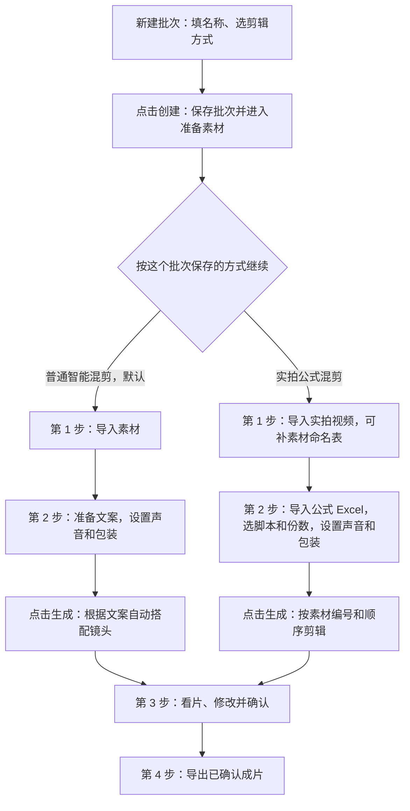

> 已作废：实拍混剪改为独立模块，见 docs/superpowers/plans/2026-10-24-实拍混剪独立模块-拆分方案.md。本文只留作资料。

# 实拍公式混剪功能方案

- 创建：2026-10-21；修订：2026-10-23。
- 状态：已按用户确认的四步流程、新建批次时选择剪辑方式的入口及[开发计划核查](../../2026-10-22-实拍公式混剪-开发计划核查.md)补齐边界，并附入口示例与流程图。本文规定产品要求，不代表功能已全部实现或验收通过；实际进度见[开发执行记录](../../2026-10-22-实拍公式混剪-开发执行记录.md)，素材统计仍为原目录快照。
- 对应[开发计划](../plans/2026-10-21-实拍公式混剪-开发计划.md)。复用批量剪辑界面、AI 整理素材/表格、自动替换并标记、原声优先+其余 TTS、包装/封面统一或随机、人工审片后导出为用户明确要求；其余数值与工程细节为实现建议。
- 目标：导入已经分类、命名的实拍素材和脚本公式，准确选片、裁切、处理声音、包装并批量导出；每次选片与替换都能追溯。

**用户实际怎么操作：** 打开项目 → 智能混剪 → 批量生产 → 新建批次。填名称、选剪辑方式，再点「创建」。

| 你手里有什么、想怎么剪 | 选择 |
| --- | --- |
| 有文案，希望系统自动搭配镜头 | **普通智能混剪（默认）** |
| 有 Excel 公式，希望按指定素材编号和顺序剪 | **实拍公式混剪** |

接下来只要记住这四件事：

1. **创建后先导入素材。** 创建时只填名称、选方式，不用提前准备视频、Excel、音色或包装，也不额外弹确认框。
2. **第二步点「生成」才开始制作。** 选好脚本、份数、声音和包装后再生成，之后共用检查成片和导出页面。
3. **每个批次记住自己的方式。** 列表和标题会标出来，刷新不用重选；同一项目可以同时有普通和实拍批次。创建后不能改方式，选错另建。
4. **创建失败不用重填。** 保留名称和选择，说明原因；实拍功能不可用时也不会自动改成普通方式。

表单示例和流程图见 §2.1；对应的[开发任务见计划 P1](../plans/2026-10-21-实拍公式混剪-开发计划.md#p1--新建入口导入素材索引与安全持久化)，入口验收见 A38–A40。本文确认产品交互，实际可用情况见开发执行记录。

## 1. 本批素材核对依据

源目录：`H:\2026\实拍混剪处理`。本次读取两份 Excel、递归枚举 `预处理` 的视频，抽查 8 个原视频的媒体参数和已有截图；未逐条听审全部素材。下列数字是本次目录快照，后续导入须重新核验。

| 来源 | 核对结果 | 使用方式 |
| --- | --- | --- |
| `PS866素材命名表格.xlsx`，工作表 `源素材分镜总表-完整 (2)`，A1:T269 | 268 条资料，逻辑编号无重复；含类别、卖点、平台、描述、景别、运镜、时长建议、花字 | 素材资料，不把旧 E 盘路径当作当前文件位置 |
| `PS866-300条视频脚本.xlsx`，工作表 `300条视频脚本`，A1:F301 | 300 条，每条 7 个编号，镜头数字段均与公式数量一致；共引用 262 个不同编号 | 顺序、平台、预估时长、原始文案 |
| `预处理` | 257 个 MP4，252 个不同编号；4 组同号多文件，另有 1 个未编号文件 | 正式候选需再核验媒体、指纹、可用区间 |
| `_work/substitutions.json` / `.txt` | 对 19 个缺号已有替换建议 | 作为自动替换的参考，仍需内容及文件校验，结果在第三步标记待审 |
| `_work/vo_profile.txt`、`vo_profile.json`、`vo_speech.json` | 既有口播区间及文字资料 | 仅作辅助；核验文件指纹、时间范围和人工听审后才能成为正式输入 |

平台分布：淘宝信息流 140 条（14–17 秒）、抖音 100 条（14–17 秒）、小红书 50 条（32–38 秒）、详情页 10 条（30–34 秒）。括号内为表中预估值，不是实测成片时长。

素材编号分布：G 25、GB 8、P 94、S 66、VO 59，共 252。257 = 252 个编号各一文件 + 4 个额外候选 + 1 个未编号文件；包含 GB9 的预览文件，不能把 257 都当正式候选。

按完整编号精确匹配：

- 170 条脚本所需编号全部存在；其中 15 条仍涉及同号多文件，155 条每个编号恰有一个当前文件。
- 130 条涉及缺号，共缺 29 个被引用编号。一个脚本可缺多个编号，附录影响数不能相加当脚本总数。
- “编号齐全”仅是匹配检查通过，不等于画面、时长、声音、字幕或正式发布已通过。

## 2. 产品入口与范围（F-01）

### 2.1 入口与新建批次

入口固定为：**打开项目 → 智能混剪 → 批量生产 → 新建批次 → 选择「实拍公式混剪」→ 创建**。新建项目后即可直接进入，不要求先完成场景图、分镜图、脚本生成或视频生成。

用户只需要在新建时多做一个选择：**想让系统根据文案搭配镜头，选「普通智能混剪」；已经有 Excel 编号公式，选「实拍公式混剪」。** 点「创建」后进入这个批次，接着导入素材；到第二步点「生成」才开始制作。

这里选的是「按什么规则选镜头、排顺序」。是否保留真人原声、哪些文案需要配音，留到第二步「脚本与口播」设置，不在新建批次时一起填写。

**新建时只要求名称和剪辑方式。** 还没导入视频或 Excel、还没选音色和包装，也可以先创建批次；这些制作条件在后续导入及点击「生成」时检查。基础批量或公式功能本身不可用时，仍按下面的不可用状态处理。

在批量生产页面左侧现有「新建批次」区域，保留批次名称输入框和「创建」按钮，增加「剪辑方式」单选项。两个选项都直接展示，不藏在高级设置中：

| 剪辑方式 | 旁边的说明 |
| --- | --- |
| 普通智能混剪 | 根据文案自动搭配镜头。 |
| 实拍公式混剪 | 按 Excel 指定的素材编号和顺序剪辑。 |

选择区下方始终显示一句提示：**「创建后不能更换剪辑方式；选错请另建批次。」** 用户在点击「创建」前就能看到，不额外弹一次确认框。

**从填写到创建，页面这样响应：**

| 用户操作或遇到的情况 | 页面反馈 |
| --- | --- |
| 打开新建区域 | 默认选中「普通智能混剪」，两个选项及用途说明直接可见。 |
| 创建前切换方式 | 只改变新建表单，不修改当前打开的批次，也不启动制作。点击文字即可选中，键盘可用 Tab 聚焦、方向键切换；焦点和选中状态清楚可见。 |
| 名称没填就点「创建」 | 在名称输入框旁提示补填，留在表单。 |
| 点「创建」，正在保存 | 按点击时的名称和方式提交；名称、方式和按钮暂时不可操作，按钮显示「创建中…」。重复点击或按回车不再次提交。 |
| 创建成功 | 选中新批次，进入第一步「准备素材」。新建表单清空名称、恢复默认普通方式，供下次使用；当前批次仍按刚才保存的方式显示。 |
| 创建失败 | 显示失败原因，恢复表单操作，保留名称和选择，当前打开的批次不变；修正后可重新创建。 |
| 实拍公式功能不可用 | 实拍选项置灰并说明原因。若此前已经选中实拍，保留选择并禁用「创建」；用户手动改选普通方式后，基础批量可用即可创建。服务端在提交时才发现不可用，也按失败处理，不自动按普通方式创建。 |

**创建后怎么继续：** 实拍批次的空页面显示「下一步：导入实拍视频，可同时导入素材命名表」及导入按钮；普通批次沿用现有提示。两种方式都走「准备素材 → 脚本与口播 → 检查成片 → 导出成片」，第二步点「生成」才启动制作。创建批次不自动分析素材、配音或渲染。

**以后打开这个批次：** 列表和当前标题旁显示已保存的剪辑方式；从列表打开或刷新后，仍停留在「批量生产」及当前批次，并恢复相应页面，不用再选一次。旧批次显示为「普通智能混剪」。新建表单里的选择不影响已打开的批次。

**选错怎么办：** 创建后方式只读，草稿也不能更换；另建一个正确方式的批次，原批次保留。前两步按批次方式显示导入与设置，第三、四步共用审片和导出界面。已有实拍批次遇到功能不可用时保留标识并显示原因，不能当成普通批次继续执行；已有正式产物的访问按第 10 节处理。

顶层仍保留「单条精准混剪 / 批量生产」，不增加第三个并列页签，也不另建工作台。上述默认选择、只读及错误反馈是本入口的交互约定。

**新建区域示例**（下图文字示意用户已选中实拍方式；表单初始仍默认普通方式）：

```text
新建批次

批次名称  [ PS866 实拍首批              ]

剪辑方式
○ 普通智能混剪
  根据文案自动搭配镜头。
● 实拍公式混剪
  按 Excel 指定的素材编号和顺序剪辑。

创建后不能更换剪辑方式；选错请另建批次。

[ 创建 ]
```

创建后，左侧列表和当前标题显示「PS866 实拍首批 · 实拍公式混剪」。用户接着导入视频、导入脚本表，在第二步点「生成」才开始制作；选错剪辑方式时，另建批次即可。

**创建后的页面示例：** 同一个项目里可以同时保留两种批次，剪辑方式属于各自的批次。下面选中的是实拍批次：

```text
批次列表
  PS866 日常推广 · 普通智能混剪
→ PS866 实拍首批 · 实拍公式混剪

当前：PS866 实拍首批 · 实拍公式混剪
① 准备素材 → ② 脚本与口播 → ③ 检查成片 → ④ 导出成片

下一步：导入实拍视频，可同时导入素材命名表。
[ 导入实拍视频 ]
```

点击「PS866 日常推广」就打开它的普通流程，点击「PS866 实拍首批」就回到它的实拍流程，各自已保存的内容保持不变。新建区域即使恢复为默认普通选项，也不会把当前实拍批次改成普通批次。



图中的分支由系统读取批次已保存的方式后展示，用户不用再选一次。两种方式共用四步页面，前两步显示各自的内容，第三、四步共用审片和导出。「创建」保存批次，「生成」才开始制作。创建失败时仍停留在原批次，保留名称和选择；实拍方式不可用时说明原因并停在表单，不能偷偷按普通方式创建。完整错误反馈见上面的交互约定，两种方式各步要做什么见下表。

**选完以后，页面有什么不同？** 两种方式用同一套四步页面，主要区别在前两步：

| 步骤 | 普通智能混剪 | 实拍公式混剪 |
| --- | --- | --- |
| 1. 准备素材 | 沿用现有素材导入 | 导入实拍视频，可补充素材命名表 |
| 2. 脚本与口播 | 沿用现有脚本和口播设置，根据文案搭配镜头 | 导入公式脚本 Excel，选择脚本及份数，设置声音与包装，按指定编号和顺序剪辑 |
| 3. 检查成片 | 看片、修改并确认 | 使用同一审片界面，额外显示素材替换等提示 |
| 4. 导出成片 | 导出已确认成片 | 导出已确认成片，清单保留公式与实际用片记录 |

例如创建「PS866 实拍首批」：选实拍方式 → 第一步导入视频 → 第二步导入 300 条脚本的 Excel，勾选这次要做的脚本和份数，设置声音与包装 → 点「生成」→ 看片、修改并确认 → 导出。以后从左侧打开这个批次，就继续它已保存的内容；切到普通批次则显示普通流程，不受新建表单当前选项影响。

「创建」只保存这个批次和剪辑方式；素材整理在后续导入时进行，正式制作由第二步的「生成」启动。这个例子用于说明操作顺序，不表示 300 条脚本都会无条件成功；缺素材、时长冲突等问题仍按后文规则处理。

### 2.2 功能范围

复用现有四步导航、素材导入、脚本准备、统一审片工作台和批量导出界面。底层复用批量生产的素材、任务、版本和渲染逻辑，选片阶段按公式约束执行，与既有语义自由分配显式分路。

首个完整版本包括：

1. 视频文件/文件夹导入，AI 根据文件名与编码整理大概内容；第二步 AI 提取表格脚本、公式及要求。
2. 精确编号匹配、自动缺失替换与明显标记、自动同号选片与人工覆盖、可用区间建议。
3. 固定顺序公式、每脚本份数、确定性候选轮换。
4. 默认口播素材保留原声，其余脚本文案自动分配 TTS；纯原声/统一配音作为高级覆盖选项。
5. 裁切排片、字幕、BGM、四套既有包装和封面预设，支持整批统一或随机分配；逐条审片调整后批量导出。

本期不做任意自然语言自动执行剪辑命令、任意表达式求值、自动生成缺失画面、口型重制、绿幕抠像、多画面拼屏或全自动精选动作。自然语言要求可以保存为备注；只有已经映射成可检查设置的要求才进入执行计划。识别不出的要求显示“尚未应用”，不宣称已满足。

## 3. 用户流程与状态（F-02）

| 步骤 | 主要内容 | 完成条件 |
| --- | --- | --- |
| 1. 准备素材 | 复用批量导入；AI 依据文件名和编码生成类别、卖点、动作大意及口播标识，可补素材命名表 | 素材登记、技术核验和内容整理完成；异常逐项显示 |
| 2. 脚本与口播 | 导入表格，AI 提取脚本、公式、平台和时长；人工选择 TTS 音色、包装/封面统一或随机策略，选脚本及份数后点击「生成」 | 提取结果可追溯，必要设置齐全；用户无需先逐条手排镜头 |
| 3. 检查成片 | 自动选片、替换、裁切、原声/TTS、字幕和包装完成后进入原批量审片工作台；时间轴显示实际素材，可看成片并单独改 | 人工审片、调整并确认当前版本，替换等问题清楚可见 |
| 4. 导出成片 | 复用批量导出入口，选择已确认成片，输出 MP4、封面和清单/ZIP | 当前版本通过正式媒体核验及发布 |

缺号表、候选预览、区间和声音映射是四步里的辅助面板，不增加强制“先逐项确认替换/裁切”步骤。第二步点击生成即可启动整条流水线；进度显示提取/选片/配音/剪辑/包装的真实状态，已完成项可先在第三步检查。

生成请求由服务端保存并逐条推进，不依赖浏览器再次点击或页面内存中的续跑标记。服务仍运行时，刷新/关闭页面不停止后续阶段；应用关闭时安全中断，重新启动后按原输入恢复。某条配音缓慢、失败或需处理，不阻止其他依赖已就绪的成片进入审片。重复提交/重试不重复生成同一份任务，也不重抽候选或包装。

流程区分“输入已保存”和“可执行计划已完成”：先保存脚本、规则、候选池、参数与种子，再落下选片决策；拿到实际原声区间、必要 TTS 及对齐后，才确定最终时长、音画区间和包装效果。声音未完成时不能以估算片长宣称就绪。第三步复用编辑器的真实媒体组合预览，完整 MP4 在第四步按已确认版本渲染；进度须区分预览就绪与正式视频已渲染，生成请求不代替用户的导出选择。

单条状态分为：资料待处理 → 生成中 → 待审片（可带替换/时长/文字标记）→ 已确认 → 导出中 → 已导出/失败。确实无可用来源、公式无法解析或严格时长冲突时进入“需处理”，不阻止其他条继续。失败保留原决策和具体原因，不静默跳过异常行。

**生成后发现脚本、素材或音色需要修改：** 回到第一步或第二步，点「修改输入」。沿用原批次，不必重新建批次或把原来的资料再导入一遍。

1. 打开修改后，可以补素材、修正公式和文案、调整份数及声音/包装设置。标题和当前批次列表显示「准备下一轮」，页面提示「正在修改下一轮制作的输入」；原制作进度继续显示，上一次已经生成的成片仍可在第三步查看。
2. 修改只是准备下一轮；保存脚本后仍需确认导入，在第二步点「生成」才开始新一轮。刷新或重启后，已经保存的修改和待确认脚本预览会恢复；尚未保存的表单内容不保证保留。
3. 新一轮使用修改后的输入，生成新的成片计划。旧制作记录和正式文件保留，旧任务的迟到结果不能覆盖新结果；第三步显示当前一轮成片，已创建的历史导出包仍可在第四步下载。
4. 打开修改或生成的回复丢失时，可以重试同一次操作，不重复开一轮。另一个页面已更新输入时，旧页面保存应提示刷新。已停止或暂停的批次，明确点新一轮「生成」后开始制作；仅重试旧请求不自动恢复它。

预览、审核、导出选择互相独立。审片沿用统一工作台 v14 的素材池、中央预览、右侧完整属性和多成片时间轴；不得另做简化卡片替代已有能力。

## 4. 导入、编号与公式（F-03）

### 4.1 素材身份

逻辑编号用于找到候选，实际素材身份仍由项目归属、素材 ID 与内容指纹确定。编号作用域为“项目 + 素材集合”，避免另一产品也有 G1 时串片；跨集合使用必须显式选择映射。

命名表中的编号定义独立于视频存在：保存原字段、来源单元格、台词、动作/卖点/花字及修订，再关联零个或多个视频候选。界面分别显示“有定义但缺文件”（如 S76）与“编号未定义”（如 P100），不能把两者都显示成相同的空素材。候选内容去重不删除编号各自的语义资料；定义或冲突解释后来更新，不改变已保存的生成决策。

- 文件名做 Unicode NFKC、去首尾空格、字母大写归一；只提取开头完整字母数字编号，例如 `G1_…`、`GB9_…`、`VO13_…`。边界必须明确，G1 不匹配 G10，P1 不匹配 P100。
- 同号不同内容保存为不同候选；同内容重复导入幂等，保留原文件名/路径来源。不同编号可明确关联同一素材，不能因去重丢失编号别名。
- 不从编号推断项目、分镜组、质量或准确动作时间。文件名与素材表标签冲突时同时展示，要求选择解释；精确编号仍为匹配主键。
- `.preview.mp4`、明确预览/代理标记进入排除候选区，不能作为正式原片自动选用。不能仅凭低分辨率把合法原片判成代理。
- 未编号的 `定格布置-已预处理.mp4` 留在待映射区；用户可指定编号或保留为手动添加素材，不自动塞进公式。
- 复制到受控素材目录后核验成功才标记导入完成；原 H 盘文件保持不变。容量不足显示错误，不悄悄改为依赖外盘路径。
- 文件夹导入按明确显示的单文件/单请求上限分批上传，保留逐文件来源与回执。中断后已核验文件保留，重试补未完成项；同内容不同名称/编号的绑定不因去重丢失。超过单文件上限明确提示，不显示成已成功导入。

### 4.2 表格与公式

第一步先用确定性规则提取完整编号，再由 AI 根据原文件名、编号和可选素材表生成结构化内容说明。G/S/P/VO 的含义以本次资料为依据，不硬编码成所有产品的固定类别；文件名推断标注“基于命名”，不能冒充画面观察或据此编造动作时间。

第二步本地读取表格单元格，AI 自动识别表头/工作表，提取脚本、公式、平台、时长和文案用途。本批默认六列为序号、平台、镜头数、预估时长、画面分镜、脚本文案。每项提取保留来源单元格，前端显示结构化结果并允许修正；正常表格不强制逐行确认才可点击生成。

AI 负责理解，确定性解析负责验真：已存在公式的编号顺序与原单元格必须一致，不能让模型补造编号、改写台词或漏掉脚本行。模型不能确定的字段标记“需处理”；素材缺号与公式提取错误分开显示。表格没有公式时首版不自行创作公式冒充提取结果。

AI 调用使用已配置的脚本模型供应商，界面显示整理进度、失败和重试；只传完成当前整理所需的文件名/表格内容，不上传视频作命名分析。无可用模型时显示 AI 未完成，可手动映射/输入继续，不将纯本地解析伪称 AI 分析成功。数据与模型响应均作为数据，不执行其中指令。

- 支持本批 `【S14】【P1】【VO1】`，以及纯编号按 `→`、`+`、逗号或空白分隔的有序列表；导入后统一显示为槽位列表。
- 对未知字符、空编号、非法嵌套、混入条件/任选表达式返回行号及错误；不得抽取部分可识别编号后吞掉剩余内容。
- 保留重复编号和原始顺序；同一编号出现两次就是两个槽位，不做去重。
- 首版不执行 Excel 公式、宏或外部链接；必填字段是计算单元格时要求导出为值后导入，避免依赖过期缓存。
- 每条脚本保留工作簿指纹、工作表、原行号、原序号、原公式和原文案。重复序号须处理，不把它当新增脚本无声覆盖。
- 导入先预览后整批校验；用户可明确排除错误行导入其余，显示排除清单。再次导入更新草稿，新建修订，不改写已冻结批次。
- 表格分块分析、视频分批上传都显示真实完成范围；脚本通过导入会话统一确认，不能因前 50 行成功而把 300 行标成完成。必填计算单元格即使有缓存结果也需转值；工作簿大小、行列及解压预算在导入前明确，超限返回原因，不能静默截断。具体保护上限见开发计划，P0 按真实样本定值。

公式模式必须按槽位顺序选片。原编号有可用素材时，现有语义分配器不得重排、插入开场或用相似素材覆盖它；原编号缺失时允许 AI 按第 5 节自动替换，在生成计划中保留原编号和替换原因。AI 给出的区间和映射需经过程序核验，正式导出消费人工审过的实际计划。

## 5. 缺失与替换（F-04）

### 5.1 决策规则

1. 找到原编号且可用：使用该编号候选；多候选走第 6 节。
2. 缺失/候选全部不可用：自动检索当前集合的替代候选，优先同台词，其次同动作/同卖点，再结合角色、景别和平台选择；沿用可复用的既有映射。
3. 有合理且可核验的替代项时直接生成待审成片，不要求生成前逐项批准。记录“原编号 → 实际编号/候选、原因、证据、差异、影响范围”，标记“自动替换·待审”。生成不是审核通过。
4. 优先同台词/同动作/同卖点；景别、背景、人物、平台适配差异单独展示。仅同类但不能证明原卖点，不算等价。
5. 替换目标仍需经过同号选择、文件核验、区间和声音检查。禁止循环映射；首版不支持多跳链式替换，必须解析为直接目标。
6. 默认作用域为当前素材集合的草稿规则，可覆盖到单脚本单槽位；只影响新生成计划。已经冻结的选片不随替换表改变，重排需显式生成新版本。
7. 用户指定单槽位来源优先；已有冻结结果保持不变；新计划优先原编号可用素材，缺失才应用人工映射或自动替换。已生成的替换不能因为后来补回原片而静默切回，界面提示可重新选择。

无合法来源时阻止受影响脚本生成正式计划；不删掉该槽位，不放黑场/静帧冒充，不自动跨项目取片。可继续处理其他合格脚本。

明显标记必须同时出现在成片行“替换 N 处”徽标、时间轴实际片段“原号 → 实际号”标识、右侧属性的理由/差异和“有替换”筛选中。颜色配文字，深浅主题可辨，刷新后保留；不是只放在日志或鼠标悬浮里。第三步确认成片时一次确认其当前可见替换，无需再逐条弹窗。人工换片后保留追溯标识；修改替换使该片重新待审。界面标记不烧进成片，导出清单保留记录。

### 5.2 本批已有建议的处理

第一步提供可选的「导入已有替换建议」：选择 `substitutions.json` 或 TXT → 读取预览 → 保存为候选参考。支持本批现有文件格式，显示原号、建议替代号、原说明及 TXT 行号；TXT 的“备选”保留在原说明中，不自动建立规则，“一镜多文件”段不作替换建议导入。文件限 UTF-8、256 KiB、1000 项，重复编号/字段、不完整编号、自替换、多跳或循环均拒绝，失败不留下半份导入。

保存后仍标为未核验的候选，原编号未定义或目标缺少可用原片时明确提示。生成时先找原编号，缺片才把建议交给当前资料核验；旧文件中的“同台词”“等价”等说法不能代替当前证据，也不变成人工强制替换。合理项可用于待审成片，无依据的项仍需处理；没有脚本模型时不凭旧建议跳过判断。

每批使用一份当前建议文件，重新保存可替换，亦可清除。生成请求保存当时建议及文件指纹，后来清除或换文件不改旧结果；已生成批次先点「修改输入」。保存回复丢失可重试同次操作，重启后保留已保存内容。实际采用的建议在第三步显示来源文件，正式清单保留来源身份和 TXT 行号，人工审片规则不变。

| 缺号 | 现有建议 | 本方案判定 |
| --- | --- | --- |
| VO49–VO57 | 依次 VO13–VO21 | 核验实际台词与语音完整性后自动用于待审成片，标明场景差异 |
| VO58、VO59、VO60 | VO10、VO11、VO12 | 同上；原计划绿幕与实拍背景不同，不能宣称保留绿幕效果 |
| VO65 | VO17 | 直播间到站沙发旁，台词候选相同，场景变化需显示 |
| G24 | G15 | 撕膜特写变开箱中景，可用于待审替换并显示动作/景别差异；G15 按候选规则选版本 |
| S29 | S25 | 同材质卖点但景别不同，校验后自动替换并标记 |
| P73 | P71 | 同清洁体验，核对动作区间后自动替换并标记 |
| P77 | P74 | 同安装入户，核对当前脚本不依赖特定转角动作后可自动替换；差异常驻显示 |
| S76 | S1 | **不默认采用**：命名表 S76 是 3cm 金属脚/扫地机同框，S1 是整体外观；旧建议对 S76 的概括也与现命名表不同。须找证明该卖点的素材，或显式修改脚本意图 |
| P100 | P1 | **不默认采用**：P100 在命名表中没有定义，不能根据空描述认定坐姿镜头等价；先修正公式或补定义 |

剩余 10 个缺号没有现成建议：P70、P83、P91、S40、S41、S42、S51、S52、S59、S67。系统可按卖点/动作筛候选，但本方案不编造一一对应关系。

## 6. 同号素材选择（F-05）

默认策略为“自动选可用版本”：先用人工已指定主版本，否则排除预览/损坏/时长不足候选，再按槽位内容适配、已核验完整动作/口播区间选择；无可靠质量依据时不能宣称选到了最好画面，等价候选按稳定 ID 顺序选择并标记“同号自动选择”。用户可在第一步或第三步并排预览后换片/设主版本，不要求逐个选择后才能生成。文件名尾部 `2`、修改时间和文件大小不作为质量证据。

| 编号 | 当前情况 | 初始处理 |
| --- | --- | --- |
| G15 | 原名与末尾 2 两个版本 | 自动选合法候选并标记，可人工覆盖 |
| GB9 | 原片与 `.preview.mp4` | 预览文件排除，剩余原片核验通过后可选 |
| S32 | 原名与末尾 2 两个版本 | 自动选合法候选并标记，可人工覆盖 |
| S46 | 原名与末尾 2 两个版本 | 自动选合法候选并标记，可人工覆盖 |

可切换“已批准候选轮换”：只在用户勾选且各自有可用区间的候选中轮换。按脚本稳定排序、份数、槽位和冻结种子生成确定结果；重试/恢复不重新随机。只改变候选，不改变公式顺序和台词。

单槽位指定候选优先于轮换；启用轮换时不使用候选池以外的文件。候选不足以容纳已知目标区间时，人工固定主版本模式报错；自动选择/轮换模式可在选片决策保存前从已冻结候选池选其他合格候选并展示结果。决策保存后发现文件失效或真实配音无法容纳时，该条需处理；重试不偷偷换片，用户显式重新选片才创建新的生成修订。

跨成片复用正常允许；同片重复编号也按原公式保留并提示重复。素材多样化不能凌驾于公式或口播语义。

## 7. 裁切与时长（F-06）

### 7.1 时间口径

默认导出 9:16、1080×1920、24fps，封面沿用 20 帧（20/24 秒）契约。原片 50fps 可正常转为输出帧率，不等于自动慢放。其他画幅由用户明确选择并预览裁切。

本批 Excel 的“预估时长”原本没有注明是否含封面，导入页明确标注本方案默认解释：**含封面的总片长目标**，用户可切换为正文时长。最终同时显示封面、正文、总片长，换算只发生一次。

- “参考目标”（默认）：努力接近目标；不能合法适配时按完整内容生成可用时长的待审成片，标记“目标 X 秒 / 实际 Y 秒”，在第三步审核接受或调整，不强制生成前再确认。任何偏离都显示，不隐藏超时。
- “严格上限”：用户设置总片长上限，不能超过；放不下则阻止生成正式计划并列出超出部分。
- 可选“固定片长”：必须满足指定总帧数；素材不足或语音装不下时失败，不补循环、定格或空白。

参考目标和固定片长先换算到最近的 24fps 整帧，显示量化结果；严格上限向下取整到合法帧，确保不因四舍五入超过用户上限。内部保存帧边界/微秒映射；不能通过累加近似的 41667 微秒长期漂移。

### 7.2 素材区间

每个候选可登记一个或多个可用区间及动作保护区间。区间来自人工标记或辅助分析；后者须审片确认。未经标记时允许从合法范围生成“待确认裁切”预览，不能声称自动找到了动作高潮。

- 普通展示镜头可在已确认可用区间内裁短；动作镜头必须覆盖保护区间，例如跳坐要含起跳、落座与结果，测试要含实施动作与结果。
- 真人原声默认去句前/句后无关空白，保留完整话语和句内停顿；有声边界建议向外保留约 120ms，再向外对齐合法帧，避免切掉辅音。该边距可调，不是固定语音识别结论。
- 句内去长停顿为可选增强，首版关闭。启用须给出实际跳切预览；不能只凭静音阈值认定可删，更不能删词。
- 首版自动排片全部 1×；不靠原声倍速、慢放、倒放、循环或冻结帧凑长度。既有编辑器如保留手动变速能力，联动原声须有完整实现，否则对联动片段禁用并说明。
- 新视频片段最短 0.5 秒；保护动作/完整句子形成的最低时长可更长。素材不足不得越界。

### 7.3 可执行的分配规则

先确定声音和固定段，再分配可伸缩的画面时间：

1. 原声句子按技术核验通过的区间固定时长，人工确认留在第三步；混合/TTS 段先得到真实音频及对齐，不用字数估算作为最终时间。
2. 固定段扣除后，剩余槽位各有最小时长、最大可用时长、偏好时长。动作保护区间和已锁定段不可被分配器压短。
3. 合法正文帧数必须落在全部槽位允许总范围内；落在范围内时，按偏好时长比例分配余量，触达上下限后重新分配，余数按槽位顺序补帧，结果可重现。
4. 若原声/动作最小总长超参考目标，自动选择保全内容的合法片长生成待审结果；最大可用长度不足参考目标时允许生成较短的完整结果。两者均标出目标/实际差异，用户在第三步接受或修订。严格上限和固定片长不能满足则报错；所有模式都不能自动补镜头、循环或截话。
5. 整段统一配音允许一句跨多个顺序镜头，但正文必须覆盖真实配音；混合模式的配音必须放在明确的非原声窗口内，不跨入真人原声句子抢话。

### 7.4 第一条脚本作为冲突样例

公式：`S14 → P1 → VO1 → P2 → VO2 → VO3 → VO4`；表中目标 16 秒。

抽查七个原片时长分别为 10.56、6.72、6.72、6.24、6.72、6.72、7.68 秒，合计 51.36 秒，均为 2160×3840、50fps，并带音轨。

既有 `_work/vo_profile.txt` 记录 VO1–VO4 的语音跨度为 4.26、5.08、2.64、5.36 秒，合计 **17.34 秒**；即使采用其压停顿估计也为 3.32 + 3.86 + 2.64 + 4.44 = **14.26 秒**。这些是辅助记录，尚未逐句听审。

采用完整原声、不压句内停顿时，17.34 秒尚未加其他三个镜头及封面，就已超 16 秒；即使压停顿，按三个展示镜头各至少 0.5 秒及封面计算也至少约 16.59 秒，尚未计语音边距。因此不能承诺照此公式保留原声并压到 16 秒。系统应在正式渲染前暴露冲突，而不是到导出时截尾。

## 8. 原声、配音与字幕（F-07）

默认采用用户明确选择的“口播原声优先 + 其余 TTS”自动混合策略。第二步人工选定 TTS 音色及配音参数即可生成，不要求先逐段分配声音。AI 识别口播槽位并核验实际台词，将剩余脚本文案映射到非口播镜头；编号只是提示，不能凭 VO 前缀认定有可用人声。纯原声/统一配音保留为高级手动覆盖，不是主流程必选步骤。

同脚本的多份成片分别保存自己的原声选择、剩余配音、字幕映射与声音修订。确切文本和配音参数相同的音频可以复用，但不能因此强制共用整份声音安排；单独修改一条，不改变同脚本其他份或历史成片。旧任务稍后完成，也不能覆盖已经修改过的新内容。

| 模式 | 视频原声 | 脚本文案 | 字幕依据 |
| --- | --- | --- | --- |
| 真人原声 | 保留指定口播片段完整原声；非口播镜头默认静音，可逐段保留明确环境音 | 默认为参考文案，不自动播、不自动当字幕 | 实际说话内容，人工核对的转写及时间 |
| 统一配音 | 默认全部静音 | 经确认的整篇文本生成 TTS，或导入外部配音并核验 | 实际生成/导入配音的对齐文本 |
| 原声优先 + 其余 TTS（默认） | 可用口播原声随视频保留；非口播镜头原音默认静音 | AI 自动映射剩余脚本文案到非口播窗口，只生成这些部分 TTS | 原声按实说内容，TTS 按生成音频对齐，均可人工改 |

### 8.1 原声处理

- 原声与其视频是联动组：源文件、入出点、时间线位置同步。移动、分割、修剪、换片须同步处理原声；换片后重新核验台词，不能留下旧人的声音。
- 首版原声不支持脱离画面的独立移动，也不允许独立拉长造成口型错位。该规则仅用于公式模式新增联动组，不改变旧批次独立 TTS/BGM 编辑语义。
- 原声窗口不叠加 TTS，非口播窗口默认承接剩余文案的 TTS；无分配文案的窗口明确显示“无旁白”，可保留 BGM。实际人声不存在/损坏时先寻找同台词口播替代；只能用 TTS 兜底时，必须有已知文本及合法非说话画面，标记声音/画面替换。不让 TTS 假装与可见嘴型同步，无法满足时该条显示需处理。
- 文件带音轨不代表有人声。原声所需片段须有核验过的音轨与有效区间；ASR 不可用时可人工录入台词和区间，不伪造识别结果。

**人工核对怎么操作：** 在第一步「人工核对原声」选一份原片，播放试听。如果已经生成过，先点「修改输入」。

- 选择「人工填写台词和时间」，按原片先后填写每段实说台词、开始秒数和结束秒数；也可以用当前播放位置填写时间。有本轮自动识别结果时，可先填入再改。不能把表格里的参考文案直接当作实际台词。
- 片段必须在原片内、互不重叠，句内停顿保留；填一句话的时间就按这一句处理，不伪装成自动逐字对齐。没有真实音轨的文件不能登记为真人原声。
- 如果整段原片确实没有话语，选择并确认「整段原片没有人声」。这与“文件没有音轨”分别记录；非口播镜头的原音仍遵守静音/配音窗口规则。
- 试听确认并保存后，第二步重新生成才应用；不回写旧成片。保存回复丢失可重试，已保存记录刷新或重启后可恢复。改选「自动识别」并保存会撤回下一轮的人工覆盖，旧记录仍保留；未配置识别服务时，新一轮应显示需处理。
- 审片依据明确标为「人工核对的台词与时间」，仍需对整条成片听审。导出清单保留本次实际使用的人工记录及时间，不用后来修改的文字替换旧包。

### 8.2 配音与混合

**已有整篇配音时怎么用：** 在第二步选「统一配音」，保存生成设置，再打开「已有配音？导入音频和字幕」。选中对应脚本，上传音频和 UTF-8 SRT，试听、核对字幕，再勾选确认并保存。之后点「生成」，这条脚本的各份成片都使用这份声音，不再重复生成 TTS。

- 外部整篇配音按脚本逐条绑定；首版用于统一配音模式。脚本文案须先整理成实际朗读内容，不能包含不朗读的标签和备注。其他未导入配音的脚本仍按所选音色处理；全部已有合格配音时可以不选 TTS 供应商。
- 音频支持 WAV、MP3、M4A、AAC、FLAC，单文件最多 60 MiB、10 分钟，保留单声道或立体声；SRT 最多 256 KiB、1,000 条。SRT 文字须与文案一致，序号连续，时间不得重叠或超出实际音频；格式、文件或内容有问题时明确报错，不保存半份配音。
- 页面展示实际文案、待上传音频试听及 SRT 内容。开始试听后才可勾选确认；改音频或字幕会清除确认，改脚本会清空待上传文件。系统核验文件和时间，实际是否读对由用户试听确认，不把导入字幕称为自动识别或自动对齐。
- 保存时绑定当前资料版本；回复丢失可原样重试，不能一边重试一边换文件。资料已变时重新核对，已保存配音可试听、替换或移除；冻结后须先「修改输入」。替换和移除只影响下一轮，已生成成片及历史包保留原声音。
- 生成、预览和正式渲染都核对同一份受控音频；文件缺失或变化时阻止继续。审片说明外部配音及人工确认来源，正式清单保留文件指纹、实际台词、SRT 时间和确认记录。

- TTS 使用既有供应商设置；生成失败/供应商缺失只阻止实际依赖它的任务，不降级成静音成功。纯原声或合格外部配音且无需 TTS 的成片不要求 TTS 供应商已配置；默认混合模式也只生成未被原声覆盖的文案。素材/表格导入触发对应 AI 整理，点击生成触发必要的声音处理；精确编号校验和时间计算在本地执行。
- 统一配音遇到可见说话嘴型时，预检提示并要求处置：改用无口播动作区间/显式替换画面/改回原声，或用户明确接受“旁白覆盖说话画面”的效果。不能称为对口型配音。
- AI 为每个文案块标明配音、原声已覆盖、花字或仅参考，并保留原文与槽位映射；正常结果直接进入生成，不要求人工逐段配置。相同台词被原声覆盖时不重复合成；无法确定覆盖或明显改了含义时标记“文案与原声差异”，在第三步展示原文/实际台词，待审核处理，不静默丢文案或改写事实。不能生成的歧义单独列为需处理，不把整篇 TTS 与所有 VO 原声叠起来。
- 例如脚本写「好擦洗。坐得稳。【花字：加宽坐面】【备注：镜头慢推】」，原声已说「好擦洗」：只给「坐得稳」配音，「加宽坐面」显示在指定镜头上，「镜头慢推」保留为备注。这两段不进入配音或声音字幕。统一配音和没有原声的素材也须识别这些用途；不能把标签与备注一起念出来。自动判为花字或备注后，须另一次模型调用核对原文语境，不能仅因第一次这样分类就跳过正常文案；不确定时提示人工处理。
- 花字正文从所属原文段选取，自动选取不得漏掉数字、单位或否定词，不能把「不防水」显示成「防水」。每条最多 60 字符、每片最多 24 条；按实际镜头时段安排，同镜头多条按原文顺序分时显示，每条至少半秒，放不下就提示调整。花字进入现有包装卖点轨道，后续可改文字和时间；有明确花字时不另叠加自动提炼的卖点。若第二步关闭了包装，提示启用后重新生成，或人工把该段改为仅参考，不暗中开启包装或丢字。素材表中的花字建议仍按 §8.3 由用户选用。
- 例如原声说「好擦洗。靠背也舒服。」，脚本是「好擦洗。坐得稳。」：第一句已由原声覆盖，只补配「坐得稳。」；原声多说的「靠背也舒服。」完整保留，字幕跟实际声音，第三步显示脚本与完整台词对照。额外原声已说过的句子也不能再配一遍。按整句匹配时不能截取「不防水」里的「防水」，或忽略数字差异；生成时的对应依据随正式清单保存，后续人工剪辑以实际音画与字幕记录为准。
- 说法不同也可以自动对应。例如原声是「好擦洗。」，脚本是「容易清洁。」：模型须引用真实台词的完整相关句子，再单独核对完整上下文及剩余配音；确认含义已覆盖后使用原声，不再配一次。「坐垫好擦洗，靠背也舒服。」也可覆盖脚本里的「好擦洗」，但整段声音和实际字幕保留，不猜词组时间或据此剪掉其他话。第三步标明模型核对并展示两句对照，清单保存引用、模型及判断依据。台词引用不存在、数字/单位或否定表述不同、含义核对不确定或剩余配音重复时列为需处理；服务调用失败可按原任务重试，不能当作核对成功。自动对应不代替人工审片。
- 自动分配失败或没有可用的脚本模型时，可在第三步打开该条的「选片记录 → 人工分配声音用途」。先核对实际台词，再将完整脚本文案按原顺序拆段，每段选「使用某镜头原声 / 在无原声窗口配音 / 花字显示在某镜头 / 仅作参考」。统一配音模式也可在此分配配音、花字和备注。打开再保存时保留已有花字正文和目标镜头；不能漏字、换序或在这里改写原文，需要改文案时回第二步「修改输入」。自动生成的配音仍需要已选音色和可用的配音服务；使用已确认的外部整篇配音时，实际朗读文本须保持一致。
- 人工选择原声不等于证明两句话含义相同。例如脚本写「容易清洁。」，实际说「好擦洗。」，用户可在试听后明确选用原声；成片仍保留完整实际声音和字幕，审片显示两句对照。拍摄备注可选「仅作参考」，不会朗读，也不会自动变成花字；想显示在画面上时须明确选花字用途及镜头。正式清单保留原文、用途、花字正文及自动判断或人工确认依据，实际文字和时段以该次发布的包装记录为准。
- 点「保存并重做这条」前须勾选已试听核对。保存沿用原公式和已选原片重新制作这一条，当前时间轴上的人工调整不会带入新结果；旧版本、正式文件及其他成片保留。新结果仍需制作检查和重新审片，人工分配确认不能代替成片审核。回复丢失可按原内容重试，刷新/重启可读回已保存用途；旧页面及后台旧任务不能覆盖新设置。
- 混合窗口内音频过长时先返回时间冲突；不无声截断、重复播放或自动改写文案。对文案、声音角色的修改使旧配音/字幕对齐失效，需重做受影响部分。
- 本期不做任意旁白跨越被保留原声窗口的自动穿插，也不默认进行人声克隆。

### 8.3 字幕、BGM 与包装文字

- 公式成片的长字幕按文字框宽度换行，预览和导出使用相同排版；不把长句硬挤成一行后裁掉两端。换行只改变显示，不改原文、SRT 时间或声音；多行向上排，空间不足时缩小字号。过长的一条 SRT 仍须人工检查停留时间和可读性，系统不能按字数猜出新的分句时间。
- 自动识别或 TTS 返回逐字时间时，成片字幕应显示可读短句，不能让单字快速闪过。按标点、停顿及长度分组，短句起止沿用首尾词的真实时间；不改声音，也不均分时间。人工 SRT、人工素材台词和已手改字幕保留人工分句。新生成或明确恢复自动字幕时使用短句，历史正式文件不自动改写。
- 命名表中 VO1 的台词“买皮沙发踩过坑的，先别划走。”与脚本 1 开头“买沙发前，这条先码住，少走弯路。”不同。保留原声时，不以脚本开头替换其逐字字幕。
- 转写建议与实际口播有差异时显示对照，可人工修正；只有估时字幕时标记“未对齐”，需校正/确认后正式发布。导入 SRT/外部配音的时间和文件关联同样需核验。
- 字幕随实际声音和编辑后的映射生成，不能把拍摄备注、表格标签、emoji 无处理地送进 TTS。清理前后文本可预览，涉及删改词意必须明确。
- 花字与逐字字幕分开：素材表花字建议可预填，用户选用；不能把所有脚本文案自动贴满画面。卖点发生时间由最终实际片段/语音决定。
- BGM 明确提供“不使用 / 自动分配 / 手动选择”，公式模式建议默认不使用。不使用时空曲库不阻止生成/导出，有曲库也不自动加音乐；手动选择为空提示补选或切为不使用，不能悄悄恢复全库自动分配。已经选择的音乐文件缺失仍需处理，不等于用户选择了不使用。旧批次缺省设置保持原解释。
- 使用 BGM 时复用既有曲库、增益及淡入淡出。新公式成片默认开启「说话时压低音乐」：相对所设音乐音量再降低 8dB，说话前用 100ms 渐弱，说完后用 250ms 恢复；三项参数均保存，可关闭或调整后试听。原声和 TTS 都生效，预览与导出使用同一规则。连续分割的片段视为同一段声音；停顿短于恢复与渐弱时间之和时，音乐保持较低音量，避免忽大忽小。旧草稿未保存此设置时保持原音量，用户可主动开启。
- 音乐裁切、移动、分割后，试听与导出取同一段歌曲。例如把歌曲第 5–7 秒放到正文第 1–3 秒，两个地方都播放这两秒；分割不降低音量，删去的区间保持安静，删光不自动补回。短音乐沿用循环播放，跨结尾的裁切也保留循环位置；循环依据本成片保存的音乐文件和时长，不受后来的曲库变化影响。音乐编辑不延长正文，也不改变播放速度。
- 片段开头和结尾做短防爆音处理，不跨话语硬切；同一句连续声音仅做分割时，不插入停顿或额外降低音量。试听与导出的音量保持一致，单声道原声不能在导出时悄悄变小，原有左右声道差异要保留。人声增益及输出限幅按真实试听校验，不能凭“有音轨”判定听感合格。

### 8.4 实时试听

第三步试听使用实际声音文件与编辑后的源区间/时间线位置。例如取某音源 5–7 秒放到正文 0–2 秒，试听和导出都应听到源 5–7 秒，不能只移动轨道图形或调整静音窗口。

暂停、跳转、切换成片和代理/原片时，画面与声音保持同步，上一条或旧音源停止发声；代理预览不能造成原声重复播放。播放器终点以最终正文时长为准，封面偏移只计一次。声音未就绪或加载失败明确提示，不能把静音试听当作正式通过依据。

## 9. 包装、审片与导出（F-08）

沿用 f1 花字种草、f2 手账拼贴、f3 极简高级、f4 综艺撕纸，以及现有封面预设库、截帧、标题、字体和画内编辑。第二步分别配置“视频包装”和“封面预设”：均支持整批统一选择一个，或勾选候选池后随机分配；可组合为包装统一/封面随机等。随机以每条成片为单位，绝不在同一条中随镜头切换包装。

### 9.1 包装与封面

- 随机只在已选且适配画幅的候选中进行，空池提示配置；单元素池按统一处理。生成时保存种子和每条实际分配快照，刷新、重试、导出不重抽。第三步可改某一条，也可显式“重新分配未锁定项”，操作使受影响成片重新待审。
- 包装与封面预设沿用既有职责及优先级：封面预设提供其支持的标题/构图设置，启用包装时按现有包装封面规则呈现，不叠加两套重复文字。实施先核对预设兼容能力；不兼容组合应排除或明确提示，不能显示选中却静默忽略。
- 第三步预览必须显示该条实际分配的包装和封面效果；同脚本多份也按成片分别保存完整样式、构图与实际分配，不因脚本相同而共用一个随机结果。既有预设的后续修改不得改变已生成快照。单条覆盖高于批次统一/随机结果。
- 第三步可分别勾选「锁定包装」「锁定封面」；手动改包装后自动锁定包装，修改封面后自动锁定封面，仍允许继续单独修改。包装模板也影响封面效果，想全部保留时同时锁定两项。旧成片没有锁定记录但已有编辑时，先按两项锁定保护，用户明确解锁后才参加重新分配。
- 「本批重新分配未锁定项」处理本批已生成、可编辑的成片，使用本次制作保存的候选；页面尚未读齐成片时不能开始。只换未锁定的包装模板和封面预设，保留手写文字、封面素材/取帧、花字标识与时间、画面和声音；不重新提取卖点。保存到每条成片后，刷新不再抽取；失败或版本冲突明确提示，其他已保存项保留。改变效果才重新待审，单纯锁定/解锁无需重审；可沿用现有撤销逐条恢复效果及锁定状态。

- 先冻结剪辑/声音，再生成包装时间信息。封面 20 帧偏移只加一次，片头默认无正文人声，BGM 也从正文起按配置播放。
- 卖点/花字按该条实际原声、TTS 和字幕时间定位，不能继续套用整篇脚本配音的旧时间。已生成标记重试后保持身份和位置；显式重新提取才产生新修订。
- 准备预览可有显式草稿标记；正式导出要求来源、区间、声音、字幕、包装配置与当前审片版本一致。
- 包装失败保留可重试状态。若允许使用现有“发布原片”能力，必须由用户明确选择且原片本身已通过全部剪辑/声音要求；不把包装失败算成带包装成功。

### 9.2 人工编辑与确认

轨道顺序为字幕 → 卖点（启用包装时）→ 视频 → 原声（存在时）→ 配音 → BGM。保留现有卖点添加、修剪、删除、画内编辑与快捷键，旧批次没有原声时维持原顺序。

- 自动生成严格遵循原公式；用户在第三步主动插入、删除或换序属于人工改编，保留原公式并常驻显示偏离。分割片段仍追溯同一槽位，新增片段记录人工来源；整条审片时一次确认可接受偏离，不增加逐操作弹窗。
- 有人工改编时，成片行显示「人工改编 · 待审/已确认」，右侧「本次确认包含的提醒」显示具体变化：删除了哪个原编号、原来和现在的镜头顺序、换片前后编号，以及原片取用区间。单纯连续分割不算内容变化；分割后只删一部分也要显示区间对照。撤销恢复原内容后，相应提醒消失；重启后按保存内容恢复。导出清单使用同一份对照，不把生成时选片误写成当前实际用片。
- 换片重新选择合法区间并核对动作保护、真实台词与字幕；不默认截取新片开头相同时长。删除造成的空位可以暂存以便补片，但公式正式成片不得用黑场占位、截断必需话语或留未解决声音冲突；这些硬限制必须先处理，不能靠“通过审核”豁免。
- 拖入素材后，先在中央完整素材预览中选择取用区间，不立即改成片。拖到镜头上替换时保持原镜头长度；拖到插入位置或「+追加」时可设置取用时长。沿用胶片选框定位画面，可选「保护一段完整动作」，填写该动作在源视频中的开始、结束秒数，取用区间须完整包含它。取消不保存。
- 只需要新画面时，点击「替换画面并静音」或「插入画面并静音」保存：新素材原声关闭，已有配音保留原位置。含必需台词的原镜头不能用此操作静音替换；需要保留新素材台词时仍须完成原声及字幕核验，不能把静音分支当作已完成口播换片。源视频未加载、长度不足或动作区间不合法时不能应用。保存回复丢失后保留选择，可重试同一次保存，不重复添加片段；成功后可撤销、重做，重启仍保留取用依据。
- 保留新素材原声时，须试听并核对实际台词及其在源视频中的时间。替换已有口播时，同时显示替换前台词，让用户确认新话语覆盖原来需要保留的内容；这份人工确认不能标成自动语义核验。保存后换成新片实际声音，字幕跟随新台词和时间，原字幕不继续套在新声音上；其他人工字幕保留。原声仍随画面移动和分割，剪掉半句话、声音重叠或尚未核验的区间不能正式发布。审片和清单保留新旧台词及确认依据，撤销同时恢复画面、声音和字幕。
- 中央预览直接提供「静音 / 保留原声」。选择保留原声后可有声试听，在旁边逐句填写实际台词和源视频起止秒数，也可把当前播放位置填为起点或终点。旧台词读取原声音记录，不能拿手改字幕充当原片实际说法。填写完整、时间合法且勾选「我已试听」后，才可点击「替换画面并保留原声」或「插入画面并保留原声」；改台词、时间、取用范围、时长或声音方式后须重新确认。保存回复丢失时保持这份填写并重试原请求。
- 新原声与已有配音重叠时，旁边显示「这里已有配音」、实际配音台词和正文时间，由用户勾选要替代的配音，再确认新台词能覆盖所选内容；不默认勾选。新画面须覆盖所选配音的完整时间及话语；只想换其中一句时，先在配音轨道按完整话语分割。未选配音保留原位，有重叠则不能保存，可返回调整声音位置或改选静音画面。保存、撤销同时处理新原声、选中的配音和字幕，审片及清单保留替代关系；分割后分别再次换片仍须共同保留必要内容，删掉一部分后不能继续把整段配音算作已覆盖。
- 审片过程中可点素材池的「添加素材」上传新视频，成功后立即在本项目相应分类出现，供预览和拖放。部分文件失败时逐项说明，成功的仍可使用；不要求重新生成整批，也不把后来上传的素材塞进原来的生成素材快照。
- 确认绑定用户当前看到的输出版本、编辑修订和问题集合。右侧属性区可展开「本次确认包含的提醒」，查看替换依据、自动区间和声音等提示；确认时保存这次实际接受的内容。另一页面或后台已更新内容时，旧页面确认返回冲突并要求刷新核对，不能自动批准新内容；批量确认显示成功数量和每条失败原因，保留冲突项，单条失败不自动跳到下一条。正式导出和发布前再次核对当前确认；已有正式文件仍可访问，不能代替新版本的审核。
- 修改实际画面、声音、字幕或包装清除当前审片确认；生成新版本保留旧正式成片，不覆盖原件。

### 9.3 正式交付与产物包

第四步增加「打包下载」区域。正式导出完成后，勾选这次要交付的成片，点「创建导出包」，再点记录旁的「下载 ZIP」。包里包含视频、封面、`清单.json` 和 `清单.csv`；以前创建的包也列在这里，刷新后可以继续下载。当前选择中有未确认、未正式导出或修改尚未导出的成片时，提示先处理；服务端发现文件缺失或内容变化时逐条说明，不生成缺条的包。

- 每条输出 MP4 + 封面 JPG；新增所选正式成片的 ZIP 及 JSON/CSV 剪辑清单，记录原脚本号、份次、原公式、人工偏离、实际候选、替换、源区间、声音来源、包装、输出版本和指纹。清单只用包内相对文件名，不泄露 API 密钥或默认输出本机绝对路径。
- 包建立时锁定所选已确认、已正式发布的视频/封面及对应清单。任一所选项未就绪或文件缺损时返回逐项原因，不静默漏条；用户可调整选择再建包。正式发布继续核验当前版本与审核，不能以下载功能绕过发布门禁。
- 清单与视频必须来自同一正式版本。包建立后返工仍交付该包已锁定的版本，不把新草稿清单与旧视频混装；中断可重试同一个包，源文件失效明确失败。中文名、重名和包内实际文件名一致性都需验收。
- 名称显式保留原脚本序号、脚本内份次和包装编号（关闭时标“无包装”）。份次在生成输入保存时确定，不随任务完成顺序改变；防覆盖后缀独立追加，不能把 -02 当第二份。素材编号 G1/VO1 绝不冒充既有生产 K 编号。正式命名与共享导出身份兼容，重试幂等，不覆盖不同结果。

文件名示例：`产品基础名-脚本141-第02份-f3.mp4`；不加包装时为 `产品基础名-脚本141-第02份-无包装.mp4`。返工后的新正式文件若重名，再加 `-02` 等后缀，例如 `产品基础名-脚本141-第02份-无包装-02.mp4`，其中「第02份」始终表示脚本的第二份。封面使用相同基础名加 `-封面.jpg`；已经发布的旧文件保留原名。

## 10. 现有能力与新增边界（F-09）

下表记录核查基点 `327f531` 的情况，用来定位开发工作；实际实现与验收进度另记，不随本次入口文档确认而标成完成。

| 已核对入口 | 核查基点可复用 | 本期新增/改造 |
| --- | --- | --- |
| `MixcutWorkspace.tsx`、`BatchPreparationPanel.tsx`、`BatchProductionSidebar.tsx`、批次创建/列表接口 | 智能混剪 → 批量生产、左侧新建批次、批次列表和四步导航 | 新建时选择剪辑方式、随批次持久化、列表/标题标识与重新打开恢复；核查基点尚无此选择 |
| `lib/batch-production/filename-analysis.ts` | 文件名到描述/标签，本地媒体核验 | AI 命名理解及来源说明、完整编号索引与精确匹配 |
| `manual-script-files.ts` | TXT/Markdown 一文件一脚本 | XLSX 双表读取、AI 提取、原表硬校验及来源单元格 |
| `assets.ts`、素材导入接口 | 真实内容去重、受控复制和媒体核验 | 独立逻辑编号定义、分批上传回执与导入会话；不是直接一次提交全部文件/300 行 |
| `allocator.ts`、批量快照/任务 | 生命周期、版本、已有素材表示 | 独立公式计划器，避免语义分配重排明确槽位 |
| `phase-e.ts`、start、任务调度 | 持久任务、租约、暂停/恢复 | 服务端逐条阶段推进及两次冻结；现有前端续跑和全批配音屏障不能直接复用 |
| `narration-executor.ts`、BGM 设置 | TTS 供应商、真实音频处理、音乐参数 | 逐输出声音修订与可共享音频块、定向提交、显式无 BGM；不沿用整脚本唯一配音 |
| `output-arrangement.ts`、`media-core/audio-edit.ts` | 编辑、源/时间线区间、撤销、TTS/BGM | 逐素材原声来源、音画联动组、混合声音及字幕映射 |
| `BatchTimelinePreview`、媒体接口/工作区 | 连续画面、字幕与预览布局 | 多源音频真实取源映射、声音就绪和资源切换；不能仅靠轨道 UI 达成 |
| `batch-renderer.ts` | 原片视频渲染、独立 narration、BGM、字幕、包装 | 正式支持多来源原声/混合模式；当前 audioMode 仅 narration/silent_placeholder，不能靠改标志绕过正式音频闸门 |
| `review.ts`、统一审片轨道 | 审核存储、完整属性、卖点编辑 | 校验用户所见版本/修订，保留卖点轨道，追溯人工公式偏离 |
| `export-orchestrator.ts` 及发布契约 | 成对发布、指纹核验、最终事务保护 | 纳入公式/声音与原号/份次，新增正式清单/ZIP 接口；旧项目 ZIP 不含批量产物 |
| 批量 readiness 与升级设施 | 备份、锁、审计、基础校验 | 区分基础批量和公式能力就绪；公式独有升级失败不能连带停用已验证安全的普通批量 |

建议在 `lib/batch-production/` 下建立公式子模块，共享纯媒体逻辑放 `lib/media-core/`。复用现有批量任务调度，不另起第二个后台调度器；批量不得导入 `final-edit/`，classic/1 固定渲染契约不动。数据迁移仅追加并经过共享备份/锁/审计 gate，所有运行数据路径走 `dataRoot()`。

兼容目标包括普通批量模式：公式升级失败或入口关闭时，普通批量在基础结构验证安全后继续工作；基础结构验证失败仍按原保护策略阻断，不能掩盖数据库损坏。公式任务不可被当成普通任务重排；关闭公式能力时暂停其新任务领取，运行项安全中断/恢复，不误停普通任务。已有正式产物保持可验证访问。具体能力门禁和迁移布局见开发计划 §3.6。

## 11. 决策状态与首批验收（F-10）

用户已明确：入口放在「智能混剪 → 批量生产」，新建批次时选择「普通智能混剪 / 实拍公式混剪」；复用批量四步界面；AI 按命名编码整理素材、提取表格脚本/公式；合理缺失自动替换并明显标记；默认口播原声优先、其他文案 TTS；四包装/封面预设统一或随机；第三步人工逐条审改、第四步批量导出。

其余建议默认值：自动选可用同号版本、目标总片长含封面、参考目标、1×、原声去头尾且不压句内停顿、非口播素材原音静音但承接 TTS、原声字幕按实说台词、BGM 不使用、9:16/1080p/24fps。单槽位 > 单脚本 > 批次默认，结构上不适用的覆盖报错。本次补齐的两次冻结、持久化续跑、版本审核、迁移隔离与产物包一致性是实现这些行为的约束，不表示相关能力已经存在。

本批由生成阶段处理的内容：29 个缺号的可替换性与映射、3 组真正多版本的自动选择、可用区间与语音核验、文案用途/对齐和参考目标偏差。第三步集中审查结果；不能把这些尚未执行的分析写成已完成。S76/P100 等缺乏语义依据的项仍须如实显示需处理。

首轮建议脚本 1、12、19、29、21、141、241、291，共 8 条，覆盖原声超时、同台词替换、G15 候选、S76 非等价替换、P100 未定义以及四个平台。合理替换、同号选择和参考时长偏差应自动形成待审结果；确实缺少合理来源或触及硬限制的样本展示需处理原因，不强行全部渲染。

完整发布前必须通过：新项目可直接新建两种剪辑方式的批次、方式标识与刷新恢复正确、不可用及失败反馈明确；编号解析及缺文件定义准确、缺失不被掩盖、关页/重启后逐条续跑、两次冻结和重试选择一致、同脚本多份声音隔离、试听与导出音画同步、字幕与声音一致、时长冲突提前暴露、无 BGM 正常运行、旧页不误审新内容、真实包装及清单/ZIP 与正式版本一致、原号/份次稳定、公式升级失败不连带破坏安全的普通批量。详细测试见开发计划 A01–A40；本次均未执行。

## 附录 A：本批 29 个缺号及影响

影响数为引用该编号的不同脚本条数；类别/意图来自素材表，P100 未定义。

| 缺号 | 影响条数 | 原意图/处理方向 |
| --- | ---: | --- |
| G24 | 12 | 撕膜开箱；G15 为待审候选 |
| P70 | 3 | 生活切片：咖啡杯口红印与曲奇；待选 |
| P73 | 11 | 清洁近景；P71 待审 |
| P77 | 6 | 入户转角搬运；P74 待审 |
| P83 | 2 | 窗边发呆侧光；待选 |
| P91 | 6 | 孩子拆靠垫搭房子；待选 |
| P100 | 10 | 无定义；先修正公式/补定义 |
| S29 | 14 | 牛皮自然反光中景；S25 待审 |
| S40 | 3 | 沙发脚特写；待选 |
| S41 | 3 | 离地间隙与扫地机通过；待选 |
| S42 | 3 | 扫地机穿过沙发底；待选 |
| S51 | 3 | 咖啡滴落皮面；待选 |
| S52 | 3 | 湿巾擦污；待选 |
| S59 | 1 | 晨光空沙发；待选 |
| S67 | 1 | 45D 座包按压回弹；待选 |
| S76 | 9 | 3cm 金属脚与扫地机同框；拒绝默认等价为 S1 |
| VO49 | 12 | VO13 待听审 |
| VO50 | 12 | VO14 待听审 |
| VO51 | 12 | VO15 待听审 |
| VO52 | 12 | VO16 待听审 |
| VO53 | 14 | VO17 待听审 |
| VO54 | 14 | VO18 待听审 |
| VO55 | 14 | VO19 待听审 |
| VO56 | 14 | VO20 待听审 |
| VO57 | 14 | VO21 待听审 |
| VO58 | 14 | VO10 待听审 |
| VO59 | 14 | VO11 待听审 |
| VO60 | 14 | VO12 待听审 |
| VO65 | 14 | VO17 待听审 |

## 附录 B：仓库依据

- [批量生产模块](../../reference/批量生产模块.md)
- [视频包装](../../reference/视频包装.md)
- [统一审片 PRD](2026-09-25-批量统一审片-PRD.md)及[执行文档](../plans/2026-09-25-批量统一审片-执行文档.md)
- [开发计划核查记录](../../2026-10-22-实拍公式混剪-开发计划核查.md)
- 代码核对基点：`327f531`，实际实施前重查工作树和迁移版本；本次未重新核验源表/视频快照。
