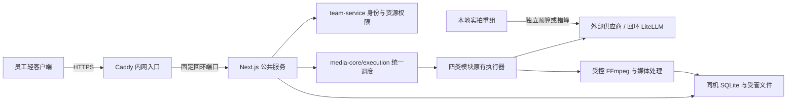

# Windows Server 统一生产技术方案

日期：2026-11-02  
状态：可评审实施设计，尚未实现或在目标服务器验证。产品边界以 [需求共识](2026-11-02-服务器统一生产-需求共识.md) 为准。  
执行入口：[实施计划](../plans/2026-11-02-服务器统一生产/README.md)；现场操作读 [部署手册](../plans/2026-11-02-服务器统一生产/部署手册.md)，验证读 [验收矩阵](../plans/2026-11-02-服务器统一生产/验收矩阵.md)。下文的新文件、表、接口、参数均为拟新增合同，不表示仓库已经具备。

## 1. 首版技术选型

以用户现有 Windows Server、3060、64GB 内存的内网主机为目标。沿用 Next.js 全栈、SQLite 和现有媒体执行器，首版部署一个拥有独占执行权的应用实例；渲染仍由受控子进程执行。容量不合格时依据测量拆执行进程或数据库，首版设计不引入多台应用服务器。

| 层 | 选定的实现方向 | 边界 |
| --- | --- | --- |
| 内网入口 | Caddy 反向代理与 HTTPS | 证书须被员工电脑信任；只开放获准内网范围，应用和 LiteLLM 监听回环。 |
| 常驻进程 | Windows SCM＋WinSW，固定版本及 SHA-256 后打包 | 工作台、入口代理、可选 LiteLLM 使用独立服务；应用退出不误停其他服务。 |
| 应用 | 新 server 入口启动 standalone Next.js | 固定回环端口，独立数据根；保留当前随机端口的本地桌面入口。 |
| 数据 | SQLite WAL＋同机受管媒体目录 | 数据库不放网络共享盘；客户端只通过 API 访问。 |
| 调度 | `media-core/execution` 的持久准入队列、调用尝试、资源占用 | 保留原模块任务表；云端额度、本地执行租约、媒体资源分别记录。 |
| 员工客户端 | Electron 轻客户端，免安装目录包 | 不带生产后台、FFmpeg、Python、工作台数据库或供应商凭据。 |
| 客户端更新 | 签名完整包＋独立更新助手＋版本目录切换 | 不恢复已移除的安装程序；不直接套用 Squirrel/MSIX 更新合同。 |

Caddy 与 WinSW 为本方案具体选型，实施任务锁定兼容目标 Windows Server 的正式版本、运行前提和校验值。公司已有证书优先；使用 Caddy 内部 CA 时部署根信任，不能跳过 TLS 校验。当前官方依据见第 11 节。



## 2. 运行模式、独占执行与停机

新增 `CREATIVE_STUDIO_DEPLOYMENT_MODE=local|server`。本地模式沿用当前行为；server 必须显式提供数据根、固定端口、部署 ID、受信外部 origin。服务数据根写入部署标识；本地入口发现 server 标识则拒绝打开，避免漏设环境变量后以无认证模式启动同一库。

新增 `runtime/team-server-entry.cjs` 与 `lib/team-service/runtime/`。现有 `runtime/server-entry.js` 强制 `port:0`，保留给本地桌面，公共服务不复用该强制随机端口逻辑。服务入口在加载业务数据库和 worker 前取得数据根独占锁，锁使用独立的锁数据库／操作系统释放语义，不长时间锁住业务库。超时不抢占仍存活的锁持有人；进程挂起不能仅凭心跳过期启动第二个执行者。

启动顺序固定为：校验模式与目录 → 独占锁 → core 与团队／执行设施 readiness → 各业务模块只迁移、不恢复或启动 → 注册权限和执行桥接及恢复器 → 复核未决调用与资源占用 → 恢复任务 → 启动各模块调度器 → readiness 为真。server 禁用当前 instrumentation 逐模块自动启动路径，把各 bootstrap 拆成 `ensureSchemaReady / registerRecovery / recover / start`；恢复不能绕过统一启动顺序。迁移或认证不可用时只保留最小健康／运维能力，不开放业务数据与付费提交；未就绪模块明确禁用，其余经过验证的能力可继续，但首版全模块验收必须全部就绪。可选 LiteLLM 不可用只关闭公司供应商。

模块恢复注册包含旧图片／视频、普通第三步脚本、详情页脚本、批量、画布和成片 prepare／render；不能等员工打开页面才恢复。每次服务启动有独立 `instanceId`，领取写入 fence，结果更新核对任务、尝试和 fence；迟到结果不能覆盖新尝试。独占锁丢失时停止新提交与写回。

`/api/team/health/live` 只报告进程活性，`ready` 报告是否允许业务；完整诊断需管理员。公共服务的原 `/api/shutdown` 和同机桌面路径接口拒绝远端调用。SCM stop helper 读取受 ACL 保护的本机控制凭据，核验实例后调用仅回环可达的运维入口；Caddy 阻断此入口，凭据不出现在命令行、日志或客户端。

停机顺序：关闭新受理及准入 → 停各模块领取 → 保留远端回执与未知提交状态 → 中止／排空受控本地工作 → 等待直接 FFmpeg → 关闭数据库 → 释放独占权。补齐旧图片／视频排空，复用唯一 `gracefulShutdown`。SCM 超时大于应用排空预算，超限只处置本实例已验证的进程树。服务端 LiteLLM 由独立 SCM 服务管理，应用停机不调用旧 detached sidecar 停止脚本；整套服务维护时按依赖顺序停止并核验。保留本地模式 sidecar 合同与已明确的三个短 FFmpeg 信号例外。

## 3. 代码边界与追加式数据结构

| 拟新增位置 | 职责与依赖 |
| --- | --- |
| `lib/team-service/` | 运行形态、独立迁移、账号会话、权限、文件登记、传输、设备、维护。组合根可调用各模块，业务模块不反向依赖它。 |
| `lib/media-core/execution/` | 模块无关的执行上下文、就绪调用、尝试、资源分配和恢复合同；独立迁移，经共享 schema-upgrade gate。 |
| `lib/media-core/access-context.ts` | 注入式资源访问合同，供批量／脚本／画布内部检查引用；不导入团队账号实现。 |
| `app/api/team/`、`app/team/` | 登录、账号管理、任务／错误中心、传输、设备、维护与客户端兼容信息。 |
| `desktop/client/` | 远端连接、原生文件传输、设备下载账本、版本握手与更新。 |
| `scripts/team-server/` | 预检、部署、维护、备份、恢复与只读诊断；PS1 使用 UTF-8 BOM。 |

团队和执行设施均使用独立 `{version, sql}` 追加迁移，经 `lib/schema-upgrade/` 备份／锁／审计；不修改既有 core、成片、批量、脚本、画布迁移。表名前缀区分 `team_` 与 `execution_`。初始库虽为空，后续升级仍遵守同一门禁。

| 核心表（拟新增） | 必须保存的身份与约束 |
| --- | --- |
| `team_users / team_sessions` | 稳定用户 ID、文本工号唯一、角色／状态、密码哈希、强制改密、会话版本；会话仅存随机 token 的哈希、过期／撤销及设备关联。 |
| `team_resource_scopes` | `(resourceType, resourceId)` 唯一，根所有者、private/public、父资源、软删除状态；缺登记即拒绝。 |
| `team_task_principals` | `(module, taskId)` 唯一，实际发起人、业务 scope、创建快照；不把项目所有者当作任务发起人。 |
| `team_files / team_file_references` | 文件身份、受控相对位置、哈希／大小／版本／ready 状态；显式记录资源到文件的引用及来源衍生关系。 |
| `team_uploads / team_upload_parts` | 用户／设备／目标 scope、预期大小、分片及整体校验、幂等键和完成状态。 |
| `team_devices / team_download_receipts` | 用户与设备绑定，`user+device+artifactVersion` 唯一，订阅起点、传输结果；设备 ID 不替代会话认证。 |
| `execution_operations / execution_attempts` | 业务任务与 step 的稳定身份、输入快照、重试次数、调用状态、实际传输尝试、回执、执行 fence。 |
| `execution_pools / execution_reservations` | 已核验额度映射、用户限额、轮转位置、占用类别、远端在途状态；资源授权与任务租约分开。 |

项目、画布、未绑定上传素材及私人全局资源均是归属根；批量／脚本按 projectId、成片按 projectId＋shotSetId、画布按 canvasId 继承。多态资源表无法直接用一个普通外键约束所有旧表，需受管创建事务和一致性检查。创建实体、scope 和首批任务身份必须同一数据库事务；复制、重试、派生任务也使用同一受管入口。

模块通过 `media-core` 合同传入主体与访问上下文，团队实现由组合根注入；server 模式缺少注入或上下文时拒绝执行。本地模式的兼容路径显式存在，不把团队认证失败当作本地模式。

## 4. 身份、全 API 归属与资源生命周期

采用服务端不透明会话：32 字节随机 token，数据库保存其哈希，HTTPS HttpOnly／Secure／SameSite Cookie，30 天绝对有效期。每次请求检查用户启用状态、角色和会话版本；重置／停用撤销现有会话。写操作检查可信 origin 与 CSRF token，限制登录尝试。首个管理员由本机受控 CLI 初始化，不提供公网自助认领；不允许停用最后一个可用管理员。

密码使用 Node 内置异步 scrypt，起始参数 N=2^17、r=8、p=1，独立随机盐，显式满足内存需求并限制并发 KDF；参数随哈希存储供升级。实施时记录实测耗时及内存，不通过降低安全参数掩盖资源问题。初始／重置凭据一次性、短期有效，只向执行该操作的管理员显示一次，不进日志；管理员恢复仅走受控本机命令。

当前盘点为 204 个 `route.ts`、29 个一级 API 组，执行时重新生成清单。新增 `scripts/team-api-coverage.mjs`，按路由＋HTTP 方法分类：公开最小入口、需登录、需资源授权、仅管理员、仅本地、server 禁用。未分类路由使检查失败；业务授权在 handler 和受管服务函数中执行，不只依赖页面或 Proxy。服务端页面、action 与缓存同样检查用户隔离。

普通用户只从专用模型目录获取已开放的安全元数据；供应商配置、真实 Key、模型开关、预算与维护仅管理员。覆盖 scene references、video reference assets、字体收藏、模板／模板附图、详情页目录／爆文库、BGM／LUT、日志和用量。现有全局去重约束不能成为跨用户共享授权：底层字节可去重，个人资源记录及使用权独立；公共版本由管理员显式发布。

文件访问统一为“授权实体 → 查受管文件与版本 → 读文件／衍生物”。server 下旧路径 URL 必须解析到有权限的实体，无法对应则拒绝；不以文件名、路径或知道 UUID 代替授权。Range、缩略图、懒转码、ZIP 和诊断包使用同一权限，用户数据响应禁止 public 缓存，登出／换账号清理对应客户端缓存与活动传输。

server 模式 DELETE 改为软删除。隐藏项目／素材后，已接受任务仍可读取其冻结依赖；用户无法用已删除资源发起新生产，已删项目结果不自动下载。管理员永久清理先计算跨模块、历史版本、在途任务、备份的引用，仍有引用则延期。文件删除有可恢复记录，数据库与文件系统失败可重试；本地模式保留既有删除行为。

## 5. 统一准入、付费尝试和本地媒体资源

模块保存业务任务后登记“已就绪的下一次调用”，统一调度按用户轮转／用户内顺序授予名额。未准入不占业务执行槽，不消耗提交次数或脚本调用预算。为一次调用需要的池与个人限制在同一短事务中检查，避免占住一个资源等待另一个导致死锁。

该规则通过持久化挂起／续跑实现：独立就绪任务在领取昂贵执行槽前登记首个操作；链内下一调用缺名额时，写入阶段检查点、下一调用输入及 continuationKey，返回专用 deferred 结果，释放编排槽，获准入后由新领取恢复。deferred 不是失败或重试，不扣尝试预算。不能在已占槽的 executor 中简单 `await admit()` 兑现公平性承诺。普通脚本、批量口播等内存链需拆到可持久重建的步骤边界；存输入与结果身份，不序列化闭包。测试必须证明 A 在等待第二步时，新用户 B 的首步仍能进入就绪队列。

```text
enqueue(operationKey, actor, scope, inputSnapshot, requiredPools)
  → admit(instance/fence)
  → prepareShortLivedReferences()
  → markSubmitting(attempt: maybe_sent)
  → attachReceipt(remoteId or synchronous result)
  → reconcile / settle(remote terminal)
  → acquire download / media resources for subsequent stage
```

请求发出前持久化 `maybe_sent`；有依据证明未发送／明确拒绝时才能按规则重试。进程崩溃在标记后、实际发送前也可能进入待核查，这是避免不确定重复付费的保守边界。异步调用拿到回执后持续持有远端名额直到终态；同步响应／流读完后结算。无远端 ID 的网络中断进入核查，不能用 lease 超时当作上游未受理。

同时维护 `dataRoot()/storage/execution-journal/` 下独立追加的提交／回执日志，按部署 ID 和单调序号记录操作、尝试、输入指纹、额度池、阶段及远端 ID，不含密钥、鉴权串、素材原文或签名 URL。顺序为数据库 maybe_sent → 提交意图日志刷盘 → POST → 回执日志刷盘 → 更新数据库。意图日志写入失败则不发送；已发送但落库失败时优先按日志核对。日志格式、校验、尾部中断修复与保留水位有测试，数据库回退不得覆盖或随快照回退此日志。

恢复前固定仍可读取的当前执行表与日志，再导入恢复目录作对账依据。日志与库仍可能同盘，日志不构成异地容灾保证；证据丢失时，受影响的在途及备份时间点后任务保持未知、禁止自动重提，进入人工核对。这里记录的是生产调用证据，不扩展为额外的管理员操作审计产品。

`operationKey=module/task/step/inputRevision` 固定；显式重试创建新 attempt，内部协议重试也记录实际 POST。额度名额不会因温度回退等内部尝试重复申请，但每次请求仍计入尝试和用量。业务输入发生改变则创建新操作。幂等键绑定用户与输入指纹，同键不同内容返回冲突。提供测试注入点覆盖标记前、发出后、回执前、文件落盘前等崩溃窗口。

业务模块 attempt、普通提交的重试轮次、实际 HTTP 传输序号分开保存；默认总共两次仅沿用对应普通提交策略，内部明确拒绝后的协议回退、轮询和下载不能混用同一计数。供应商身份、模型、池映射和配置版本在操作建立时冻结，凭据使用受保护版本引用；恢复时续查原任务所属的平台身份，不因管理员后来换了默认供应商而查询错账号。

COS 短期 URL 在真正提交前生成／刷新。上传、远端生成、下载和 FFmpeg 使用不同池，避免一个生成名额直到成片渲染完才释放。保持供应商尺寸、参考顺序、尾帧精确 allowlist 和公司温度协议。

必须覆盖的调用面：

| 链路 | 接入与恢复要点 |
| --- | --- |
| 旧图片／视频 | 全部同步／异步适配器分支、reference submit、项目 run、retry/regenerate/resume；按回执恢复，替换批量重置 running。 |
| 普通第三步脚本 | 将 `script-generation-manager` 的内存闭包改为可重建的输入快照与持久检查点；长任务受理后不依赖 HTTP 连接。 |
| 全部 LLM | `script-providers/index.ts` 的 completeJson 与 analyzeSellingPoints 均接入；实际传输层记录内部回退／重试。同步卖点分析、资料整理、视频分析、语义匹配、包装提取不能漏。 |
| 详情页脚本 | 保留持久方案预算与检查点；等待名额不扣实际调用预算；补 scheduler tick 防重入和真实活跃上限。 |
| TTS／对齐 | 分段／分块稳定 ID 和已完成音频复用；试听缓存未命中、转录内部重试也记录；不能中断后重跑整个已付费合成。 |
| 批量 | 每个 executor 的实际调用或媒体阶段接入；保留 attempt lease、暂停／停机语义；防止嵌套申请同一个媒体锁。 |
| 画布 | 保留 nodeEpoch、fence、draft/final、补下载与模型约束；内部 slot 与公共远端 permit 各司其职，避免双占和提前释放。 |

同步的长生产 API 在 server 模式变为受理任务＋进度／结果读取，保留本地合同；新增任务类型作为 operation wrapper 持久化，不强迫统一业务表。流式文案进度可保留，但 HTTP 断开不取消已接受任务。

本地媒体资源闸门下沉 `media-core`，覆盖批量、成片、包装、代理、预览转码、抽帧。预览 GET 先授权，再复用或登记去重转码任务；未完成返回可重试状态，不在每次 GET 无限启动 FFmpeg。共享使用量账本只负责记录：现有 usage 包装失败放行，不能用它充当额度锁；执行设施不可用时必须阻止新付费操作。

账号停用／显式取消区分“停止新阶段”和“收取已受理结果”。领取前重新检查用户和 scope；受理后的后台回收以持久任务身份进行，不要求用户仍有登录会话。维护状态同样允许续查与收取，直到进入真正停机屏障。

### 5.1 成员月度费用额度（2026-11-02 评审增补，待实现）

管理员按人设置月度费用额度、个人云端并发及“暂停新的付费生成”；员工只读自己的额度。额度按实际发起人跨四类模块合并，独立于本地／服务器上游并发预算；不限金额不豁免并发控制。成员页显示今日、本月、模块费用、在途预留、剩余可用及接近／达到上限状态。

- 强制准入保存用户策略版本、自然月账期、币种、整数最小货币单位、定价快照与每次调用的预留。与个人／共享并发在同一短事务核验及占额，管理修改与准入串行化；排队不预留，真正调用前重验。现有可失败放行的 usage 包装不能承担此门禁。
- 已计＋预留＋本次预估超过额度时停止新的付费步骤，保留可恢复等待原因；生成暂停与账号停用分开，前者仍可登录、编辑、查看和下载。降低并发不终止在途工作，只在占用回落到新上限以下后授予新名额。
- 已受理和受理不明的调用保留预留；核查未受理才释放，明确计费结果后幂等结算，失败不等于免费。重试和内部协议回退按实际请求定价与占额，不能因复用并发 permit 而跳过新增费用检查。结算超出预留时如实记账并停止后续付费步骤，不截断已受理结果或把差额抹成零。
- 实施前固定账期时区、跨月归属和晚到结算合同。建议按调用准入时固定的账期结算，按月建账而非清空旧记录；跨月待核查调用仍保留原预留及并发占用，并单独展示，不能在月初消失。旧账期额度调整、超预估告警与核查后释放均需有可复验案例。
- 定价不明不能按零放行；额度受限的调用在缺乏可信预估或可验证预留上界时暂停并提示管理员补齐计价。不限额账号的未知费用仍明确展示。费用是工作台估算及结算口径，不承诺等于供应商最终账单；本地 Agent 不计入。

原型中的具体金额和新账号默认 ¥0／并发 2 仅为待评审示例。正式默认策略及账期／定价规则由任务 06 固化，界面和员工提示由任务 13 实现；原型完成不表示上述持久化契约已实现。

## 6. 分片传输、设备与文件一致性

新增 API 合同：

| 入口（拟新增） | 行为 |
| --- | --- |
| `POST /api/team/uploads` | 验证用户与目标 scope，登记文件清单／相对名／大小／幂等键，返回 uploadId、分片尺寸与缺片列表。 |
| `PUT /api/team/uploads/[id]/parts/[part]` | 流式接收一个固定范围，限制真实字节数并校验分片；重复相同分片幂等，内容不同返回冲突。 |
| `GET /api/team/uploads/[id]` | 只向所属用户返回已收分片及状态。 |
| `POST /api/team/uploads/[id]/complete` | 校验总大小、哈希、媒体类型与当前权限，原子发布受管实体引用；重复完成返回同一实体。 |
| `DELETE /api/team/uploads/[id]` | 取消尚未发布的上传，清理自己 staging；不删除已经成为生产素材的文件。 |
| `GET /api/team/files/[id]` | 授权后支持 Range／ETag，返回不可变版本；预览与原件共享资源权限。 |
| `/api/team/devices`、`/downloads` | 设备注册、自动交付清单与完成回执；回执只有校验成功落盘后提交。 |

文件系统与 SQLite 没有共同事务。采用 `receiving → validating → staged → ready`：分片在 staging，完整文件校验后移动到不可变受管位置，再在数据库事务内登记实体／scope／引用／ready。崩溃留下的文件可由恢复器对账；在 ready 前不可被任务使用。正在发布、在途任务和备份引用拥有保护标记，清理只处理已证明无引用的中间文件。

原生上传选择后在主进程保存受管文件句柄／指纹，服务端只收到内容和相对名；拒绝绝对路径、上级穿越、Windows ADS／设备名等非法目标。源文件改变时停止续传并说明重新上传，不能把旧分片拼进新内容。初始工程参数建议分片 8MiB、每设备上传 2 路／下载 2 路，仅作为测试起点，最终配置由验收冻结。

客户端传输使用与窗口一致的 Electron Session 网络接口，显式携带对应会话与 CSRF，不假定 Node fetch 自动带 Chromium Cookie。登出停止该账号传输和自动重试，重登录同账号后恢复；用户切换不能接管前一账号的记录。设备记录按服务部署 ID＋用户＋设备隔离，设备身份本身无授权能力。

服务端导出发布固定 manifest（文件 ID、版本、大小、哈希）。客户端按设备账本保存 `.part`、ETag 和目标；Range 恢复先核对版本，完成校验后以不覆盖方式发布。新设备创建订阅起点，不补拉全部历史；手工选择旧成果仍可下载。原设备补下未完成成片；已删项目抑制自动交付。对外可见文件不可原地覆盖，新的成片写新版本。

## 7. 轻客户端、可信更新与兼容

将 `DesktopWindowHost` 分为 local／remote 类型，远端不要求 service、desktopSecret 或服务器 dataRoot。保留主 frame、精确 origin、sandbox、contextIsolation 和导航限制。远端 IPC 使用 transferId／downloadId 操作受管本地文件，不接受页面任意指定的绝对路径；本地实拍导航协议仅存在于 local 模式。

轻客户端启动时握手 `GET /api/team/client-capabilities`：服务部署 ID、API 协议版本、支持的客户端范围、上传约束、维护状态。服务端执行兼容检查；旧客户端不兼容时阻止业务写入并展示更新入口。认证状态和文件权限不因版本兼容而降低。

免安装更新采用稳定 launcher＋`versions/<releaseId>`＋独立客户端状态目录。manifest 至少签名 releaseId、平台架构、完整包大小／SHA-256、版本、API 兼容范围、客户端状态 schema 兼容范围和受控 URL。初始可信包内置验证公钥；签名私钥只在发布环境，现有无签名 portable manifest 不能代替可信签名。

更新助手从已验证版本启动，下载 staging → 验签与校验 → 安全解压至新目录 → 保存／暂停传输 → 等旧主进程退出并快照本机状态 → 原子切换版本指针 → 启动新版本并等待本机健康确认。健康确认前不恢复传输或新增交付；失败先停新版进程，再按 API 和本机状态 schema 的兼容性回切版本，必要时恢复更新前状态快照。健康确认后才提交本次升级并恢复传输，不能再盲目恢复旧快照覆盖新下载记录。旧可执行目录不原地覆盖；助手仍占用的旧目录延后清理。旧版不兼容时保留数据并显示修复入口，不强行恢复业务提交。保留最近可用版本和当前运行引用，不误删状态／下载目录。

中断下载、错误签名、篡改 ZIP、路径穿越、磁盘不足、杀毒软件占用、指针写入失败、新版本启动失败均应有明确可恢复结果。拒绝任意页面发起更新 URL，客户端使用固定信任来源。完整更新助手技术实现由任务 12 的 Windows 验证固定，不能在产物中暗中增加安装程序。

## 8. 发布、备份与恢复边界

服务器不可变 release 目录与 dataRoot／配置／备份分开。服务端包复用隔离构建、standalone 资源同步、锁定 Node 与媒体依赖；server 新入口显式加入同步白名单。轻客户端单独白名单，不从完整桌面包删几项碰运气。现有 forbidden-paths 断言保留，新 consumer 只表达各类包的精确差异。

日常备份采用可恢复的文件引用快照：短暂冻结数据库相关发布、配置变更与物理清理 → SQLite Online Backup → 在屏障内固定 releaseId、配置版本／受保护配置副本及哈希 → 从备份库形成文件清单及保留引用 → 解冻 → 复制被引用不可变文件和已经固定的配置副本 → 校验清单／哈希／数据库 → 标记成功。解冻后不再读取“当前配置”充当快照；独立执行日志记录备份序号及保留水位，覆盖后续恢复核查。依赖文件不可变及引用登记完整；任务 05／11 未完成前不能把普通复制包装成在线一致性备份。失败不轮换有效副本；只保留最近 14 个成功日常版本，手工和升级备份独立。

首次上线用新库。后续升级先维护与处理在途任务，停旧实例并确认无持有写入进程，再做升级前完整备份、切换 release、追加迁移和维护态自检。迁移兼容时可以回切程序；不兼容时恢复数据库＋对应文件和配置到新恢复目录，再切换数据根。恢复后先禁止新付费调度，核对备份时间点之后的任务回执与供应商状态；未核清不能把旧快照里的任务重新提交。

## 9. 配置与容量验证

所有服务器路径和端口写入受控部署配置，由预检确认。文档不把旧 IP、F/D 盘符、CPU、3060 显存或未测试的 NVENC 会话数当作事实。示例 app `127.0.0.1:3300`／LiteLLM `127.0.0.1:4300` 仅示意；可用性核实后锁定，并让种子／供应商配置使用同一实际代理端口。

本机重任务初始并行 1，仅用于保护性试跑；在同一素材与输出规格下逐级测试后提高。云端额度填入已核验共享关系与本地预留，原 70 不是新服务器的默认授权容量。对上传／下载、数据库锁等待、事件循环、渲染、CPU／GPU／内存和磁盘分别记录曲线。

试点建议验收阈值及负载定义在验收矩阵中固定；它们是工程验收目标，不是硬件已达到的性能承诺。达不到时先定位瓶颈并减并发，若必须牺牲已确认体验或规模，回到需求决定。

## 10. 实施顺序

先完成运行隔离与两套共享 schema，再做身份、原子归属、文件权限；随后并行建设统一执行设施和软删除／传输。业务接入按旧图片视频 → 普通脚本与 LLM → 批量／详情页／媒体 → 画布推进，每一步保留本地回归。最后收敛轻客户端更新、用量管理、服务打包、备份恢复和全模块容量验收。任务依赖以计划 README 为准，未通过依赖验收不得启动对应生产上线步骤。

## 11. 官方依据

- [Next.js 自托管](https://nextjs.org/docs/app/guides/self-hosting)：入口代理和多实例协调边界；代码版本以本仓库锁文件为准。
- [SQLite 适用范围](https://www.sqlite.org/whentouse.html)、[WAL](https://www.sqlite.org/wal.html)：同库单写者及同机文件系统限制。
- [WinSW 配置](https://github.com/winsw/winsw/blob/v3/docs/xml-config-file.md?plain=1)、[正式发行列表](https://github.com/winsw/winsw/releases)：停止程序、超时和服务账号；v3 文档不等于采用 alpha 版本，实施时对所锁正式版本复核字段。
- [Caddy 运行说明](https://caddyserver.com/docs/running)：Windows 常驻运行与本地 CA 信任。
- [Electron Session](https://www.electronjs.org/docs/latest/api/session)、[autoUpdater](https://www.electronjs.org/docs/latest/api/auto-updater/)：会话网络与官方 Windows 更新形态；免安装助手是本项目设计。
- [OWASP 密码存储](https://cheatsheetseries.owasp.org/cheatsheets/Password_Storage_Cheat_Sheet.html)：scrypt 参数依据；不扩展为额外管理员审计产品需求。
