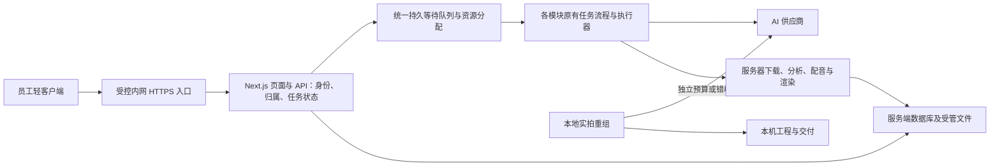

# Creative Studio 服务器统一生产：首版需求共识

日期：2026-11-02  
状态：产品边界已收敛；第 7 节为待验证的技术设计方向，尚未开始业务代码改造或目标服务器部署。  
依据：[9 月 20 日需求基线](../../2026-09-20-轻客户端与服务器统一生产方案梳理.md)、[本轮六项确认及源码证据](../../2026-11-02-服务器集中部署-重启讨论.md)、[ADR-0001](../../adr/0001-轻客户端与服务器统一生产边界.md)。本轮明确变更优先，其余已确认规则继续沿用。

技术细化已另成 [Windows Server 技术方案](2026-11-02-服务器统一生产-技术方案.md) 与 [分项实施计划](../plans/2026-11-02-服务器统一生产/README.md)，包含先后依赖、部署手册和验收矩阵。本文保留产品规则，第 7～8 节作为技术方向摘要；具体执行以新技术方案与任务单为准。

## 1. 目标与边界

把员工日常生产集中到服务器，统一管理并发、版本、任务和错误。目标规模仍按最高 20 人同时使用准备；是否达到容量要求，以目标主机实测为准，不把在线人数等同于同时渲染数量。

| 项目 | 首版规则 |
| --- | --- |
| 员工入口 | 工作台轻客户端，复用现有界面与 Electron 桌面壳；生产由服务器执行。 |
| 覆盖模块 | 常规项目五步流程、批量生产、详情页智能脚本、创作画布。 |
| 本地例外 | 实拍重组 Agent 暂留本地，后续另期接入；它不是员工轻客户端的离线生产模式。 |
| 身份 | 工号＋独立工作台密码，管理员建号；员工只看自己，两位管理员可看全部。 |
| 数据启用 | 服务器从新项目开始，使用独立数据根；旧项目和素材保留原处，无历史工程批量迁移或双向同步。 |
| 上游额度 | 本地与服务器分别分配并发预算；核实前先错峰。上游并发预算指在途名额；另设服务器成员个人费用额度。 |
| 成员用量控制 | 管理员查看每人用量，分别设置每月费用额度与个人云端并发上限；跨项目、窗口和首版模块合并计算。 |
| 结果交付 | 服务器保存结果；混剪最终成片导出成功自动下载到员工本机，其他结果按需下载；员工自行放入共享盘。 |
| 更新 | 服务端业务集中发布；客户端外壳提示后由员工一键更新，保存传输状态后重启。 |

服务器的 AI 生成仍调用公司平台或外部供应商；集中生产不意味着在服务器部署生成模型。公共服务按公司受控内网接入设计，保留不向公网开放工作台本机服务及 LiteLLM 的约束。

## 2. 员工与管理员的完整流程

员工首次使用管理员创建的账号及一次性初始凭据，设置独立密码，登录后只看到自己的项目、画布和任务。员工选择本机或自己可访问的共享盘文件，经上传完成并校验后供服务器任务引用；个人电脑的盘符或绝对路径不能直接交给服务器读取。

员工提交任务后看到排队、执行、下载、渲染及失败阶段。关闭窗口、退出登录、客户端升级或电脑离线，不停止服务器已经接受的任务；未上传完的本机素材还不属于已接受的生产输入。服务器不可达时明确提示连接状态，轻客户端不自行启动本地生产后台。

管理员管理账号、供应商及开放模型，查看部门与个人用量、任务和错误，发布公共模板、知识库、音色及 BGM，安排维护更新、备份及永久清理。允许管理员代操作，沿用登录发起人归属规则，不另建身份切换、账单转记或额外管理员操作记录系统。

### 账号、归属与文件权限

- 工号按文本保存，保留前导零；另有稳定内部用户 ID。工作台密码独立于电脑密码，不读取或同步电脑密码。
- 记住登录 30 天；主动退出撤销对应会话，重置密码或停用账号撤销该账号已有会话。管理员不能查看原密码。
- 停用立即阻止登录和新提交，暂停未执行任务；已被供应商受理的任务收取结果，随后不再启动付费步骤。
- 项目、画布、素材、任务、预览、下载、导出、搜索、错误和用量均在服务端检查身份与归属；只过滤列表或隐藏按钮不足以满足隔离要求。
- 公共资源由管理员发布，员工可用不可改；个人创建或上传的资源仅本人及管理员可见。供应商、凭据、开放模型与并发上限仅管理员配置。

## 3. 调度与两条生产路径并存

服务器维护持久任务与权威的资源占用记录。个人计数跨项目、窗口和四类模块合并；同一个上游额度池不能因为模型别名、供应商记录或模块不同就被拆成多份可用额度。

原七牛 image2 与视频共享上限 70、每人最高 10 作为历史配置基线：本轮已允许根据本地预算与实际平台额度调整服务器总上限，不能在未核实前直接把 70 当作可用容量。每人 10 仍受共享池上限约束；其他供应商另按实际额度配置。

各用户之间轮流取得空闲名额，同一用户队内按提交顺序执行，已执行的任务不被抢占。云端生成、服务端下载、渲染、分析、配音及转码等资源分别受控，不能把云端名额直接用于 FFmpeg 并发。

### 上游调用与恢复

- 明确未受理的提交失败按约定次数重试；普通图片／视频提交默认总共两次，轮询、限流等待及下载有独立策略，脚本保留合理局部重试。
- 已有上游任务 ID 时继续查询或补下载；受理不明先核查，不自动从头重跑整个流程。
- 重复点击、重连、进程重启和客户端升级不能自动变成新的付费提交。
- 取消排队任务立即停止其执行；已受理但上游不可取消的任务继续收取结果，停止后续步骤并提示可能计费。上游未结束前不得因本地取消、超时或租约过期释放远端名额。
- 重启后的状态恢复须确认原执行者和远端事实，不能由后启动的实例把另一个仍在运行的任务重置为待执行。

### 本地实拍重组例外

先核验本地与服务器是否使用同一上游额度池。优先使用平台明确隔离的额度；共用池时，为两边分配实际可执行的预算，计入同池的其他调用者并留出平台要求的余量。不能只换一个 Key 就假定额度独立。

核实及限制措施落实前，共用池的付费生成错峰运行。限制必须覆盖本地所有工程和进程，不能把每个工程都限为 50 后宣称本地合计只有 50。无上游调用的本地渲染不占云端生成池。

首版服务器任务中心和个人用量只承诺覆盖经过统一生产服务的调用；本地 Agent 的任务、费用与工程不自动同步。部门账单可能还包含本地及其他系统的调用，不能把服务端统计冒充平台总账。

## 4. 素材、下载与数据保留

### 上传与下载

- 多文件、文件夹导入支持进度、取消与中断恢复；上传完成后才登记可供生产使用的素材。文件类型、单文件与批次上限、传输并发由实际素材和容量测试确定。
- 员工首次选择下载根目录；混剪成片按项目／导出版本保存，同名不覆盖，可打开所在文件夹。服务器生成成功与本机下载成功分别记录。
- 原设备重连补下未完成导出；新设备只展示结果列表，员工按需下载，不自动拉全部历史。下载失败只补下载，不重新生成或渲染。
- 画布节点的图片、视频结果按需下载；用户主动打包后，ZIP 完成即接续下载。模型的“生成正式版”不等于最终剪辑成片，不据此自动下载全部视频。画布 ZIP 当前语义仍是选中生成节点的当前结果，不自动扩展为历史候选备份。
- 员工自行把下载结果放入共享盘；后台直传共享盘不属于首版，系统不宣称手动交付已完成。

### 删除、空间与旧数据

- 生产素材与结果不自动删除。员工删除自己的项目或素材后从日常界面隐藏、进入回收站；任务依赖文件保留，删除不等于取消已提交任务。
- 已删除项目的新结果不自动下载。管理员负责永久清理，仍被任务使用的文件暂缓物理删除；回收站不自动清空。
- 低空间告警并暂停新上传／新提交，保留已有状态。安全余量及在途任务的空间预留需核验，不能继续启动无法完成写入的新阶段。
- 服务器新库不从旧数据库整体复制；旧项目、个人素材、凭据、日志及账本不随“初始化”静默带入。需要复用的旧素材可由员工上传副本。

## 5. 用量、诊断、更新与备份

2026-11-02 原型评审增补：负责人明确选择“费用额度＋并发上限”，替代此前“只统计、不做金额预算拦截”的规则。管理员查看每人今日／本月费用、模块明细、已计费用、在途预留与个人并发，分别调整每月费用额度、个人并发上限，也可暂停新的付费生成。员工只能查看自己的额度，不能修改。

月度费用按自然月、实际发起人跨项目与模块合并；可用金额为额度减去已计与在途预留。每个付费调用真正执行前重新检查并预留，排队等待并发时不预留；余额不足或被暂停时不启动新的付费步骤。已受理调用继续收取结果，受理不明继续保留预留及名额，核查后结算或释放。降低额度／并发不终止已有调用；账号登录、项目编辑、结果查看与下载继续可用。

支持今日、本月、自选日期、模型、任务成败和预估金额，管理员可导出 CSV。覆盖全部首版模块的计费调用，保留重试记录；未定价和费用不确定单独标明，不能记成零。费用额度控制基于服务端计价与预留，不宣称与上游最终账单严格相等；跨月、超预估结算及不可估价调用的处理在技术方案和任务 06 中落实。真实个人 Key 和平台账单接入仍是后续能力，不阻塞首版。本地 Agent 不计入这套个人费用额度。

每次错误能由错误编号关联人员、项目或画布、内部任务、上游请求／任务、失败阶段及版本。服务端采集调用、下载、存储与媒体执行错误，客户端采集界面、上传、下载及更新异常。诊断内容脱敏，普通员工仅查看本人数据。通知只在客户端显示，沿用不增加系统通知、邮件或钉钉通知的范围；日志容量与保留参数在工程设计中明确。

页面和主要业务由服务器提供；外壳更新先提示，员工点击后保存传输状态、更新并重启，恢复未完成传输。兼容旧版可暂缓，不兼容时要求升级；更新失败需保留可恢复的客户端状态与可用版本。客户端更新不停止服务器任务。

服务端无人值守、开机自启、异常恢复；管理员断开远程桌面不停止生产。服务端更新由管理员安排维护时段：验证新版本 → 停止接收新任务并处理在途工作 → 一致性备份 → 更新及追加式迁移 → 启动与关键链路验证 → 恢复接单。数据库变更后的回退必须考虑数据兼容，不能只替换旧程序。

每日备份数据库、素材与必要配置，日常保留最近 14 个成功版本；升级前另做备份。失败备份不淘汰有效副本，既有手动备份与升级备份不进入日常误清理。每个保留版本须可恢复其数据库和被引用素材；备份目标位置、容量与物理故障隔离需要核验。

## 6. 首次初始化与上线准备

“从新项目开始”不等于发布一个没有生产资源的空壳：

1. 新服务使用独立程序版本目录、数据根和运行身份；识别并保护旧版本、旧数据和已有手动备份。
2. 初始化账号和管理员恢复路径。供应商目录及代码内置模板可按程序种子初始化，真正可用的服务端凭据和 LiteLLM 配置由管理员在受控环境配置。
3. 管理员明确发布需要共用的模板、知识库、音色和 BGM。仅显式准备的内容包进入公共资源，不复制个人数据库或整个旧 storage。
4. 当前 BGM 来自数据根的实际文件，并非程序必然内置；批量生产依赖曲库，应把可用 BGM 验证列为首批全模块验收前置项。
5. 负责人和另一位同事先验收四类模块，再结合模拟并发完成目标规模测试，通过后开放其他员工。备用管理员仍是负责人领导。

首个管理员初始化、供应商配置与公共资源发布属于已确认管理员职责的落地，不另引入一轮产品选择；具体凭据和待发布文件不应写入需求文档。

## 7. 技术设计方向（建议，尚未实现或完成验证）

### 7.1 首版部署形态

目标主机已经由负责人确认：现有高性能电脑、3060 显卡、64GB 内存、已安装 Windows Server、内网运行，管理员可通过远程桌面连接使用。首版以该主机和一套拥有独占执行权的应用实例作为验证起点，复用 Next.js 页面、API 与现有生产模块。员工连接受控内网 HTTPS 入口，应用及 LiteLLM 保持本机受控监听；程序发布、运行数据、备份分开。具体服务管理器、反向代理、证书和目录方案依据目标环境确定。

远程桌面是管理员维护通道，员工轻客户端到工作台服务是业务通道，需分别验证。现有远程桌面可用不代表业务入口、无人登录时的后台运行或服务账号下的 GPU 编码已经通过验收。

单实例不是单任务串行，仍可并发等待远端生成并启动受控媒体子进程；也不是现在直接搬过去即可使用。需先实现公共服务独占运行、身份隔离、资源分配和恢复规则，不能用多个现有后台共用库代替中央调度。

### 7.2 模块、队列与数据库

- 各模块保留独立表、迁移流与状态机，共享持久化的等待与额度分配机制。记录至少关联模块、任务、尝试、实际发起人和额度池；业务所有者与任务发起人不可混用。
- 统一机制负责跨模块公平领取和真实在途占用，不能仅在发 HTTP 请求时套一层内存信号量。提交不明、远端执行、重试、取消、停用及恢复均要进入同一资源契约。
- 保留模块依赖方向与 `media-core` 共享边界，避免把批量、脚本或画布重新耦合到 `final-edit`。
- SQLite 可作为首版候选继续验证，数据库放服务器本地磁盘，员工通过 API 访问；不能放网络共享盘让客户端直接读写。用目标负载检查短事务、锁等待、轮询／日志写入及恢复；达不到要求时评估数据库或执行进程拆分，不能只凭 20 人这个数字判定容量。
- 启动独占控制必须先于旧 worker 的恢复操作；对失去执行权的旧实例，不能继续提交或写回任务。新旧模式显式分开，服务器认证初始化失败时不能自动回退成无认证本地模式。

技术依据：[Next.js 自托管](https://nextjs.org/docs/app/guides/self-hosting)建议通过反向代理承接入口，并要求多实例额外协调；[SQLite 适用范围](https://www.sqlite.org/whentouse.html)说明每库同一时刻只有一个写者，写入密集或多服务器场景需考虑其他数据库；[WAL 文档](https://www.sqlite.org/wal.html)要求数据库使用者位于同一主机。以上支持先做单机方案验证，不构成工作台已通过容量验收的结论。

### 7.3 改造落点

| 能力 | 现有入口与重点 |
| --- | --- |
| 运行形态 | `desktop/main.ts`、`desktop/service-spawn.ts`、`instrumentation.ts`、`lib/shutdown.ts`；区分本地私有后台与公共服务，客户端退出不调用公共停机。 |
| 身份与权限 | `app/api/` 全量接口与文件访问、项目／画布／资源归属；服务端授权及缓存隔离，不只在页面或入口层校验。 |
| 统一资源 | `lib/queue.ts`、`lib/video-queue.ts`、批量／脚本／画布执行器、成片 worker；持久公平调度、执行所有权和恢复。 |
| 传输 | 普通上传、批量素材导入、桌面链接导入、详情页目录导入、画布素材与导出；把同机路径依赖转为受控文件传输。 |
| 用量与诊断 | 现有 usage ledger、日志及各模块任务；补用户和模块关联、全部计费步骤、客户端错误编号与版本。 |
| 打包与维护 | 现有桌面打包、standalone 同步及部署脚本；薄客户端包、受控更新包、版本兼容与失败恢复，保留现有敏感文件禁入断言。 |

数据库迁移继续追加，不修改已发布条目；涉及新结构的安全升级遵守备份、锁和审计设施。新数据根不免除本地模式兼容及后续升级验证。

## 8. 实施阶段与验收门槛

以下保留阶段摘要；[17 项独立实施任务](../plans/2026-11-02-服务器统一生产/README.md) 已补齐具体文件范围、依赖、步骤和验收。运行模式基础可先开展本地开发，部署及容量验证仍以现场核验和前置任务完成证据为门槛。

| 阶段 | 产出 | 进入下一阶段的条件 |
| --- | --- | --- |
| 1. 技术设计与环境核验 | 接口／身份／任务与资源契约、目标机器和额度事实、部署及测试方案 | 能说明每个生产入口、在途恢复与文件访问归属；实际权限和环境缺口可追踪。 |
| 2. 公共服务与身份基础 | 独立新数据根、独占运行、账号、角色、各模块归属和文件授权 | 两个普通账号及管理员通过直接 API／文件越权验证，窗口退出不停止服务。 |
| 3. 四类模块统一生产 | 公平排队、供应商共享池、本地重任务资源控制、重启恢复与用量关联 | 交叉模块不超总预算／个人上限；重复点击与重启不重复提交已受理任务。 |
| 4. 轻客户端与传输 | 文件／文件夹上传、续传、按设备下载状态、一键更新 | 断网、重启、客户端升级及同名文件场景保留结果与可恢复状态；大文件负载有边界。 |
| 5. 管理、运维与开放 | 错误定位、备份恢复、维护发布与回退、两人试点和容量报告 | 四类模块全链路、目标人数负载、资源不足与异常恢复通过，随后开放其他员工。 |

诊断字段、用量归属和恢复记录从前期即采集；第 5 阶段完善管理界面，不把可观测性延迟到最后才建设。可以分模块开发，首版上线验收必须四类全部覆盖。

关键交叉验收包括：同一员工跨项目和画布共享个人额度、不同员工公平排队、管理员操作归属、直接猜测他人文件 ID、停用时上游仍执行、重启前后受理不明、下载失败只补下载、已删项目抑制自动下载、旧客户端不兼容、上传期间客户端升级，以及曲库缺失／磁盘不足／代理不可用。

## 9. 尚待查明的事实与工程参数

2026-11-02 负责人已确认部署主机为 3060 显卡＋64GB 内存的电脑，Windows Server 已安装，处于内网且可通过远程桌面连接使用。以这些事实继续设计；以下是仍需工具核验的细节及运行指标，不再把“是否有服务器／是否已装操作系统”列为缺失信息。

| 待核验项 | 证据要求 |
| --- | --- |
| 服务器 | Windows Server 具体版本、CPU 型号、GPU 显存／驱动、磁盘类型与可用空间、网络带宽、服务账号权限、当前运行程序与数据根；已知 3060 与 64GB 内存仍需在运行诊断中记录，9 月地址和部署版本不当作当前实测。 |
| 入口与运行 | 固定内网地址或域名、HTTPS、受控访问范围、服务自启和异常恢复、LiteLLM 及供应商连通性。 |
| 上游额度 | 平台账户／Key／模型的实际共享关系、上限、其他使用者，本地与服务器预算及可验证的执行限制。 |
| 素材与吞吐 | 代表性文件、批量规模和输出规格；上传下载带宽、渲染／分析／配音耗时、数据库写入及界面响应。 |
| 维护与恢复 | 备份位置及空间、恢复验证、发布回退与客户端更新失败恢复、日志保留与磁盘安全余量。 |

这些是调查和测试任务，不要求负责人猜硬件参数或选择数据库品牌。若结果要求缩减已确认模块、改变交付体验或增加新的外部依赖，再回到相应产品决定讨论。本轮只整理文档，没有连接服务器、读取真实凭据、迁移数据、启动生产任务或验证容量。
