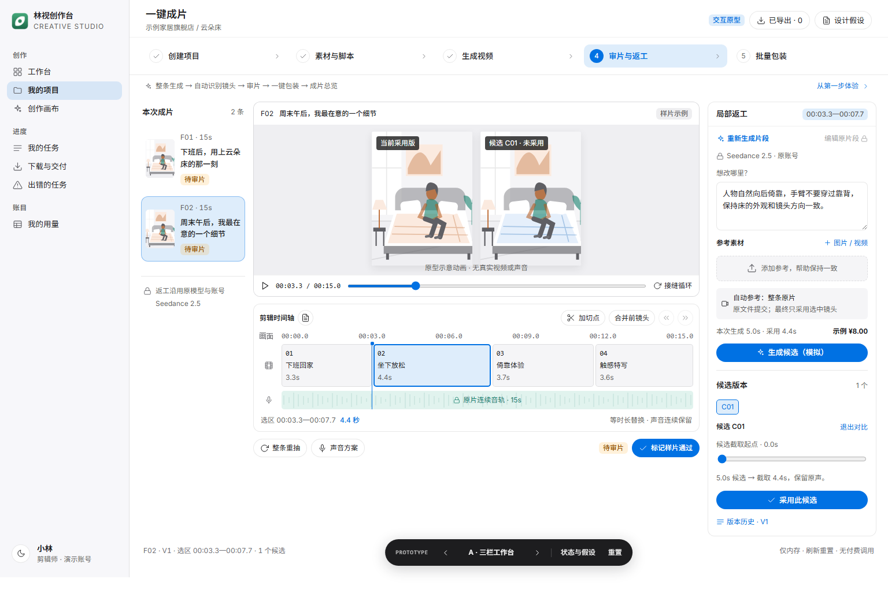

# 一键成片首版 PRD

**状态：** `ready-for-agent`

**日期：** 2026-11-19

## Problem Statement

剪辑师拿到同一款产品的场景图和详情页，想一次做出几条讲法不同、有人物实际使用产品的淘系种草短视频。现在需要自己摘卖点、写分镜提示词，再把生成的视频、口播和包装接起来。最常见的两种返工发生在不同阶段。写稿时，第一条已经确认，第二条的结构合适但内容不满意。审片时，整条的声音和大部分画面都满意，只有一个镜头需要重拍。两种情况下，剪辑师都需要保住已经挑好、改好或确认过的部分。

## Solution

工作台提供「一键成片」入口。剪辑师在同一项目里完成五步，最后一次查看、预览和下载所有已导出的成片。

| 步骤 | 剪辑师的操作 | 交给下一步的结果 |
| --- | --- | --- |
| 1 · 创建项目 | 填店铺、型号、类型和剪辑师，按工作台规则自动命名 | 一个可以继续补素材、做多条成片的项目 |
| 2 · 素材与脚本 | 依次进入「上传素材」「分析内容」「生成脚本」三个子页。核对卖点后选视频结构、配音方式、成片数量，逐条编辑和确认 | 每条成片一份确认稿，包含大纲、适用的口播、完整视频提示词。选用 TTS 的条目附已试听并确认的配音 |
| 3 · 生成视频 | 选模型、正文时长、画幅、生成模式，按确认稿整条生成，再识别实际画面的切点 | 每条独立的原片、连续声音和可调整的镜头区间 |
| 4 · 审片与返工 | 在 **A 三栏工作台**看整条或单镜头、比较候选并采用。样片通过后转高清，直出视频通过后可去包装 | 已通过审片的成片版本及其采用的画面和声音来源 |
| 5 · 包装与导出 | 一键包装所有合格条目，可继续逐条编辑时间轴，然后全选导出 | 独立的「已导出成片」总览和可下载的正式产物 |

**已确认的首版口径。** 默认采用视频模型的**原生画外音**，人物自然体验产品，旁白在画外讲述。默认生成 **15 秒正文**，封面到第五步再加。剪辑师已实测 Seedance 2.5 样片转高清的一致性并确认可用，首版按样片上选定的镜头关系转高清、合成。A 布局用于正式审片。

### 逐页看原型

下面的页面图随规格一起保存，可离线查看。交互链接打开本机原型，沿同一标签页的按钮往下走可以看到前一步的编辑。前十一张图来自同一个云朵床项目的两条脚本和成片，最后一张演示脚本阶段的 TTS 分支。原型的生成、声音、费用和下载内容均为模拟。

| 页面 | 在这一屏能做什么，下一步去哪里 | 页面图与交互入口 |
| --- | --- | --- |
| ① 创建项目 | 在四个字段旁核对「项目名预览」，点「创建并准备素材」来到上传页。数量在脚本页决定，视频参数在生成页决定 | [项目表单](2026-11-19-一键成片-原型/01-project.png) · [从头体验](http://127.0.0.1:3321/prototype/one-click-film?variant=A&step=1) |
| ② 上传素材 | 「场景图」和「详情页」分区添加、预览、移除图片。至少有一份素材就可点「分析 N 份素材」，已有结果时可直接回看 | [上传页](2026-11-19-一键成片-原型/02-upload.png) · [打开原型](http://127.0.0.1:3321/prototype/one-click-film?variant=A&step=2&section=upload) |
| ② 分析内容 | 核对产品名称、外观与场景线索、卖点及来源。产品名称有效且至少勾选一项有内容的卖点后，点「确认内容，去生成脚本」。也可返回上传或重新分析 | [已出结果的分析页](2026-11-19-一键成片-原型/03-analysis.png) · [打开分析入口](http://127.0.0.1:3321/prototype/one-click-film?variant=A&step=2&section=analysis) |
| ② 生成脚本 | 上方设置结构、配音和数量，生成后左侧逐条选稿，右侧编辑当前条。「重新生成本条」位于本条卡片内，「重新生成全部」位于整批设置区。脚本列表显示确认进度 | [脚本工作区](2026-11-19-一键成片-原型/04-scripts.png) · [打开 F01 已确认、F02 待确认的示例](http://127.0.0.1:3321/prototype/one-click-film?variant=A&step=2&section=scripts&example=redraft) |
| ② 提示词与配音 | 点「查看与编辑」展开全文，能复制、保存草稿或确认。选 TTS 后可逐条或整批生成配音，逐条试听并确认。全部脚本确认后点「继续生成视频」 | [分镜提示词编辑](2026-11-19-一键成片-原型/05-storyboard.png) · [TTS 试听与确认](2026-11-19-一键成片-原型/12-tts.png) |
| ③ 生成视频 | 左侧是模型、正文时长、画幅和生成模式，以及脚本阶段确定的声音。右侧队列能逐条核对提示词，依次显示整条生成、识别切点和审片入口。点某条的镜头可以直接定位到该片选区 | [生成设置和创作队列](2026-11-19-一键成片-原型/06-generation.png) · [打开生成页](http://127.0.0.1:3321/prototype/one-click-film?variant=A&step=3) |
| ④ 审片与返工 | A 布局中选成片、选完整镜头，右侧写要求并加参考。比较候选、循环检查接缝、选取候选入点后采用。时间轴下方可整条重抽、切回脚本调整声音或标记通过 | [A 布局与候选对比](2026-11-19-一键成片-原型/07-review-a.png) · [打开 A 布局](http://127.0.0.1:3321/prototype/one-click-film?variant=A&step=4) |
| ④ 一键高清 | 样片通过后，点「一键高清」核对采用的原片、补片来源与预计费用。确认转换并复核高清结果后去包装。直接生成的视频从审片通过直接去包装 | [按采用来源转高清](2026-11-19-一键成片-原型/08-hd-sources.png) |
| ⑤ 批量包装 | 左侧统一设模板、标题规则以及封面、字幕、花字、BGM。右侧卡片显示哪些条目已就绪，哪些还需审片。点「一键包装全部」处理合格条目。单独体验本页可点「载入已审片示例」 | [批量包装与成片卡片](2026-11-19-一键成片-原型/09-packaging.png) · [打开包装页](http://127.0.0.1:3321/prototype/one-click-film?variant=A&step=5) |
| ⑤ 继续编辑 | 从成片卡片进入。在原来的画面和声音轨道下点选封面、字幕、花字、BGM，右侧切换「包装调整」和「镜头返工」。局部编辑完成后点「保存并返回批量包装」 | [包装后的时间轴与检查器](2026-11-19-一键成片-原型/10-packaging-editor.png) |
| 已导出成片 | 支持导出已选条目或「全选并导出」。导出后自动进入总览，按记录预览、选择和打包下载。也可从「已导出」或「下载与交付」回看。原型的历史记录保存在本次页面会话中 | [两条已导出成片](2026-11-19-一键成片-原型/11-exports.png) · [打开总览入口](http://127.0.0.1:3321/prototype/one-click-film?variant=A&view=exports) |

图中 F02 正文的第二个镜头约 4.4 秒。右侧候选长 5 秒，剪辑师可以移动截取起点。点击采用后只有选区的 4.4 秒画面改变，下方 15 秒的原片声音连续播放。

## User Stories

1. 作为剪辑师，我想先用店铺、型号、类型和姓名创建项目，以便先整理素材，了解卖点后再决定做几条。
2. 作为剪辑师，我想分别放入场景图和详情页，并在上传页直接点「分析素材」，以便知道分析从哪里开始。
3. 作为剪辑师，我想看到产品外观、候选卖点及其素材来源，能够改写、勾选或排除，以便只讲素材能支持的购买理由。
4. 作为剪辑师，我想在三个子页之间往返时保留本次编辑，以便写脚本时能回到原图核对细节。
5. 作为剪辑师，我想在「生成脚本」一次选定数量、结构和声音，以便同一款产品可以做成多条用途相近、讲法不同的视频。
6. 作为剪辑师，我想让结构自动搭配，也能只指定其中一条，例如第一条「场景体验」、第二条「痛点解决」，以便自己掌控每条的切入点。
7. 作为剪辑师，我想让系统把景别、运镜和人物动作写进初稿，以便平时不用逐项填写拍摄参数。
8. 作为剪辑师，我想看到每条的大纲和口播，展开、编辑、复制带时间码的分镜提示词，并能保存草稿后再确认，以便知道视频模型实际会收到什么。
9. 作为剪辑师，我想对第二条点「重新生成本条」，以便沿用它的结构和卖点重写大纲、口播、分镜，同时保住第一条的手稿、配音和确认记录。
10. 作为剪辑师，我想默认获得画外音，也能在脚本阶段选「不配音」或「TTS 统一旁白」，以便画面提示词和后续音轨从一开始就配套。
11. 作为剪辑师，我想为 TTS 选服务、音色和语速，试听后确认每一条，以便提前发现读音或口播时长问题。
12. 作为剪辑师，我想在第三步选择可用模型、时长、画幅和样片或直接生成，以便按这批视频的交付需求出片。
13. 作为剪辑师，我想在更换时长或画幅后核对受影响的提示词，以便保留手改文字，并让分镜安排适配新的正文。
14. 作为剪辑师，我想要一条连贯的原片，并在成片后看到实际镜头边界，以便按真正出现问题的位置返工。
15. 作为剪辑师，我想在同一屏看到左侧成片列表、中间预览和时间轴、右侧返工面板，以便在多条片间切换时知道正在改哪条、哪一镜。
16. 作为剪辑师，我想手动加切点、合并相邻同源镜头，以便漏检切点或遇到一镜到底时仍可明确返工范围。
17. 作为剪辑师，我想为一个镜头写修改要求、添加图片或视频参考并标明用途，以便说明要保留的产品外观和要改变的人物动作。
18. 作为剪辑师，我想同时比较当前画面与候选、调候选截取起点并循环看前后接缝，以便确认替换后动作和连续旁白能接上。
19. 作为剪辑师，我想只采用候选里等时长的画面，并能撤销、恢复或改选其他候选，以便反复比较时保留原片、原声和其他镜头的位置。
20. 作为剪辑师，我想在整条都不合适时选择「整条重抽」，提交前看清模型、账号、生成范围和估算费用，以便判断是否值得重做。
21. 作为剪辑师，我想让「一键高清」处理当前版本实际采用的样片来源，以便补过的镜头也能进入最终高清成片。
22. 作为剪辑师，我想一次设置封面、字幕、花字和 BGM，对合格条目一键包装，并可为每条用自己的标题，以便批量处理仍能区分每条片。
23. 作为剪辑师，我想在包装后继续编辑时间轴、改字幕或花字的文字和时间、调配乐音量，也能回到镜头返工，以便交付前还能做最后一处修改。
24. 作为剪辑师，我想全选可导出成片，在总览里预览、单独下载或整批打包下载，以便一次交付这一批的实际视频文件。
25. 作为剪辑师，我想在某条失败时看到原因并重试，也能找回先前已导出的版本，以便一次返工或重新导出不会覆盖已经交付的片子。

## Implementation Decisions

### 步骤间的确认与版本

- 一条目标成片拥有稳定身份，贯穿脚本、视频任务、候选、包装和导出。界面中的 F01、F02 是用户可识别的条目编号。成片数量表示目标成片数，脚本重写、任务重试、整条重抽和局部候选都归在原条目下。
- 场景图用于核对产品外观，详情页提供卖点依据。有一张产品图即可发起分析。卖点附素材来源，只有外观依据时可以设计可观察的使用动作，具体功能主张须有相应素材支持。用户核对产品并选定卖点后可生成脚本。替换素材后重新分析，改写卖点后重新核对受影响的稿件，已导出版本保留原依据。
- 脚本设置沿用原型的 1–12 条范围。支持自动搭配、整批指定一种结构、逐条指定并让余项自动搭配。调整结构或数量并应用时，复用仍适用的条目。**重新生成本条**只发起该条的重写，保留其结构和已选卖点，新版回到待确认。若使用 TTS，旧配音随旧口播失效。其他条目的手稿、音频和确认状态原样保留。
- 每份视频提示词包含产品与场景约束、叙事结构、按起止时间排列的分镜、景别、运镜、人物动作和声音安排。确认时保存项目脚本版本及提示词全文，视频任务固定采用的脚本快照、参考素材和参数。第三步调整时长或画幅时，展示更新后的建议稿，遇到手改冲突由用户核对和选择。提交时使用最终确认的全文。
- 剪辑师可以保存草稿并继续编辑。进入整批视频生成前，每条都要有与当前参数匹配的确认稿。启动后的任务、候选和历史导出保留各自输入版本。重复提交同一次操作应能找回同一任务和结果，失败重试可以定位到具体条目。

### 返回修改时的影响范围

| 回到哪一屏，做了什么 | 哪些内容需要更新 | 怎样继续 |
| --- | --- | --- |
| 浏览前一个子页、切换 F01/F02，或打开提示词后取消 | 保留原稿和确认进度 | 返回原条目继续编辑即可 |
| 在分析页改产品或本批采用的卖点 | 本批脚本依赖的素材分析已变更 | 重新核对分析结果并生成相应脚本 |
| 在脚本页应用结构或数量变更 | 更新结构有变化的条目及增减的条目。同批仍适用的手改内容、配音和确认记录继续使用 | 核对新增或变更的稿件。另有明确的「重新生成全部」操作用于整批重写 |
| 手改一条口播、分镜全文，或重新生成本条 | 手改稿可先保存。改口播需要重做该条 TTS，重做本条需要重新确认该条大纲、口播与提示词。只改镜头文字可沿用适用的 TTS | 在当前条试听或核对后确认。其他条按自己的版本继续 |
| 在脚本页更换整批配音方式、TTS 服务、音色或语速 | 受该设置影响的条目重新准备声音和确认稿 | 可统一生成音频，再逐条试听确认。从生成或审片页选择调整声音会回到脚本页 |
| 在生成页改时长或画幅 | 队列标出需复核的提示词，检查 TTS 实际时长。保留既有视频和它实际采用的参数 | 核对后按新参数提交，任务关联当次确认版本 |
| 在审片或包装内生成候选，再点击采用、撤销或恢复 | 新候选先进入列表。采用或切换剪辑版本后，当前条重新审片并核对包装。已完成的其他条仍可交付 | 样片按采用来源转高清。包装草稿可继续编辑，声音改变时重建已启用的字幕 |
| 在包装页只改标题、花字时间或配乐音量 | 当前条包装草稿待保存，已通过的画面和以前导出的文件继续可用 | 保存当前包装后再次导出，总览新增一份独立记录 |

### 声音和生成参数

| 脚本阶段的选择 | 发给视频模型的声音要求 | 审片和包装使用的声音 |
| --- | --- | --- |
| 原生画外音（默认） | 人物自然行动，口播由画外音讲述，提示词带确认文案。生成正文时仅使用旁白与合适的现场声 | 保留当前采用原片的连续声音。需要字幕时按实际发声识别、校对和对时 |
| TTS 统一旁白 | 只生成环境声和动作声，明确排除模型人声和配乐 | 以已试听、确认的 TTS 作为独立连续旁白，字幕按该音频对时。口播、服务、音色或语速变化时重新准备受影响的配音 |
| 不配音 | 仅环境声和动作声 | 保留现场声，包装时跳过口播字幕，BGM 由包装设置决定 |

第三步默认请求 15 秒正文，允许在当前模型支持范围内调整。首版按仓库已有通道能力提供 Seedance 2.5（4–30 秒）、MiniMax H3（4–15 秒）、Wan 3.0（2–30 秒）。Seedance 2.5 在支持样片的通道可选「样片生成」或「直接生成」，其余两个走直接生成。画幅和参考素材组合以所选通道能力为准。切换后把需要调整的选项和原因展示给剪辑师，服务端也校验实际提交参数。

正文生成阶段排除封面、烧录字幕、花字和 BGM。TTS 使用音频实测时长。配音超过正文时长时，保留完整尾句，让剪辑师改文案、调语速或选择更长正文，核对后再提交。

### A 布局、镜头返工与高清

- 左栏切换成片并显示审片状态。中栏播放当前版本，显示时间轴、切点和选区，可并排对比候选、循环检查接缝。右栏填写返工要求、管理参考素材、生成并采用候选。包装后的「继续编辑」沿用同一套预览和镜头操作。
- 视频按一条完整正文生成。系统在实际下载的原片上识别镜头切点，时间轴以来源片的帧和区间为准。一镜到底保留完整镜头，识别失败时标明原因并允许手动加切点。源文件保持完整，选镜头只记录范围。脚本里的计划分镜仅用于创作和核对。
- 返工沿用原片的模型、通道和账号。分别记录要换的区间、提交给模型的参考或生成范围、最终采用的候选区间。模型最小时长超过选区时可多生成，再从中截取所需长度。候选过短时可重做。带人物的参考按通道已验证的来源和格式提交，剪段或抽帧能否作为受信参考单独核验。
- 生成候选时当前版本仍可播放。点击采用才形成新的成片版本。局部采用只替换所选区间的等长画面，整条连续音轨及前后镜头时间位置保持一致。整条重抽作为独立候选，原生画外音模式采用新的整条声画，TTS 模式继续使用已确认的旁白。
- 样片通过审片后，按当前剪辑实际用到的原片和补片来源分别转高清，同一来源只需一份可用的高清结果，再按已确认的入出点合成。提交前显示将处理的来源、预计费用和来源可用性，过期或不可用时定位到对应来源。高清片可复核接缝、声音和时长后去包装。直接生成的视频通过审片即可去包装。
- **2026-11-19，剪辑师反馈已实测 Seedance 2.5 样片转高清，一致性符合预期。** 这项结论可直接用于首版。集成验收检查工作台是否取对来源、用对区间并交付可播放的文件。带人脸的参考素材与提示词编辑原片仍按各自通道能力核验。

### 包装、交付与现有工作台

- 第五步对通过审片的条目应用统一包装配置，支持逐条标题或统一标题。封面、口播字幕、花字和 BGM 按勾选项应用。剪辑师可逐条更改文字、起止时间、模板、配乐和音量，再保存包装。修改画面需要复核该条，改声音需要按新音轨重建并核对已启用的字幕。
- **封面只在包装时加入。** 正文分镜、TTS 时长和返工选区都从正文第 0 秒计时。沿用现有 24 fps 交付契约，加封面时在正文前增加 20 帧。15 秒正文是 360 帧，加封面后共 380 帧，约 15.83 秒。包装预览与正式导出使用同一个偏移，正文声音、字幕和花字只顺延一次。
- 全选导出作用于当前版本已通过、包装修改已保存的成片。成功项进入同一项目的已导出成片总览，可以预览、下载 MP4 或批量下载 ZIP。每次交付绑定当时的脚本、提示词、剪辑和包装版本。单条失败显示原因并可重试，已发布的文件和历史导出可继续使用。
- 正式实现复用已有的素材及卖点来源核对、视频供应商与队列、样片来源绑定、切点检测、配音对时、HyperFrames 包装和正式产物登记能力。五步使用同一项目上下文，通过共享媒体能力连接各模块。
- 团队部署遵循工作台轻客户端与统一生产服务的既有分工。服务端按员工项目权限接收任务、使用供应商凭据、核算用量并登记产物，客户端负责上传、预览和下载。项目、条目、素材及版本的归属由服务端核验。

## Testing Decisions

**主验收入口是剪辑师实际使用的五步工作台。** 用户已确认用同一项目做两条片，检查单条重做、镜头返工后的声音、包装时长和实际下载文件。自动验收给远端生成和 TTS 提供可重复的样本，走正式页面、任务入口、媒体处理、包装和下载。用于下表的 15 秒验收样本在第 6 秒和第 9 秒有实际切点。判定依据是能看到、听到和取回的结果，以及任务实际收到的提示词。

| 顺序 | 从工作台执行 | 通过条件 |
| --- | --- | --- |
| 1 | 创建一个产品项目，上传场景图和详情页，核对并勾选卖点。在脚本页选 2 条，F01「场景体验」、F02「痛点解决」 | 创建页只收项目信息。分析可以追溯到素材，两个结构正确，声音初选为原生画外音 |
| 2 | 手改并确认 F01 的大纲、口播与一处分镜。记录两条原稿，选 F02 点「重新生成本条」 | F02 三项内容都有新稿，结构与选用卖点相同，状态为待确认。F01 的手改全文和确认状态逐项相同。确认 F02 后两条都能提交 |
| 3 | 在第三步选 Seedance 2.5、15 秒正文和支持的画幅，以样片模式生成两条 | 两个视频任务各收到自己最终确认的提示词。原片可播放，未加封面和包装。审片时间轴上的边界与测试视频的实际切点相符 |
| 4 | 在 A 布局选 F02 正文 6–9 秒的完整镜头，添加参考和修改要求。用带不同测试音的候选比较、采用、撤销并恢复 | 采用前当前版本可用，采用后仅该 3 秒画面更换。前后画面在原位置，原音穿过两个接缝连续可听，听不到候选测试音。撤销与恢复能重现各自版本，F01 不受影响 |
| 5 | 让样片通过，按采用来源转高清。将两条一键包装并添加封面，打开 F02 的「继续编辑」修改花字起点并保存 | 高清结果含选中的补片。逐条预览与采用版本一致，正文完整。F02 的花字按新时间出现，正文第 0 秒对应加封面后的第 20 帧（从 0 计） |
| 6 | 全选并导出，进入总览播放两条文件，下载并解压 ZIP。再修改 F02 包装并导出一次 | 首次交付包含两份可播放的 MP4。15 秒样本加封面后各为 24 fps、380 帧，声音及启用的字幕对齐。新旧 F02 可区分，第一次下载的版本仍可取回 |

### 同一入口的分支验收

- **TTS 和不配音。** 两条都试听、确认 TTS 后重做 F02，只需为 F02 重做配音，F01 仍能播放原来确认的音频。超时长的 TTS 会提示修改。选择不配音时检查现场声和跳过口播字幕的包装结果。
- **参数与切点。** 改模型、时长或画幅后能看见新的可选范围并核对受影响的手稿。直接生成经审片后可包装。一镜到底和切点识别失败都能保有整条媒体，手动切分、合并后可继续工作。
- **采用与发布。** 候选过短时保留当前版本，转高清时只处理采用的来源。某一条任务失败时另一条成功结果可用。调声音后旧字幕需复核，已导出的版本仍引用原音轨。重复提交同一次交付能追溯到同一结果。

可复用现有主流程检查的隔离数据根、固定供应商响应、真实 FFmpeg 和 ZIP 内容校验。浏览器操作参照智能混剪及统一审片的 Playwright 验收，样片身份和包装输出分别有来源绑定、实际帧数与音轨的回归先例。现有主流程检查只覆盖原工作台，新入口需按上表贯通。A 布局沿用仓库三档桌面尺寸与浅深主题验收，检查选镜、采用、保存和导出控件均可到达。[主流程检查](../../reference/主流程检查.md) · [界面尺寸验收](../../reference/界面尺寸验收.md) · [视频包装验收](../../reference/视频包装.md)

## Out of Scope

- B 逐条审片、C 批量审片保留在历史原型比较中。首版正式审片采用 A。
- 首版交付「重新生成片段」和「整条重抽」。「编辑原片段」须另行验证所用通道能按提示词改对原画面，再确定开放范围。
- 人物对镜讲解及对口型、强制使用人物定妆图、把 TTS 上传给视频模型作为参考、节点画布和通用多轨编辑器均留待后续独立讨论。

## Further Notes

- 办公椅案例可以用来核对提示词质量。两条 15 秒淘系种草片采用不同结构，每条至少六镜，有人物体验和画外音，禁 POV、内部结构、字幕及 BGM。这些是该案例的创作要求。生成前核对计划分镜数量，审片时以实际拍出的镜头为准。
- 原型演示以两条、自动搭配和 3:4 起步，数量、结构和画幅均可调。默认原生画外音、正文 15 秒、封面在包装时加入和 A 布局已由用户明确选定。
- 交互证据保存在原型分支 `codex/prototype-one-click-film-20261115` 的 `e47f0974`。该版本已在浏览器验证 F02 单条重做保留 F01 手稿、配音和确认状态。在该分支运行 `npm run prototype:film`，或在 Windows 双击「打开一键成片原型.cmd」，即可使用文中的本机链接。原型用模拟媒体演示，下载 ZIP 仅含状态清单。正式交付以能播放的 MP4 验收。[原型评审记录](../plans/2026-11-15-一键成片原型/01-可点原型评审.md)
- 早期交接保留模型通道、人脸素材和原片编辑实验的背景。团队部署沿用现有架构决策。[讨论交接](../../2026-11-13-一键成片-讨论交接.md) · [工作台轻客户端与统一生产服务边界](../../adr/0001-轻客户端与服务器统一生产边界.md)
